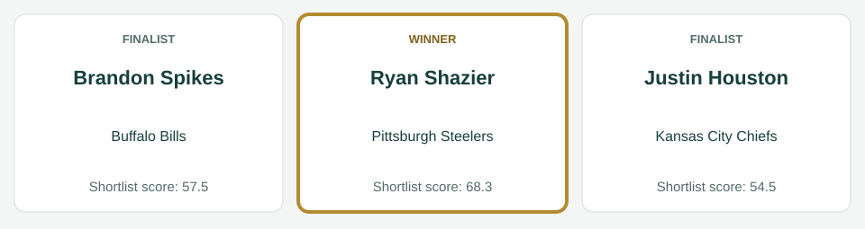
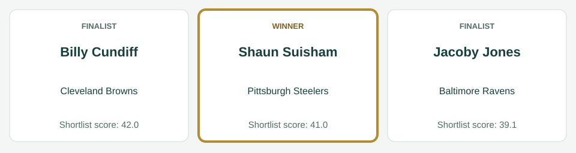
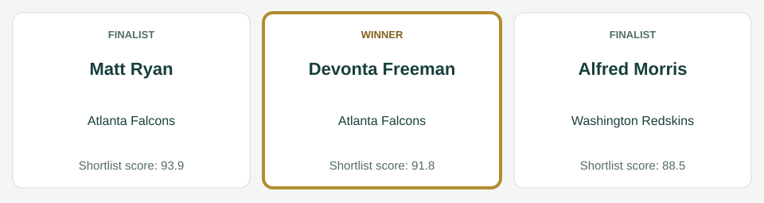
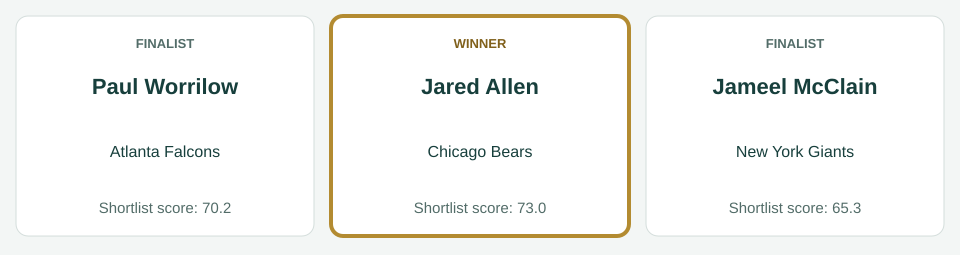

# September awards

[All regular-season awards](../../README.md)

## AFC Offensive Player

| Photo | Player | Team | Shortlist score | Result |
|---|---|---|---:|---|
|  | Le'Veon Bell | Pittsburgh Steelers | 137.8 | Winner |
|  | Joe Flacco | Baltimore Ravens | 89.4 | Finalist |
|  | Andrew Luck | Indianapolis Colts | 86.2 | Finalist |

Scores preserve the recorded shortlist. No vote totals or second/third places are inferred.

Photos, identity imagery only: Le'Veon Bell (I, the copyright holder of this work, hereby publish it under the following license:, [CC BY-SA 3.0](https://creativecommons.org/licenses/by-sa/3.0), [source](https://commons.wikimedia.org/wiki/File:LeVeon_Bell_26_practicing_2013.jpg)); Joe Flacco (Erik Drost, [CC BY 4.0](https://creativecommons.org/licenses/by/4.0), [source](https://commons.wikimedia.org/wiki/File:Joe_Flacco_2025_Browns_Camp_-_54694425196_(cropped).jpg)); Andrew Luck (BrokenSphere, [CC BY 3.0](https://creativecommons.org/licenses/by/3.0), [source](https://commons.wikimedia.org/wiki/File:Andrew_Luck_at_2010_Stanford_football_open_house.JPG)).

## AFC Defensive Player

| Photo | Player | Team | Shortlist score | Result |
|---|---|---|---:|---|
|  | Ryan Shazier | Pittsburgh Steelers | 68.3 | Winner |
|  | Brandon Spikes | Buffalo Bills | 57.5 | Finalist |
|  | Justin Houston | Kansas City Chiefs | 54.5 | Finalist |

Scores preserve the recorded shortlist. No vote totals or second/third places are inferred.

Photos, identity imagery only: Ryan Shazier (David Schellhaas, [CC BY 2.0](https://creativecommons.org/licenses/by/2.0), [source](https://commons.wikimedia.org/wiki/File:Ryan_Shazier.jpg)); Brandon Spikes (Jeffrey Beall, [CC BY 3.0](https://creativecommons.org/licenses/by/3.0), [source](https://commons.wikimedia.org/wiki/File:Brandon_Spikes.JPG)); Justin Houston (Mike Morbeck, [CC BY-SA 2.0](https://creativecommons.org/licenses/by-sa/2.0), [source](https://commons.wikimedia.org/wiki/File:Justin_Houston_(cropped).jpg)).

## AFC Special Teams Player

| Photo | Player | Team | Shortlist score | Result |
|---|---|---|---:|---|
|  | Billy Cundiff | Cleveland Browns | 42.0 | Finalist |
|  | Shaun Suisham | Pittsburgh Steelers | 41.0 | Winner |
|  | Jacoby Jones | Baltimore Ravens | 39.1 | Finalist |

Scores preserve the recorded shortlist. No vote totals or second/third places are inferred.

Photos, identity imagery only: Billy Cundiff (Thibous, [CC BY-SA 3.0](https://creativecommons.org/licenses/by-sa/3.0), [source](https://commons.wikimedia.org/wiki/File:Billy_Cundiff_2011_stadium_practice.jpg)); Shaun Suisham (Sodexo USA, [CC BY 2.0](https://creativecommons.org/licenses/by/2.0), [source](https://commons.wikimedia.org/wiki/File:Suisham_closeup.jpg)); Jacoby Jones (Aberdeen Proving Ground, [CC BY 2.0](https://creativecommons.org/licenses/by/2.0), [source](https://commons.wikimedia.org/wiki/File:Jacoby_Jones_(16070179516).jpg)).

## NFC Offensive Player

| Photo | Player | Team | Shortlist score | Result |
|---|---|---|---:|---|
|  | Matt Ryan | Atlanta Falcons | 93.9 | Finalist |
|  | Devonta Freeman | Atlanta Falcons | 91.8 | Winner |
|  | Alfred Morris | Washington Redskins | 88.5 | Finalist |

Scores preserve the recorded shortlist. No vote totals or second/third places are inferred.

Photos, identity imagery only: Matt Ryan (All-Pro Reels from District of Columbia, USA, [CC BY-SA 2.0](https://creativecommons.org/licenses/by-sa/2.0), [source](https://commons.wikimedia.org/wiki/File:Washington_Football_Team_at_Atlanta_Falcons_(3_October_2021)_DSC_4628_(51555290664)_(cropped).jpg)); Devonta Freeman (Thomson200, [CC0](http://creativecommons.org/publicdomain/zero/1.0/deed.en), [source](https://commons.wikimedia.org/wiki/File:Devonta_Freeman_training_camp_2016.jpg)); Alfred Morris (Keith Allison, [CC BY-SA 2.0](https://creativecommons.org/licenses/by-sa/2.0), [source](https://commons.wikimedia.org/wiki/File:Alfred_morris_redskins.jpg)).

## NFC Defensive Player

| Photo | Player | Team | Shortlist score | Result |
|---|---|---|---:|---|
|  | Jared Allen | Chicago Bears | 73.0 | Winner |
|  | Paul Worrilow | Atlanta Falcons | 70.2 | Finalist |
|  | Jameel McClain | New York Giants | 65.3 | Finalist |

Scores preserve the recorded shortlist. No vote totals or second/third places are inferred.

Photos, identity imagery only: Jared Allen (MN National Guard, [CC BY 3.0](https://creativecommons.org/licenses/by/3.0), [source](https://commons.wikimedia.org/wiki/File:Jared_Allen_2009.JPG)); Paul Worrilow (Thomson200, [CC0](http://creativecommons.org/publicdomain/zero/1.0/deed.en), [source](https://commons.wikimedia.org/wiki/File:Paul_Worrilow_2013.jpg)); Jameel McClain (Thibous, [CC BY-SA 3.0](https://creativecommons.org/licenses/by-sa/3.0), [source](https://commons.wikimedia.org/wiki/File:Jameel_McClain_2011_stadium_practice.jpg)).

## NFC Special Teams Player

| Photo | Player | Team | Shortlist score | Result |
|---|---|---|---:|---|
|  | Jeremy Ross | Detroit Lions | 46.8 | Winner |
|  | Cody Parkey | Philadelphia Eagles | 40.0 | Finalist |
|  | Andre Roberts | Washington Redskins | 37.5 | Finalist |

Scores preserve the recorded shortlist. No vote totals or second/third places are inferred.

Photos, identity imagery only: Jeremy Ross (original: John Martinez Pavliga derivative: Diddykong1130, [CC BY 2.0](https://creativecommons.org/licenses/by/2.0), [source](https://commons.wikimedia.org/wiki/File:Jeremy_Ross_Golden_Bears.jpg)); Cody Parkey (Sgt. Staci Miller, Public domain, [source](https://commons.wikimedia.org/wiki/File:Cody_Parkey.jpg)); Andre Roberts (Keith Allison from Hanover, MD, USA, [CC BY-SA 2.0](https://creativecommons.org/licenses/by-sa/2.0), [source](https://commons.wikimedia.org/wiki/File:Andre_Roberts_2018.jpg)).
