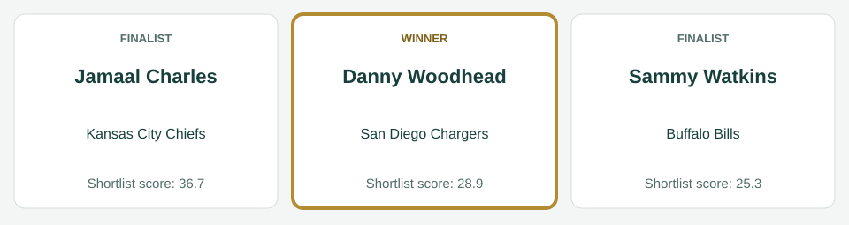
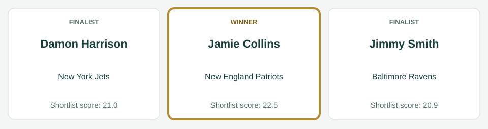
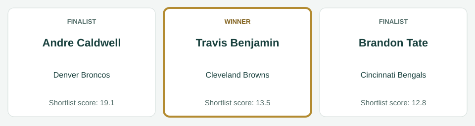
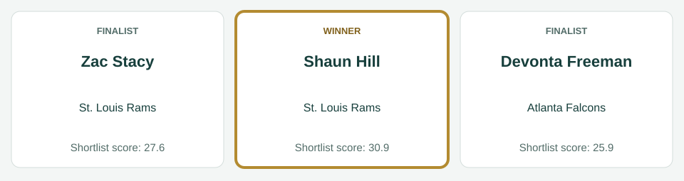
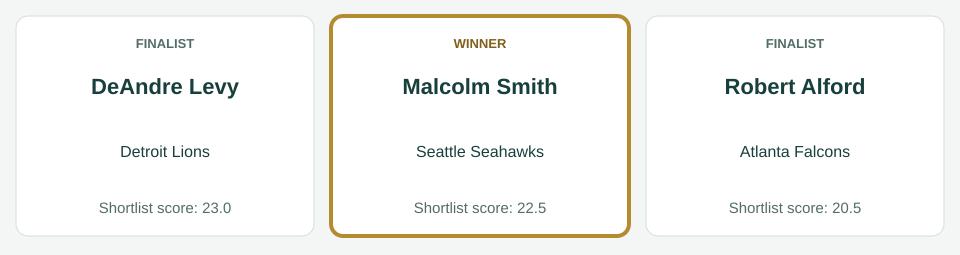
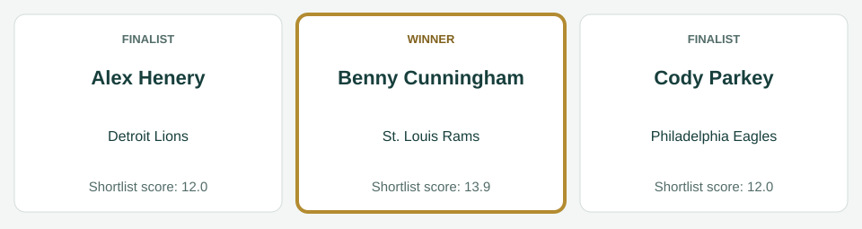

# Week 5 awards

[All regular-season awards](../README.md)

## AFC Offensive Player

| Photo | Player | Team | Shortlist score | Result |
|---|---|---|---:|---|
|  | Jamaal Charles | Kansas City Chiefs | 36.7 | Finalist |
|  | Danny Woodhead | San Diego Chargers | 28.9 | Winner |
|  | Sammy Watkins | Buffalo Bills | 25.3 | Finalist |

Scores preserve the recorded shortlist. No vote totals or second/third places are inferred.

Photos, identity imagery only: Jamaal Charles (Jeffrey Beall, [CC BY-SA 3.0](https://creativecommons.org/licenses/by-sa/3.0), [source](https://commons.wikimedia.org/wiki/File:Jamaal_Charles.JPG)); Danny Woodhead (Jack Newton from Austin, TX, USA, [CC BY-SA 2.0](https://creativecommons.org/licenses/by-sa/2.0), [source](https://commons.wikimedia.org/wiki/File:Danny_Woodhead_2011.jpg)); Sammy Watkins (Mr.schultz, [CC BY-SA 3.0](https://creativecommons.org/licenses/by-sa/3.0), [source](https://commons.wikimedia.org/wiki/File:Sammy_Watkins.JPG)).

## AFC Defensive Player

| Photo | Player | Team | Shortlist score | Result |
|---|---|---|---:|---|
|  | Jamie Collins | New England Patriots | 22.5 | Winner |
|  | Damon Harrison | New York Jets | 21.0 | Finalist |
|  | Jimmy Smith | Baltimore Ravens | 20.9 | Finalist |

Scores preserve the recorded shortlist. No vote totals or second/third places are inferred.

Photos, identity imagery only: Jamie Collins (Jeffrey Beall, [CC BY 3.0](https://creativecommons.org/licenses/by/3.0), [source](https://commons.wikimedia.org/wiki/File:Jamie_Collins_(American_football).JPG)); Damon Harrison (Tom Hanny from Kinnelon, USA, [CC BY 2.0](https://creativecommons.org/licenses/by/2.0), [source](https://commons.wikimedia.org/wiki/File:Damon_Harrison_2016.jpg)); Jimmy Smith (Thibous, [CC BY-SA 3.0](https://creativecommons.org/licenses/by-sa/3.0), [source](https://commons.wikimedia.org/wiki/File:Jimmy_smith_2011_stadium_practice.jpg)).

## AFC Special Teams Player

| Photo | Player | Team | Shortlist score | Result |
|---|---|---|---:|---|
|  | Andre Caldwell | Denver Broncos | 19.1 | Finalist |
|  | Travis Benjamin | Cleveland Browns | 13.5 | Winner |
|  | Brandon Tate | Cincinnati Bengals | 12.8 | Finalist |

Scores preserve the recorded shortlist. No vote totals or second/third places are inferred.

Photos, identity imagery only: Andre Caldwell (Jeffrey Beall, [CC BY-SA 3.0](https://creativecommons.org/licenses/by-sa/3.0), [source](https://commons.wikimedia.org/wiki/File:Andre_Caldwell_2012.JPG)); Travis Benjamin (Jeffrey Beall, [CC BY-SA 3.0](https://creativecommons.org/licenses/by-sa/3.0), [source](https://commons.wikimedia.org/wiki/File:Travis_Benjamin.JPG)); Brandon Tate (Jeffrey Beall, [CC BY-SA 3.0](https://creativecommons.org/licenses/by-sa/3.0), [source](https://commons.wikimedia.org/wiki/File:Brandon_Tate.JPG)).

## NFC Offensive Player

| Photo | Player | Team | Shortlist score | Result |
|---|---|---|---:|---|
|  | Shaun Hill | St. Louis Rams | 30.9 | Winner |
|  | Zac Stacy | St. Louis Rams | 27.6 | Finalist |
|  | Devonta Freeman | Atlanta Falcons | 25.9 | Finalist |

Scores preserve the recorded shortlist. No vote totals or second/third places are inferred.

Photos, identity imagery only: Shaun Hill (Keith Allison, [CC BY-SA 2.0](https://creativecommons.org/licenses/by-sa/2.0), [source](https://commons.wikimedia.org/wiki/File:Shaun_Hill_2014_Cropped.jpg)); Zac Stacy (Johnmaxmena2, [CC BY-SA 3.0](https://creativecommons.org/licenses/by-sa/3.0), [source](https://commons.wikimedia.org/wiki/File:Zacstacy2013.jpg)); Devonta Freeman (Thomson200, [CC0](http://creativecommons.org/publicdomain/zero/1.0/deed.en), [source](https://commons.wikimedia.org/wiki/File:Devonta_Freeman_training_camp_2016.jpg)).

## NFC Defensive Player

| Photo | Player | Team | Shortlist score | Result |
|---|---|---|---:|---|
|  | DeAndre Levy | Detroit Lions | 23.0 | Finalist |
|  | Malcolm Smith | Seattle Seahawks | 22.5 | Winner |
|  | Robert Alford | Atlanta Falcons | 20.5 | Finalist |

Scores preserve the recorded shortlist. No vote totals or second/third places are inferred.

Photos, identity imagery only: DeAndre Levy (Jeffrey Beall, [CC BY-SA 3.0](https://creativecommons.org/licenses/by-sa/3.0), [source](https://commons.wikimedia.org/wiki/File:DeAndre_Levy.JPG)); Malcolm Smith (Jeffrey Beall, [CC BY 3.0](https://creativecommons.org/licenses/by/3.0), [source](https://commons.wikimedia.org/wiki/File:Malcolm_Smith_(American_football).JPG)); Robert Alford (Thomson200, [CC0](http://creativecommons.org/publicdomain/zero/1.0/deed.en), [source](https://commons.wikimedia.org/wiki/File:Robert_Alford_(American_football)_2014_02.jpg)).

## NFC Special Teams Player

| Photo | Player | Team | Shortlist score | Result |
|---|---|---|---:|---|
|  | Benny Cunningham | St. Louis Rams | 13.9 | Winner |
|  | Alex Henery | Detroit Lions | 12.0 | Finalist |
|  | Cody Parkey | Philadelphia Eagles | 12.0 | Finalist |

Scores preserve the recorded shortlist. No vote totals or second/third places are inferred.

Photos, identity imagery only: Benny Cunningham (Jeffrey Beall, [CC BY 4.0](https://creativecommons.org/licenses/by/4.0), [source](https://commons.wikimedia.org/wiki/File:Benny_Cunningham.jpg)); Cody Parkey (Sgt. Staci Miller, Public domain, [source](https://commons.wikimedia.org/wiki/File:Cody_Parkey.jpg)).
