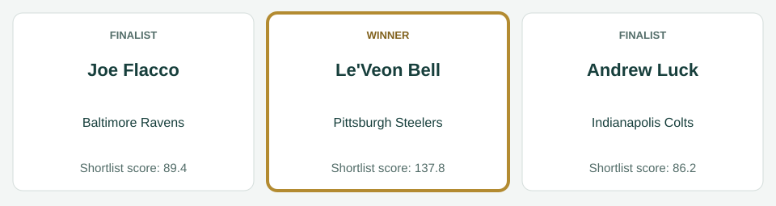
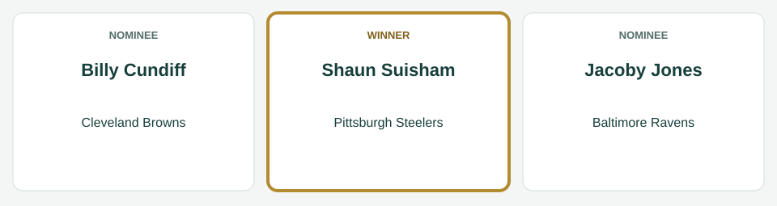
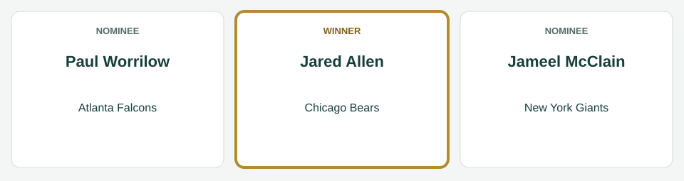
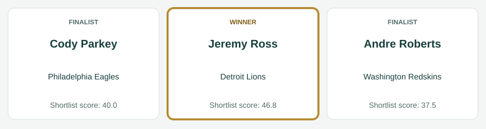

# September Players of the Month

[All regular-season awards](../../README.md)

The league’s players of the month for September, for the games of September 4 to September 29, 2014.

| Award | Player | Club |
|---|---|---|
| AFC Offensive Player of the Month | Le'Veon Bell | Pittsburgh Steelers |
| AFC Defensive Player of the Month | Ryan Shazier | Pittsburgh Steelers |
| AFC Special Teams Player of the Month | Shaun Suisham | Pittsburgh Steelers |
| NFC Offensive Player of the Month | Devonta Freeman | Atlanta Falcons |
| NFC Defensive Player of the Month | Jared Allen | Chicago Bears |
| NFC Special Teams Player of the Month | Jeremy Ross | Detroit Lions |

## AFC Offensive Player of the Month

**Le'Veon Bell, running back, Pittsburgh Steelers.** In four games: 83 carries for 581 yards and 8 touchdowns; 15 catches for 217 yards and 2 touchdowns.

| Photo | Player | Team | Shortlist score | Result |
|---|---|---|---:|---|
|  | Le'Veon Bell | Pittsburgh Steelers | 137.8 | Winner |
|  | Joe Flacco | Baltimore Ravens | 89.4 | Finalist |
|  | Andrew Luck | Indianapolis Colts | 86.2 | Finalist |

The shortlist score is the award formula’s score for the month; the panel picked the winner from the three finalists.

*Photo: Le'Veon Bell, I, the copyright holder of this work, hereby publish it under the following license:, [CC BY-SA 3.0](https://creativecommons.org/licenses/by-sa/3.0), [source](https://commons.wikimedia.org/wiki/File:LeVeon_Bell_26_practicing_2013.jpg).*

*Photo: Joe Flacco, Erik Drost, [CC BY 4.0](https://creativecommons.org/licenses/by/4.0), [source](https://commons.wikimedia.org/wiki/File:Joe_Flacco_2025_Browns_Camp_-_54694425196_(cropped).jpg).*

*Photo: Andrew Luck, BrokenSphere, [CC BY 3.0](https://creativecommons.org/licenses/by/3.0), [source](https://commons.wikimedia.org/wiki/File:Andrew_Luck_at_2010_Stanford_football_open_house.JPG).*

## AFC Defensive Player of the Month

**Ryan Shazier, linebacker, Pittsburgh Steelers.** In four games: 45 tackles, 3 sacks, 2 tackles for loss, 1 interception, 3 passes defended, 1 forced fumble, 1 fumble recovery.

| Photo | Player | Team | Shortlist score | Result |
|---|---|---|---:|---|
|  | Ryan Shazier | Pittsburgh Steelers | 68.3 | Winner |
|  | Brandon Spikes | Buffalo Bills | 57.5 | Finalist |
|  | Justin Houston | Kansas City Chiefs | 54.5 | Finalist |

The shortlist score is the award formula’s score for the month; the panel picked the winner from the three finalists.

*Photo: Ryan Shazier, David Schellhaas, [CC BY 2.0](https://creativecommons.org/licenses/by/2.0), [source](https://commons.wikimedia.org/wiki/File:Ryan_Shazier.jpg).*

*Photo: Brandon Spikes, Jeffrey Beall, [CC BY 3.0](https://creativecommons.org/licenses/by/3.0), [source](https://commons.wikimedia.org/wiki/File:Brandon_Spikes.JPG).*

*Photo: Justin Houston, Mike Morbeck, [CC BY-SA 2.0](https://creativecommons.org/licenses/by-sa/2.0), [source](https://commons.wikimedia.org/wiki/File:Justin_Houston_(cropped).jpg).*

## AFC Special Teams Player of the Month

**Shaun Suisham, kicker, Pittsburgh Steelers.** In four games: 9 of 9 field goals; 14 of 14 extra points.

| Photo | Player | Team | Shortlist score | Result |
|---|---|---|---:|---|
|  | Billy Cundiff | Cleveland Browns | 42.0 | Finalist |
|  | Shaun Suisham | Pittsburgh Steelers | 41.0 | Winner |
|  | Jacoby Jones | Baltimore Ravens | 39.1 | Finalist |

The shortlist score is the award formula’s score for the month; the panel picked the winner from the three finalists.

*Photo: Billy Cundiff, Thibous, [CC BY-SA 3.0](https://creativecommons.org/licenses/by-sa/3.0), [source](https://commons.wikimedia.org/wiki/File:Billy_Cundiff_2011_stadium_practice.jpg).*

*Photo: Shaun Suisham, Sodexo USA, [CC BY 2.0](https://creativecommons.org/licenses/by/2.0), [source](https://commons.wikimedia.org/wiki/File:Suisham_closeup.jpg).*

*Photo: Jacoby Jones, Aberdeen Proving Ground, [CC BY 2.0](https://creativecommons.org/licenses/by/2.0), [source](https://commons.wikimedia.org/wiki/File:Jacoby_Jones_(16070179516).jpg).*

## NFC Offensive Player of the Month

**Devonta Freeman, running back, Atlanta Falcons.** In four games: 72 carries for 349 yards and 2 touchdowns; 19 catches for 369 yards and 2 touchdowns.

| Photo | Player | Team | Shortlist score | Result |
|---|---|---|---:|---|
|  | Matt Ryan | Atlanta Falcons | 93.9 | Finalist |
|  | Devonta Freeman | Atlanta Falcons | 91.8 | Winner |
|  | Alfred Morris | Washington Redskins | 88.5 | Finalist |

The shortlist score is the award formula’s score for the month; the panel picked the winner from the three finalists.

*Photo: Matt Ryan, All-Pro Reels from District of Columbia, USA, [CC BY-SA 2.0](https://creativecommons.org/licenses/by-sa/2.0), [source](https://commons.wikimedia.org/wiki/File:Washington_Football_Team_at_Atlanta_Falcons_(3_October_2021)_DSC_4628_(51555290664)_(cropped).jpg).*

*Photo: Devonta Freeman, Thomson200, [CC0](http://creativecommons.org/publicdomain/zero/1.0/deed.en), [source](https://commons.wikimedia.org/wiki/File:Devonta_Freeman_training_camp_2016.jpg).*

*Photo: Alfred Morris, Keith Allison, [CC BY-SA 2.0](https://creativecommons.org/licenses/by-sa/2.0), [source](https://commons.wikimedia.org/wiki/File:Alfred_morris_redskins.jpg).*

## NFC Defensive Player of the Month

**Jared Allen, defensive end, Chicago Bears.** In four games: 27 tackles, 9 sacks, 3 tackles for loss, 2 passes defended, 1 forced fumble, 1 fumble recovery.

| Photo | Player | Team | Shortlist score | Result |
|---|---|---|---:|---|
|  | Jared Allen | Chicago Bears | 73.0 | Winner |
|  | Paul Worrilow | Atlanta Falcons | 70.2 | Finalist |
|  | Jameel McClain | New York Giants | 65.3 | Finalist |

The shortlist score is the award formula’s score for the month; the panel picked the winner from the three finalists.

*Photo: Jared Allen, MN National Guard, [CC BY 3.0](https://creativecommons.org/licenses/by/3.0), [source](https://commons.wikimedia.org/wiki/File:Jared_Allen_2009.JPG).*

*Photo: Paul Worrilow, Thomson200, [CC0](http://creativecommons.org/publicdomain/zero/1.0/deed.en), [source](https://commons.wikimedia.org/wiki/File:Paul_Worrilow_2013.jpg).*

*Photo: Jameel McClain, Thibous, [CC BY-SA 3.0](https://creativecommons.org/licenses/by-sa/3.0), [source](https://commons.wikimedia.org/wiki/File:Jameel_McClain_2011_stadium_practice.jpg).*

## NFC Special Teams Player of the Month

**Jeremy Ross, wide receiver, Detroit Lions.** In four games: 14 kickoff returns for 331 yards; 6 punt returns for 137 yards.

| Photo | Player | Team | Shortlist score | Result |
|---|---|---|---:|---|
|  | Jeremy Ross | Detroit Lions | 46.8 | Winner |
|  | Cody Parkey | Philadelphia Eagles | 40.0 | Finalist |
|  | Andre Roberts | Washington Redskins | 37.5 | Finalist |

The shortlist score is the award formula’s score for the month; the panel picked the winner from the three finalists.

*Photo: Jeremy Ross, original: John Martinez Pavliga derivative: Diddykong1130, [CC BY 2.0](https://creativecommons.org/licenses/by/2.0), [source](https://commons.wikimedia.org/wiki/File:Jeremy_Ross_Golden_Bears.jpg).*

*Photo: Cody Parkey, Sgt. Staci Miller, Public domain, [source](https://commons.wikimedia.org/wiki/File:Cody_Parkey.jpg).*

*Photo: Andre Roberts, Keith Allison from Hanover, MD, USA, [CC BY-SA 2.0](https://creativecommons.org/licenses/by-sa/2.0), [source](https://commons.wikimedia.org/wiki/File:Andre_Roberts_2018.jpg).*
