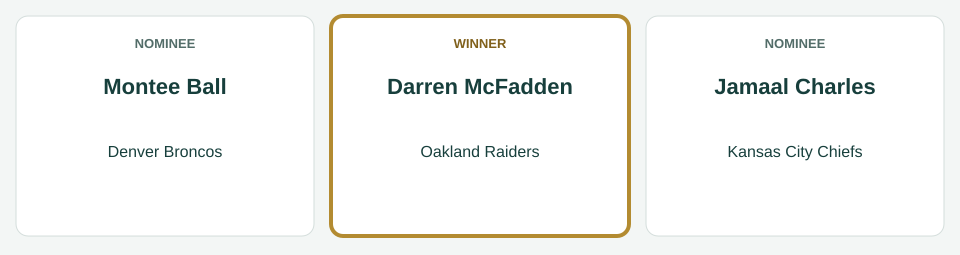
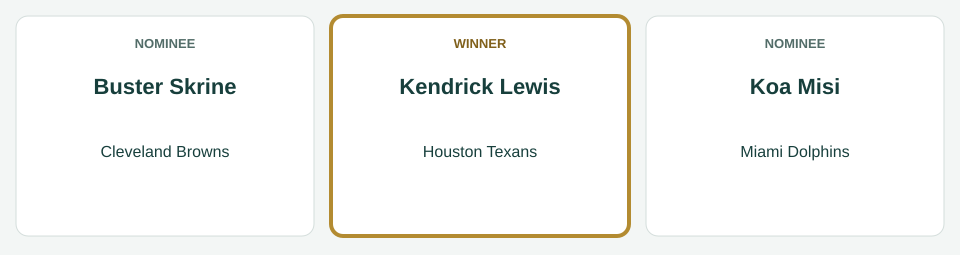
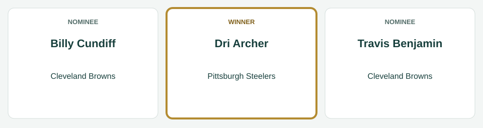
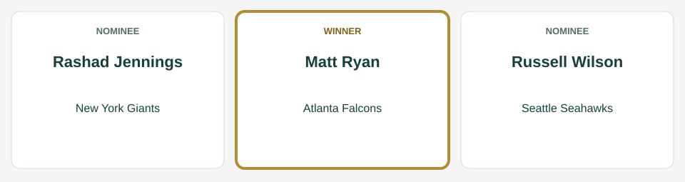
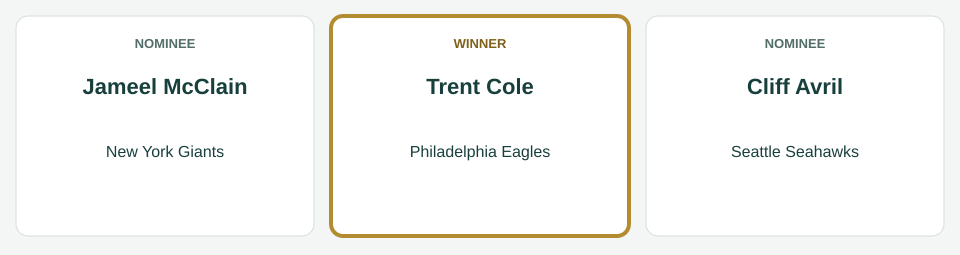
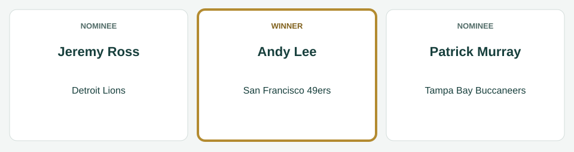

# Week 1 Players of the Week

[All regular-season awards](../README.md)

The league’s players of the week for Week 1, for the games of September 4 to September 8, 2014.

| Award | Player | Club |
|---|---|---|
| AFC Offensive Player of the Week | Darren McFadden | Oakland Raiders |
| AFC Defensive Player of the Week | Kendrick Lewis | Houston Texans |
| AFC Special Teams Player of the Week | Dri Archer | Pittsburgh Steelers |
| NFC Offensive Player of the Week | Matt Ryan | Atlanta Falcons |
| NFC Defensive Player of the Week | Trent Cole | Philadelphia Eagles |
| NFC Special Teams Player of the Week | Andy Lee | San Francisco 49ers |

## AFC Offensive Player of the Week

**Darren McFadden, running back, Oakland Raiders.** In the Raiders' 31-20 win over the New York Jets on September 7: 19 carries for 110 yards and 1 touchdown; 4 catches for 88 yards.

| Photo | Player | Team | Shortlist score | Result |
|---|---|---|---:|---|
|  | Montee Ball | Denver Broncos | 38.3 | Finalist |
|  | Darren McFadden | Oakland Raiders | 25.8 | Winner |
|  | Jamaal Charles | Kansas City Chiefs | 25.6 | Finalist |

The shortlist score is the award formula’s score for the week; the panel picked the winner from the three finalists.

*Photo: Montee Ball, Jeffrey Beall, [CC BY 3.0](https://creativecommons.org/licenses/by/3.0), [source](https://commons.wikimedia.org/wiki/File:Montee_Ball.JPG).*

*Photo: Darren McFadden, Jeffrey Beall, [CC BY-SA 3.0](https://creativecommons.org/licenses/by-sa/3.0), [source](https://commons.wikimedia.org/wiki/File:Darren_McFadden_Raiders.JPG).*

*Photo: Jamaal Charles, Jeffrey Beall, [CC BY-SA 3.0](https://creativecommons.org/licenses/by-sa/3.0), [source](https://commons.wikimedia.org/wiki/File:Jamaal_Charles.JPG).*

## AFC Defensive Player of the Week

**Kendrick Lewis, safety, Houston Texans.** In the Texans' 27-23 win over the Washington Redskins on September 7: 10 tackles, 1 tackle for loss, 1 interception, 1 pass defended, 1 forced fumble, 1 fumble recovery.

| Photo | Player | Team | Shortlist score | Result |
|---|---|---|---:|---|
|  | Buster Skrine | Cleveland Browns | 23.0 | Finalist |
|  | Koa Misi | Miami Dolphins | 21.5 | Finalist |
|  | Kendrick Lewis | Houston Texans | 21.0 | Winner |

The shortlist score is the award formula’s score for the week; the panel picked the winner from the three finalists.

*Photo: Buster Skrine, Erik Drost from United States, [CC BY 2.0](https://creativecommons.org/licenses/by/2.0), [source](https://commons.wikimedia.org/wiki/File:Buster_Skrine_cropped.jpg).*

*Photo: Koa Misi, June Rivera, [CC BY-SA 2.0](https://creativecommons.org/licenses/by-sa/2.0), [source](https://commons.wikimedia.org/wiki/File:Koa_Misi_in_2012.jpg).*

*Photo: Kendrick Lewis, Jeffrey Beall, [CC BY 3.0](https://creativecommons.org/licenses/by/3.0), [source](https://commons.wikimedia.org/wiki/File:Kendrick_Lewis_2014.JPG).*

## AFC Special Teams Player of the Week

**Dri Archer, running back, Pittsburgh Steelers.** In the Steelers' 36-24 loss to the Cleveland Browns on September 7: 6 kickoff returns for 159 yards.

| Photo | Player | Team | Shortlist score | Result |
|---|---|---|---:|---|
|  | Billy Cundiff | Cleveland Browns | 18.0 | Finalist |
|  | Dri Archer | Pittsburgh Steelers | 15.9 | Winner |
|  | Travis Benjamin | Cleveland Browns | 13.1 | Finalist |

The shortlist score is the award formula’s score for the week; the panel picked the winner from the three finalists.

*Photo: Billy Cundiff, Thibous, [CC BY-SA 3.0](https://creativecommons.org/licenses/by-sa/3.0), [source](https://commons.wikimedia.org/wiki/File:Billy_Cundiff_2011_stadium_practice.jpg).*

*Photo: Travis Benjamin, Jeffrey Beall, [CC BY-SA 3.0](https://creativecommons.org/licenses/by-sa/3.0), [source](https://commons.wikimedia.org/wiki/File:Travis_Benjamin.JPG).*

## NFC Offensive Player of the Week

**Matt Ryan, quarterback, Atlanta Falcons.** In the Falcons' 42-21 win over the New Orleans Saints on September 7: 24 of 37 passing for 437 yards, 5 touchdowns and no interceptions; 3 carries for 7 yards and 1 touchdown.

| Photo | Player | Team | Shortlist score | Result |
|---|---|---|---:|---|
|  | Matt Ryan | Atlanta Falcons | 44.2 | Winner |
|  | Rashad Jennings | New York Giants | 34.0 | Finalist |
|  | Russell Wilson | Seattle Seahawks | 27.9 | Finalist |

The shortlist score is the award formula’s score for the week; the panel picked the winner from the three finalists.

*Photo: Matt Ryan, All-Pro Reels from District of Columbia, USA, [CC BY-SA 2.0](https://creativecommons.org/licenses/by-sa/2.0), [source](https://commons.wikimedia.org/wiki/File:Washington_Football_Team_at_Atlanta_Falcons_(3_October_2021)_DSC_4628_(51555290664)_(cropped).jpg).*

*Photo: Rashad Jennings, Keith Allison from Hanover, MD, USA, [CC BY-SA 2.0](https://creativecommons.org/licenses/by-sa/2.0), [source](https://commons.wikimedia.org/wiki/File:Rashad_Jennings.jpg).*

*Photo: Russell Wilson, Aqwfyj, [CC BY-SA 3.0](https://creativecommons.org/licenses/by-sa/3.0), [source](https://commons.wikimedia.org/wiki/File:Russell_Wilson_at_the_2013_Jessie_Vetter_Classic,_July_1,_2013.jpg).*

## NFC Defensive Player of the Week

**Trent Cole, linebacker, Philadelphia Eagles.** In the Eagles' 23-20 loss to the Jacksonville Jaguars on September 7: 18 tackles, 2 sacks, 2 tackles for loss.

| Photo | Player | Team | Shortlist score | Result |
|---|---|---|---:|---|
|  | Jameel McClain | New York Giants | 32.3 | Finalist |
|  | Trent Cole | Philadelphia Eagles | 26.0 | Winner |
|  | Cliff Avril | Seattle Seahawks | 25.0 | Finalist |

The shortlist score is the award formula’s score for the week; the panel picked the winner from the three finalists.

*Photo: Jameel McClain, Thibous, [CC BY-SA 3.0](https://creativecommons.org/licenses/by-sa/3.0), [source](https://commons.wikimedia.org/wiki/File:Jameel_McClain_2011_stadium_practice.jpg).*

*Photo: Trent Cole, Tech. Sgt. Scott T. Sturkol, Public domain, [source](https://commons.wikimedia.org/wiki/File:Trent_Cole_080805-F-9429S-132_crop.jpg).*

*Photo: Cliff Avril, Jeffrey Beall, [CC BY 3.0](https://creativecommons.org/licenses/by/3.0), [source](https://commons.wikimedia.org/wiki/File:Cliff_Avril_2014.JPG).*

## NFC Special Teams Player of the Week

**Andy Lee, punter, San Francisco 49ers.** In the 49ers' 20-14 win over the Dallas Cowboys on September 7: 5 punts for a 53.2-yard average, 4 inside the 20.

| Photo | Player | Team | Shortlist score | Result |
|---|---|---|---:|---|
|  | Jeremy Ross | Detroit Lions | 14.4 | Finalist |
|  | Andy Lee | San Francisco 49ers | 14.2 | Winner |
|  | Patrick Murray | Tampa Bay Buccaneers | 14.0 | Finalist |

The shortlist score is the award formula’s score for the week; the panel picked the winner from the three finalists.

*Photo: Jeremy Ross, original: John Martinez Pavliga derivative: Diddykong1130, [CC BY 2.0](https://creativecommons.org/licenses/by/2.0), [source](https://commons.wikimedia.org/wiki/File:Jeremy_Ross_Golden_Bears.jpg).*

*Photo: Andy Lee, Jeffrey Beall, [CC BY-SA 3.0](https://creativecommons.org/licenses/by-sa/3.0), [source](https://commons.wikimedia.org/wiki/File:Andy_Lee_(American_football).JPG).*

*Photo: Patrick Murray, Keith Allison, [CC BY-SA 2.0](https://creativecommons.org/licenses/by-sa/2.0), [source](https://commons.wikimedia.org/wiki/File:Patrick_Murray_field_goal_vs._Redskins_Cropped.jpg).*
