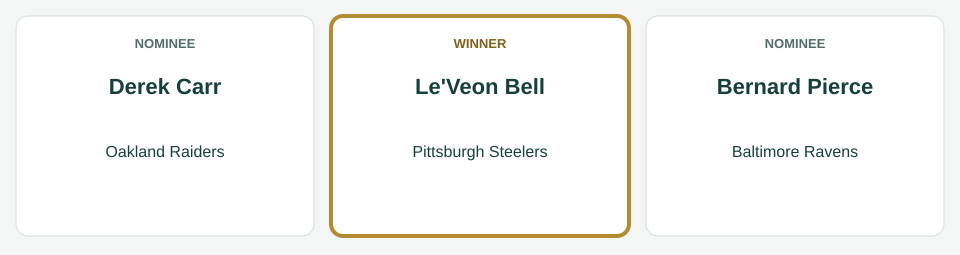
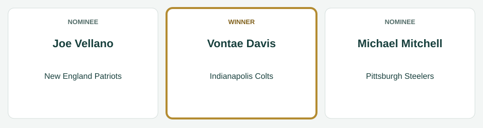
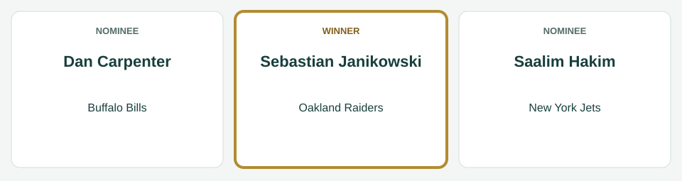
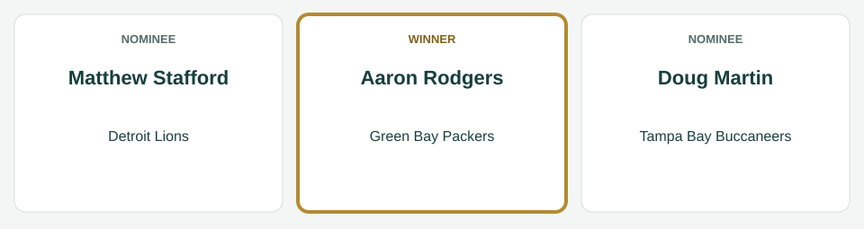
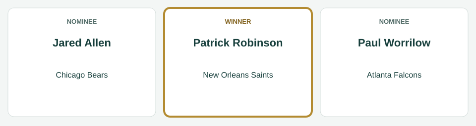
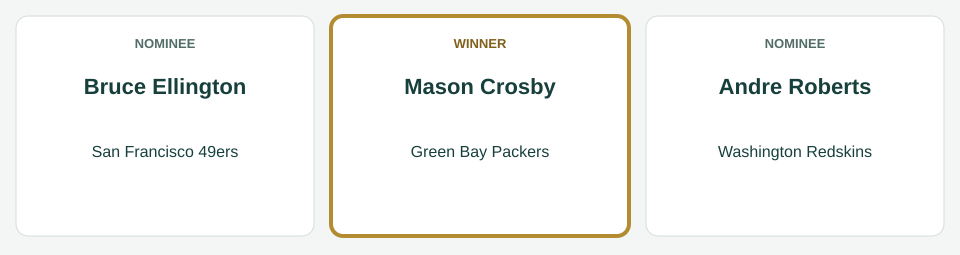

# Week 2 Players of the Week

[All regular-season awards](../README.md)

The league’s players of the week for Week 2, for the games of September 11 to September 15, 2014.

| Award | Player | Club |
|---|---|---|
| AFC Offensive Player of the Week | Le'Veon Bell | Pittsburgh Steelers |
| AFC Defensive Player of the Week | Vontae Davis | Indianapolis Colts |
| AFC Special Teams Player of the Week | Sebastian Janikowski | Oakland Raiders |
| NFC Offensive Player of the Week | Aaron Rodgers | Green Bay Packers |
| NFC Defensive Player of the Week | Patrick Robinson | New Orleans Saints |
| NFC Special Teams Player of the Week | Mason Crosby | Green Bay Packers |

## AFC Offensive Player of the Week

**Le'Veon Bell, running back, Pittsburgh Steelers.** In the Steelers' 41-28 win over the Baltimore Ravens on September 11: 27 carries for 194 yards and 4 touchdowns; 2 catches for 63 yards.

| Photo | Player | Team | Result |
|---|---|---|---|
|  | Le'Veon Bell | Pittsburgh Steelers | Winner |
|  | Derek Carr | Oakland Raiders | Nominee |
|  | Bernard Pierce | Baltimore Ravens | Nominee |

*Photo: Le'Veon Bell, I, the copyright holder of this work, hereby publish it under the following license:, [CC BY-SA 3.0](https://creativecommons.org/licenses/by-sa/3.0), [source](https://commons.wikimedia.org/wiki/File:LeVeon_Bell_26_practicing_2013.jpg).*

*Photo: Derek Carr, All-Pro Reels, [CC BY-SA 2.0](https://creativecommons.org/licenses/by-sa/2.0), [source](https://commons.wikimedia.org/wiki/File:Derek_Carr_WFT_at_Raiders_-_51735347857_(cropped).jpg).*

*Photo: Bernard Pierce, Thibous, [CC BY-SA 3.0](https://creativecommons.org/licenses/by-sa/3.0), [source](https://commons.wikimedia.org/wiki/File:Bernard_Pierce_Navy_Stadium_2012_Practice.jpg).*

## AFC Defensive Player of the Week

**Vontae Davis, cornerback, Indianapolis Colts.** In the Colts' 31-6 win over the Philadelphia Eagles on September 15: 10 tackles, 1 tackle for loss, 1 interception, 4 passes defended.

| Photo | Player | Team | Result |
|---|---|---|---|
|  | Vontae Davis | Indianapolis Colts | Winner |
|  | Joe Vellano | New England Patriots | Nominee |
|  | Michael Mitchell | Pittsburgh Steelers | Nominee |

*Photo: Vontae Davis, FanDuel, [CC BY 3.0](https://creativecommons.org/licenses/by/3.0), [source](https://commons.wikimedia.org/wiki/File:Vontae_Davis_2018_01.png).*

*Photo: Joe Vellano, U.S. Navy photo by Mass Communication Specialist 3rd Class Pyoung K. Yi/Released, Public domain, [source](https://commons.wikimedia.org/wiki/File:Joe_Vellano_(1691317)_(cropped).jpg).*

*Photo: Michael Mitchell, Jeffrey Beall, [CC BY-SA 3.0](https://creativecommons.org/licenses/by-sa/3.0), [source](https://commons.wikimedia.org/wiki/File:Mike_Mitchell_(safety).JPG).*

## AFC Special Teams Player of the Week

**Sebastian Janikowski, kicker, Oakland Raiders.** In the Raiders' 29-14 win over the Houston Texans on September 14: 5 of 5 field goals; 2 of 2 extra points.

| Photo | Player | Team | Result |
|---|---|---|---|
|  | Sebastian Janikowski | Oakland Raiders | Winner |
|  | Dan Carpenter | Buffalo Bills | Nominee |
|  | Saalim Hakim | New York Jets | Nominee |

*Photo: Sebastian Janikowski, Jeffrey Beall, [CC BY 4.0](https://creativecommons.org/licenses/by/4.0), [source](https://commons.wikimedia.org/wiki/File:Sebastian_Janikowski_2018.JPG).*

*Photo: Dan Carpenter, Chrisjnelson at en.wikipedia, [CC BY 3.0](https://creativecommons.org/licenses/by/3.0), [source](https://commons.wikimedia.org/wiki/File:Dan_Carpenter1.jpg).*

## NFC Offensive Player of the Week

**Aaron Rodgers, quarterback, Green Bay Packers.** In the Packers' 47-7 win over the New York Jets on September 14: 26 of 40 passing for 326 yards, 4 touchdowns and 1 interception; 3 carries for 50 yards.

| Photo | Player | Team | Result |
|---|---|---|---|
|  | Matthew Stafford | Detroit Lions | Nominee |
|  | Doug Martin | Tampa Bay Buccaneers | Nominee |
|  | Aaron Rodgers | Green Bay Packers | Winner |

*Photo: Matthew Stafford, Keith Allison, [CC BY-SA 2.0](https://creativecommons.org/licenses/by-sa/2.0), [source](https://commons.wikimedia.org/wiki/File:Matthew_Stafford_2015.jpg).*

*Photo: Doug Martin, Stephanie Rush, Pacific Regional Medical Command Public Affairs, Public domain, [source](https://commons.wikimedia.org/wiki/File:Doug_Martin_at_Schoffield_Barracks_(cropped).jpg).*

*Photo: Aaron Rodgers, All-Pro Reels, [CC BY-SA 2.0](https://creativecommons.org/licenses/by-sa/2.0), [source](https://commons.wikimedia.org/wiki/File:Aaron_Rodgers_Packers_OCT2021_(cropped).jpg).*

## NFC Defensive Player of the Week

**Patrick Robinson, cornerback, New Orleans Saints.** In the Saints' 19-7 loss to the Cleveland Browns on September 14: 19 tackles, 1 tackle for loss, 1 interception, 1 pass defended, 1 forced fumble, 1 fumble recovery.

| Photo | Player | Team | Result |
|---|---|---|---|
|  | Jared Allen | Chicago Bears | Nominee |
|  | Patrick Robinson | New Orleans Saints | Winner |
|  | Paul Worrilow | Atlanta Falcons | Nominee |

*Photo: Jared Allen, MN National Guard, [CC BY 3.0](https://creativecommons.org/licenses/by/3.0), [source](https://commons.wikimedia.org/wiki/File:Jared_Allen_2009.JPG).*

*Photo: Patrick Robinson, Jeffrey Beall, [CC BY-SA 3.0](https://creativecommons.org/licenses/by-sa/3.0), [source](https://commons.wikimedia.org/wiki/File:Patrick_Robinson_(cornerback).JPG).*

*Photo: Paul Worrilow, Thomson200, [CC0](http://creativecommons.org/publicdomain/zero/1.0/deed.en), [source](https://commons.wikimedia.org/wiki/File:Paul_Worrilow_2013.jpg).*

## NFC Special Teams Player of the Week

**Mason Crosby, kicker, Green Bay Packers.** In the Packers' 47-7 win over the New York Jets on September 14: 4 of 4 field goals; 5 of 5 extra points.

| Photo | Player | Team | Result |
|---|---|---|---|
|  | Mason Crosby | Green Bay Packers | Winner |
|  | Bruce Ellington | San Francisco 49ers | Nominee |
|  | Andre Roberts | Washington Redskins | Nominee |

*Photo: Mason Crosby, Paul Cutler, [CC BY-SA 2.0](https://creativecommons.org/licenses/by-sa/2.0), [source](https://commons.wikimedia.org/wiki/File:Mason_Crosby_kicks_a_field_goal_for_Green_Bay_Packers_off_ball_held_by_Jon_Ryan_during_October_7,_2007_game_against_Chicago_Bears_at_Lambeau_Field_in_Green_Bay.jpg).*

*Photo: Bruce Ellington, Gamecock Central, [CC BY 2.0](https://creativecommons.org/licenses/by/2.0), [source](https://commons.wikimedia.org/wiki/File:Bruce_Ellington.jpg).*

*Photo: Andre Roberts, Keith Allison from Hanover, MD, USA, [CC BY-SA 2.0](https://creativecommons.org/licenses/by-sa/2.0), [source](https://commons.wikimedia.org/wiki/File:Andre_Roberts_2018.jpg).*
