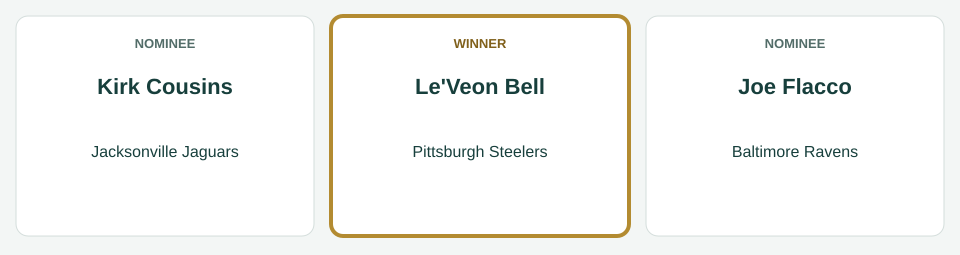
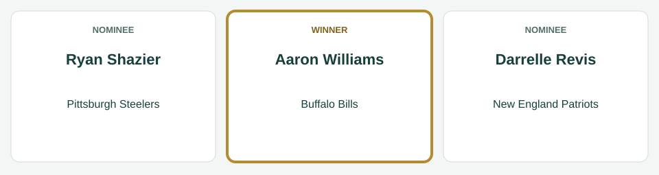
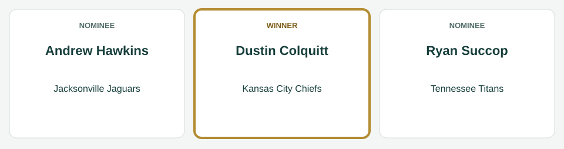
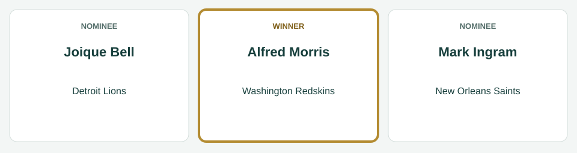
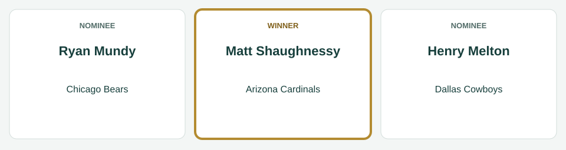
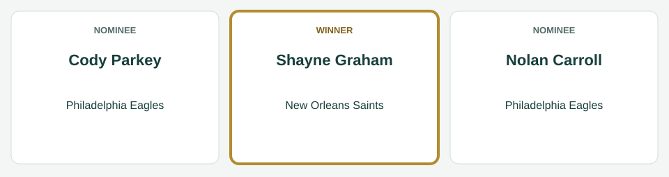

# Week 3 Players of the Week

[All regular-season awards](../README.md)

The league’s players of the week for Week 3, for the games of September 18 to September 22, 2014.

| Award | Player | Club |
|---|---|---|
| AFC Offensive Player of the Week | Le'Veon Bell | Pittsburgh Steelers |
| AFC Defensive Player of the Week | Aaron Williams | Buffalo Bills |
| AFC Special Teams Player of the Week | Dustin Colquitt | Kansas City Chiefs |
| NFC Offensive Player of the Week | Alfred Morris | Washington Redskins |
| NFC Defensive Player of the Week | Matt Shaughnessy | Arizona Cardinals |
| NFC Special Teams Player of the Week | Shayne Graham | New Orleans Saints |

## AFC Offensive Player of the Week

**Le'Veon Bell, running back, Pittsburgh Steelers.** In the Steelers' 34-24 win over the Carolina Panthers on September 21: 26 carries for 202 yards and 2 touchdowns; 6 catches for 76 yards and 1 touchdown.

| Photo | Player | Team | Result |
|---|---|---|---|
|  | Le'Veon Bell | Pittsburgh Steelers | Winner |
|  | Kirk Cousins | Jacksonville Jaguars | Nominee |
|  | Joe Flacco | Baltimore Ravens | Nominee |

*Photo: Le'Veon Bell, I, the copyright holder of this work, hereby publish it under the following license:, [CC BY-SA 3.0](https://creativecommons.org/licenses/by-sa/3.0), [source](https://commons.wikimedia.org/wiki/File:LeVeon_Bell_26_practicing_2013.jpg).*

*Photo: Kirk Cousins, All-Pro Reels, [CC BY-SA 2.0](https://creativecommons.org/licenses/by-sa/2.0), [source](https://commons.wikimedia.org/wiki/File:Cousins_2022.jpg).*

*Photo: Joe Flacco, Erik Drost, [CC BY 4.0](https://creativecommons.org/licenses/by/4.0), [source](https://commons.wikimedia.org/wiki/File:Joe_Flacco_2025_Browns_Camp_-_54694425196_(cropped).jpg).*

## AFC Defensive Player of the Week

**Aaron Williams, safety, Buffalo Bills.** In the Bills' 24-21 loss to the San Diego Chargers on September 21: 13 tackles, 2 interceptions, 2 passes defended.

| Photo | Player | Team | Result |
|---|---|---|---|
|  | Aaron Williams | Buffalo Bills | Winner |
|  | Ryan Shazier | Pittsburgh Steelers | Nominee |
|  | Darrelle Revis | New England Patriots | Nominee |

*Photo: Aaron Williams, Jeffrey Beall, [CC BY-SA 3.0](https://creativecommons.org/licenses/by-sa/3.0), [source](https://commons.wikimedia.org/wiki/File:Aaron_Williams_(American_football).JPG).*

*Photo: Ryan Shazier, David Schellhaas, [CC BY 2.0](https://creativecommons.org/licenses/by/2.0), [source](https://commons.wikimedia.org/wiki/File:Ryan_Shazier.jpg).*

*Photo: Darrelle Revis, Jeff Kern, [CC BY 2.0](https://creativecommons.org/licenses/by/2.0), [source](https://commons.wikimedia.org/wiki/File:Darrelle_Revis_ESPNWeekend2010-051.jpg).*

## AFC Special Teams Player of the Week

**Dustin Colquitt, punter, Kansas City Chiefs.** In the Chiefs' 31-6 loss to the Miami Dolphins on September 21: 7 punts for a 52.1-yard average, 4 inside the 20.

| Photo | Player | Team | Result |
|---|---|---|---|
|  | Andrew Hawkins | Jacksonville Jaguars | Nominee |
|  | Dustin Colquitt | Kansas City Chiefs | Winner |
|  | Ryan Succop | Tennessee Titans | Nominee |

*Photo: Andrew Hawkins, original: Navin75 derivative: Diddykong1130, [CC BY-SA 2.0](https://creativecommons.org/licenses/by-sa/2.0), [source](https://commons.wikimedia.org/wiki/File:Andrew_hawkins_bengals.jpg).*

*Photo: Dustin Colquitt, Time2Football, [CC BY 3.0](https://creativecommons.org/licenses/by/3.0), [source](https://commons.wikimedia.org/wiki/File:Chiefs_Punter_Dustin_Colquitt_Super_Bowl_54_Interview_(cropped).png).*

*Photo: Ryan Succop, Jeffrey Beall, [CC BY-SA 3.0](https://creativecommons.org/licenses/by-sa/3.0), [source](https://commons.wikimedia.org/wiki/File:Ryan_Succop.JPG).*

## NFC Offensive Player of the Week

**Alfred Morris, running back, Washington Redskins.** In the Redskins' 33-30 loss to the Philadelphia Eagles on September 21: 18 carries for 73 yards and 2 touchdowns; 4 catches for 65 yards and 1 touchdown.

| Photo | Player | Team | Result |
|---|---|---|---|
|  | Alfred Morris | Washington Redskins | Winner |
|  | Joique Bell | Detroit Lions | Nominee |
|  | Mark Ingram | New Orleans Saints | Nominee |

*Photo: Alfred Morris, Keith Allison, [CC BY-SA 2.0](https://creativecommons.org/licenses/by-sa/2.0), [source](https://commons.wikimedia.org/wiki/File:Alfred_morris_redskins.jpg).*

*Photo: Joique Bell, Kevin Doebler, [CC BY-SA 3.0](https://creativecommons.org/licenses/by-sa/3.0), [source](https://commons.wikimedia.org/wiki/File:Joique_Bell_warming_up_before_a_Detroit_Lions_football_game_on_2013-09-29.jpg).*

*Photo: Mark Ingram, Executive Office of the President, Public domain, [source](https://commons.wikimedia.org/wiki/File:Mark_Ingram,_Jr._at_the_White_House_2010-03-08_3.jpg).*

## NFC Defensive Player of the Week

**Matt Shaughnessy, defensive end, Arizona Cardinals.** In the Cardinals' 24-20 win over the San Francisco 49ers on September 21: 10 tackles, 1 sack, 2 tackles for loss, 1 interception, 1 pass defended.

| Photo | Player | Team | Result |
|---|---|---|---|
|  | Matt Shaughnessy | Arizona Cardinals | Winner |
|  | Ryan Mundy | Chicago Bears | Nominee |
|  | Henry Melton | Dallas Cowboys | Nominee |

*Photo: Matt Shaughnessy, Jeffrey Beall, [CC BY-SA 3.0](https://creativecommons.org/licenses/by-sa/3.0), [source](https://commons.wikimedia.org/wiki/File:Matt_Shaughnessy.JPG).*

*Photo: Ryan Mundy, original: U.S. Army Photo by Sgt. 1st Class Michel Sauret on behalf of 416th Theater Engineer Command Army Reserve derivative: Diddykong1130, Public domain, [source](https://commons.wikimedia.org/wiki/File:Ryan_mundy_bears.jpg).*

*Photo: Henry Melton, Quinnanmatt, [CC BY-SA 3.0](https://creativecommons.org/licenses/by-sa/3.0), [source](https://commons.wikimedia.org/wiki/File:Melton_Quinnan_123.jpg).*

## NFC Special Teams Player of the Week

**Shayne Graham, kicker, New Orleans Saints.** In the Saints' 33-7 win over the Minnesota Vikings on September 21: 4 of 4 field goals; 3 of 3 extra points.

| Photo | Player | Team | Result |
|---|---|---|---|
|  | Cody Parkey | Philadelphia Eagles | Nominee |
|  | Shayne Graham | New Orleans Saints | Winner |
|  | Nolan Carroll | Philadelphia Eagles | Nominee |

*Photo: Cody Parkey, Sgt. Staci Miller, Public domain, [source](https://commons.wikimedia.org/wiki/File:Cody_Parkey.jpg).*

*Photo: Shayne Graham, Keith Allison from Baltimore, USA, [CC BY-SA 2.0](https://creativecommons.org/licenses/by-sa/2.0), [source](https://commons.wikimedia.org/wiki/File:Shayne_Graham_2006-11-05.jpg).*

*Photo: Nolan Carroll, Chrisjnelson at en.wikipedia, [CC BY 3.0](https://creativecommons.org/licenses/by/3.0), [source](https://commons.wikimedia.org/wiki/File:Nolan_Carroll.jpg).*
