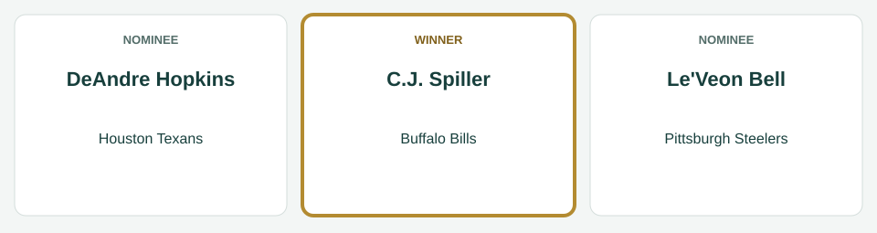
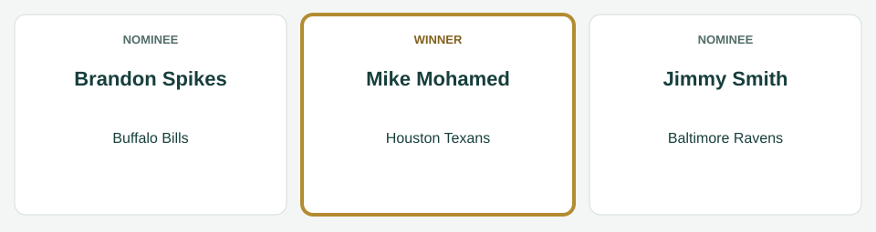
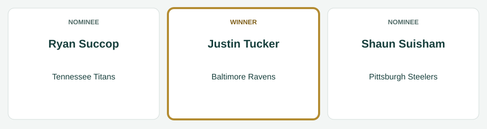
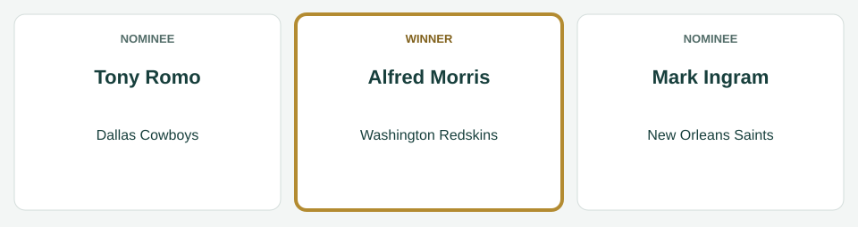
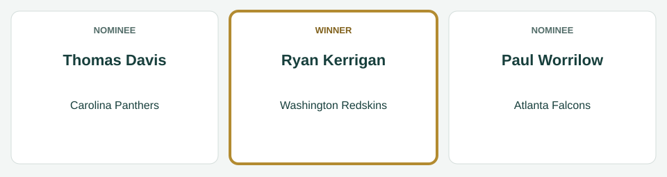
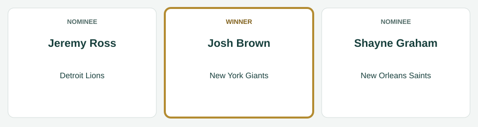

# Week 4 Players of the Week

[All regular-season awards](../README.md)

The league’s players of the week for Week 4, for the games of September 25 to September 29, 2014.

| Award | Player | Club |
|---|---|---|
| AFC Offensive Player of the Week | C.J. Spiller | Buffalo Bills |
| AFC Defensive Player of the Week | Mike Mohamed | Houston Texans |
| AFC Special Teams Player of the Week | Justin Tucker | Baltimore Ravens |
| NFC Offensive Player of the Week | Alfred Morris | Washington Redskins |
| NFC Defensive Player of the Week | Ryan Kerrigan | Washington Redskins |
| NFC Special Teams Player of the Week | Josh Brown | New York Giants |

## AFC Offensive Player of the Week

**C.J. Spiller, running back, Buffalo Bills.** In the Bills' 37-31 loss to the Houston Texans on September 28: 15 carries for 102 yards and 2 touchdowns; 2 catches for 60 yards and 1 touchdown.

| Photo | Player | Team | Shortlist score | Result |
|---|---|---|---:|---|
|  | C.J. Spiller | Buffalo Bills | 34.2 | Winner |
|  | DeAndre Hopkins | Houston Texans | 28.6 | Finalist |
|  | Le'Veon Bell | Pittsburgh Steelers | 27.9 | Finalist |

The shortlist score is the award formula’s score for the week; the panel picked the winner from the three finalists.

*Photo: C.J. Spiller, Keith Allison, [CC BY-SA 2.0](https://creativecommons.org/licenses/by-sa/2.0), [source](https://commons.wikimedia.org/wiki/File:C.J._Spiller_2015.jpg).*

*Photo: DeAndre Hopkins, All-Pro Reels, [CC BY-SA 2.0](https://creativecommons.org/licenses/by-sa/2.0), [source](https://commons.wikimedia.org/wiki/File:DeAndre_Hopkins_2020.jpg).*

*Photo: Le'Veon Bell, I, the copyright holder of this work, hereby publish it under the following license:, [CC BY-SA 3.0](https://creativecommons.org/licenses/by-sa/3.0), [source](https://commons.wikimedia.org/wiki/File:LeVeon_Bell_26_practicing_2013.jpg).*

## AFC Defensive Player of the Week

**Mike Mohamed, linebacker, Houston Texans.** In the Texans' 37-31 win over the Buffalo Bills on September 28: 13 tackles, 1 sack, 1 tackle for loss, 1 interception, 2 passes defended.

| Photo | Player | Team | Shortlist score | Result |
|---|---|---|---:|---|
|  | Mike Mohamed | Houston Texans | 26.5 | Winner |
|  | Brandon Spikes | Buffalo Bills | 22.5 | Finalist |
|  | Jimmy Smith | Baltimore Ravens | 17.3 | Finalist |

The shortlist score is the award formula’s score for the week; the panel picked the winner from the three finalists.

*Photo: Mike Mohamed, Jeffrey Beall, [CC BY-SA 3.0](https://creativecommons.org/licenses/by-sa/3.0), [source](https://commons.wikimedia.org/wiki/File:Mike_Mohamed.JPG).*

*Photo: Brandon Spikes, Jeffrey Beall, [CC BY 3.0](https://creativecommons.org/licenses/by/3.0), [source](https://commons.wikimedia.org/wiki/File:Brandon_Spikes.JPG).*

*Photo: Jimmy Smith, Thibous, [CC BY-SA 3.0](https://creativecommons.org/licenses/by-sa/3.0), [source](https://commons.wikimedia.org/wiki/File:Jimmy_smith_2011_stadium_practice.jpg).*

## AFC Special Teams Player of the Week

**Justin Tucker, kicker, Baltimore Ravens.** In the Ravens' 33-6 win over the Carolina Panthers on September 28: 4 of 5 field goals; 3 of 3 extra points.

| Photo | Player | Team | Shortlist score | Result |
|---|---|---|---:|---|
|  | Ryan Succop | Tennessee Titans | 16.0 | Finalist |
|  | Justin Tucker | Baltimore Ravens | 14.0 | Winner |
|  | Shaun Suisham | Pittsburgh Steelers | 14.0 | Finalist |

The shortlist score is the award formula’s score for the week; the panel picked the winner from the three finalists.

*Photo: Ryan Succop, Jeffrey Beall, [CC BY-SA 3.0](https://creativecommons.org/licenses/by-sa/3.0), [source](https://commons.wikimedia.org/wiki/File:Ryan_Succop.JPG).*

*Photo: Justin Tucker, Maryland GovPics, [CC BY 2.0](https://creativecommons.org/licenses/by/2.0), [source](https://commons.wikimedia.org/wiki/File:Justin_Tucker_(cropped).jpg).*

*Photo: Shaun Suisham, Sodexo USA, [CC BY 2.0](https://creativecommons.org/licenses/by/2.0), [source](https://commons.wikimedia.org/wiki/File:Suisham_closeup.jpg).*

## NFC Offensive Player of the Week

**Alfred Morris, running back, Washington Redskins.** In the Redskins' 34-30 win over the New York Giants on September 25: 22 carries for 200 yards and 3 touchdowns; 2 catches for 7 yards.

| Photo | Player | Team | Shortlist score | Result |
|---|---|---|---:|---|
|  | Alfred Morris | Washington Redskins | 38.7 | Winner |
|  | Tony Romo | Dallas Cowboys | 30.3 | Finalist |
|  | Mark Ingram | New Orleans Saints | 28.3 | Finalist |

The shortlist score is the award formula’s score for the week; the panel picked the winner from the three finalists.

*Photo: Alfred Morris, Keith Allison, [CC BY-SA 2.0](https://creativecommons.org/licenses/by-sa/2.0), [source](https://commons.wikimedia.org/wiki/File:Alfred_morris_redskins.jpg).*

*Photo: Tony Romo, MC2 Elisia V. Gonzales, USN, Public domain, [source](https://commons.wikimedia.org/wiki/File:Tony_Romo_before_2008_Pro_Bowl_(cropped).JPEG).*

*Photo: Mark Ingram, Executive Office of the President, Public domain, [source](https://commons.wikimedia.org/wiki/File:Mark_Ingram,_Jr._at_the_White_House_2010-03-08_3.jpg).*

## NFC Defensive Player of the Week

**Ryan Kerrigan, defensive end, Washington Redskins.** In the Redskins' 34-30 win over the New York Giants on September 25: 8 tackles, 3 sacks, 1 tackle for loss, 1 forced fumble, 1 fumble recovery.

| Photo | Player | Team | Shortlist score | Result |
|---|---|---|---:|---|
|  | Thomas Davis | Carolina Panthers | 27.5 | Finalist |
|  | Paul Worrilow | Atlanta Falcons | 26.5 | Finalist |
|  | Ryan Kerrigan | Washington Redskins | 25.0 | Winner |

The shortlist score is the award formula’s score for the week; the panel picked the winner from the three finalists.

*Photo: Thomas Davis, original: Spc. Klinton Smith of the 3d U.S. Infantry Regiment of the United States Army derivative: Diddykong1130, Public domain, [source](https://commons.wikimedia.org/wiki/File:Thomas_davis_2014.jpg).*

*Photo: Paul Worrilow, Thomson200, [CC0](http://creativecommons.org/publicdomain/zero/1.0/deed.en), [source](https://commons.wikimedia.org/wiki/File:Paul_Worrilow_2013.jpg).*

*Photo: Ryan Kerrigan, Jeffrey Beall, [CC BY 3.0](https://creativecommons.org/licenses/by/3.0), [source](https://commons.wikimedia.org/wiki/File:Ryan_Kerrigan.JPG).*

## NFC Special Teams Player of the Week

**Josh Brown, kicker, New York Giants.** In the Giants' 34-30 loss to the Washington Redskins on September 25: 3 of 3 field goals; 3 of 3 extra points.

| Photo | Player | Team | Shortlist score | Result |
|---|---|---|---:|---|
|  | Jeremy Ross | Detroit Lions | 17.4 | Finalist |
|  | Josh Brown | New York Giants | 12.0 | Winner |
|  | Shayne Graham | New Orleans Saints | 12.0 | Finalist |

The shortlist score is the award formula’s score for the week; the panel picked the winner from the three finalists.

*Photo: Jeremy Ross, original: John Martinez Pavliga derivative: Diddykong1130, [CC BY 2.0](https://creativecommons.org/licenses/by/2.0), [source](https://commons.wikimedia.org/wiki/File:Jeremy_Ross_Golden_Bears.jpg).*

*Photo: Josh Brown, Jeffrey Beall, [CC BY-SA 3.0](https://creativecommons.org/licenses/by-sa/3.0), [source](https://commons.wikimedia.org/wiki/File:Josh_Brown_(American_football).JPG).*

*Photo: Shayne Graham, Keith Allison from Baltimore, USA, [CC BY-SA 2.0](https://creativecommons.org/licenses/by-sa/2.0), [source](https://commons.wikimedia.org/wiki/File:Shayne_Graham_2006-11-05.jpg).*
