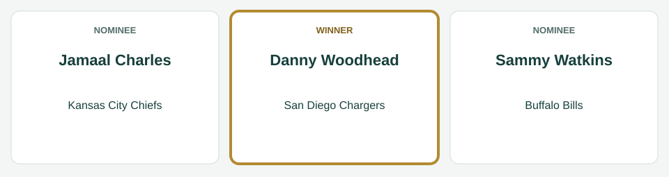
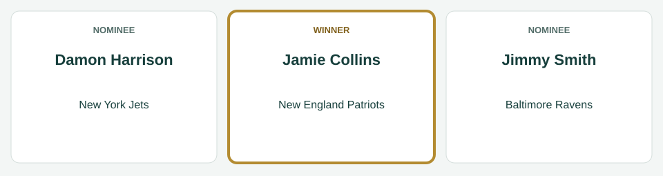
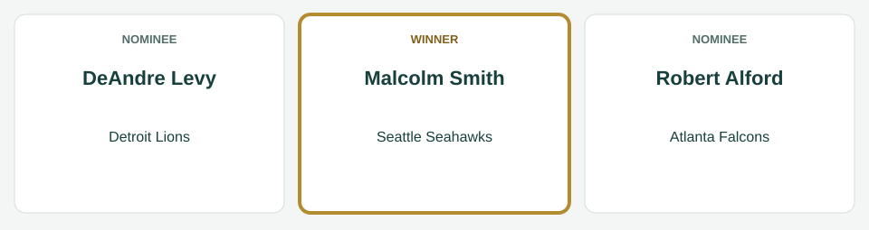

# Week 5 Players of the Week

[All regular-season awards](../README.md)

The league’s players of the week for Week 5, for the games of October 2 to October 6, 2014.

| Award | Player | Club |
|---|---|---|
| AFC Offensive Player of the Week | Danny Woodhead | San Diego Chargers |
| AFC Defensive Player of the Week | Jamie Collins | New England Patriots |
| AFC Special Teams Player of the Week | Travis Benjamin | Cleveland Browns |
| NFC Offensive Player of the Week | Shaun Hill | St. Louis Rams |
| NFC Defensive Player of the Week | Malcolm Smith | Seattle Seahawks |
| NFC Special Teams Player of the Week | Benny Cunningham | St. Louis Rams |

## AFC Offensive Player of the Week

**Danny Woodhead, running back, San Diego Chargers.** In the Chargers' 33-21 win over the New York Jets on October 5: 23 carries for 112 yards and 1 touchdown; 4 catches for 57 yards and 1 touchdown.

| Photo | Player | Team | Shortlist score | Result |
|---|---|---|---:|---|
|  | Jamaal Charles | Kansas City Chiefs | 36.7 | Finalist |
|  | Danny Woodhead | San Diego Chargers | 28.9 | Winner |
|  | Sammy Watkins | Buffalo Bills | 25.3 | Finalist |

The shortlist score is the award formula’s score for the week; the panel picked the winner from the three finalists.

*Photo: Jamaal Charles, Jeffrey Beall, [CC BY-SA 3.0](https://creativecommons.org/licenses/by-sa/3.0), [source](https://commons.wikimedia.org/wiki/File:Jamaal_Charles.JPG).*

*Photo: Danny Woodhead, Jack Newton from Austin, TX, USA, [CC BY-SA 2.0](https://creativecommons.org/licenses/by-sa/2.0), [source](https://commons.wikimedia.org/wiki/File:Danny_Woodhead_2011.jpg).*

*Photo: Sammy Watkins, Mr.schultz, [CC BY-SA 3.0](https://creativecommons.org/licenses/by-sa/3.0), [source](https://commons.wikimedia.org/wiki/File:Sammy_Watkins.JPG).*

## AFC Defensive Player of the Week

**Jamie Collins, linebacker, New England Patriots.** In the Patriots' 35-9 win over the Cincinnati Bengals on October 5: 10 tackles, 2 sacks, 1 forced fumble, 1 fumble recovery.

| Photo | Player | Team | Shortlist score | Result |
|---|---|---|---:|---|
|  | Jamie Collins | New England Patriots | 22.5 | Winner |
|  | Damon Harrison | New York Jets | 21.0 | Finalist |
|  | Jimmy Smith | Baltimore Ravens | 20.9 | Finalist |

The shortlist score is the award formula’s score for the week; the panel picked the winner from the three finalists.

*Photo: Jamie Collins, Jeffrey Beall, [CC BY 3.0](https://creativecommons.org/licenses/by/3.0), [source](https://commons.wikimedia.org/wiki/File:Jamie_Collins_(American_football).JPG).*

*Photo: Damon Harrison, Tom Hanny from Kinnelon, USA, [CC BY 2.0](https://creativecommons.org/licenses/by/2.0), [source](https://commons.wikimedia.org/wiki/File:Damon_Harrison_2016.jpg).*

*Photo: Jimmy Smith, Thibous, [CC BY-SA 3.0](https://creativecommons.org/licenses/by-sa/3.0), [source](https://commons.wikimedia.org/wiki/File:Jimmy_smith_2011_stadium_practice.jpg).*

## AFC Special Teams Player of the Week

**Travis Benjamin, wide receiver, Cleveland Browns.** In the Browns' 23-20 win over the Tennessee Titans on October 5: 2 kickoff returns for 46 yards; 8 punt returns for 89 yards.

| Photo | Player | Team | Shortlist score | Result |
|---|---|---|---:|---|
|  | Andre Caldwell | Denver Broncos | 19.1 | Finalist |
|  | Travis Benjamin | Cleveland Browns | 13.5 | Winner |
|  | Brandon Tate | Cincinnati Bengals | 12.8 | Finalist |

The shortlist score is the award formula’s score for the week; the panel picked the winner from the three finalists.

*Photo: Andre Caldwell, Jeffrey Beall, [CC BY-SA 3.0](https://creativecommons.org/licenses/by-sa/3.0), [source](https://commons.wikimedia.org/wiki/File:Andre_Caldwell_2012.JPG).*

*Photo: Travis Benjamin, Jeffrey Beall, [CC BY-SA 3.0](https://creativecommons.org/licenses/by-sa/3.0), [source](https://commons.wikimedia.org/wiki/File:Travis_Benjamin.JPG).*

*Photo: Brandon Tate, Jeffrey Beall, [CC BY-SA 3.0](https://creativecommons.org/licenses/by-sa/3.0), [source](https://commons.wikimedia.org/wiki/File:Brandon_Tate.JPG).*

## NFC Offensive Player of the Week

**Shaun Hill, quarterback, St. Louis Rams.** In the Rams' 30-27 loss to the Philadelphia Eagles on October 5: 25 of 47 passing for 420 yards, 2 touchdowns and no interceptions; 3 carries for 1 yard and 1 touchdown.

| Photo | Player | Team | Shortlist score | Result |
|---|---|---|---:|---|
|  | Shaun Hill | St. Louis Rams | 30.9 | Winner |
|  | Zac Stacy | St. Louis Rams | 27.6 | Finalist |
|  | Devonta Freeman | Atlanta Falcons | 25.9 | Finalist |

The shortlist score is the award formula’s score for the week; the panel picked the winner from the three finalists.

*Photo: Shaun Hill, Keith Allison, [CC BY-SA 2.0](https://creativecommons.org/licenses/by-sa/2.0), [source](https://commons.wikimedia.org/wiki/File:Shaun_Hill_2014_Cropped.jpg).*

*Photo: Zac Stacy, Johnmaxmena2, [CC BY-SA 3.0](https://creativecommons.org/licenses/by-sa/3.0), [source](https://commons.wikimedia.org/wiki/File:Zacstacy2013.jpg).*

*Photo: Devonta Freeman, Thomson200, [CC0](http://creativecommons.org/publicdomain/zero/1.0/deed.en), [source](https://commons.wikimedia.org/wiki/File:Devonta_Freeman_training_camp_2016.jpg).*

## NFC Defensive Player of the Week

**Malcolm Smith, linebacker, Seattle Seahawks.** In the Seahawks' 19-17 win over the Washington Redskins on October 6: 9 tackles, 1 sack, 1 tackle for loss, 1 interception, 1 pass defended, 1 forced fumble.

| Photo | Player | Team | Shortlist score | Result |
|---|---|---|---:|---|
|  | DeAndre Levy | Detroit Lions | 23.0 | Finalist |
|  | Malcolm Smith | Seattle Seahawks | 22.5 | Winner |
|  | Robert Alford | Atlanta Falcons | 20.5 | Finalist |

The shortlist score is the award formula’s score for the week; the panel picked the winner from the three finalists.

*Photo: DeAndre Levy, Jeffrey Beall, [CC BY-SA 3.0](https://creativecommons.org/licenses/by-sa/3.0), [source](https://commons.wikimedia.org/wiki/File:DeAndre_Levy.JPG).*

*Photo: Malcolm Smith, Jeffrey Beall, [CC BY 3.0](https://creativecommons.org/licenses/by/3.0), [source](https://commons.wikimedia.org/wiki/File:Malcolm_Smith_(American_football).JPG).*

*Photo: Robert Alford, Thomson200, [CC0](http://creativecommons.org/publicdomain/zero/1.0/deed.en), [source](https://commons.wikimedia.org/wiki/File:Robert_Alford_(American_football)_2014_02.jpg).*

## NFC Special Teams Player of the Week

**Benny Cunningham, running back, St. Louis Rams.** In the Rams' 30-27 loss to the Philadelphia Eagles on October 5: 5 kickoff returns for 139 yards.

| Photo | Player | Team | Shortlist score | Result |
|---|---|---|---:|---|
|  | Benny Cunningham | St. Louis Rams | 13.9 | Winner |
|  | Alex Henery | Detroit Lions | 12.0 | Finalist |
|  | Cody Parkey | Philadelphia Eagles | 12.0 | Finalist |

The shortlist score is the award formula’s score for the week; the panel picked the winner from the three finalists.

*Photo: Benny Cunningham, Jeffrey Beall, [CC BY 4.0](https://creativecommons.org/licenses/by/4.0), [source](https://commons.wikimedia.org/wiki/File:Benny_Cunningham.jpg).*

*Photo: Cody Parkey, Sgt. Staci Miller, Public domain, [source](https://commons.wikimedia.org/wiki/File:Cody_Parkey.jpg).*
