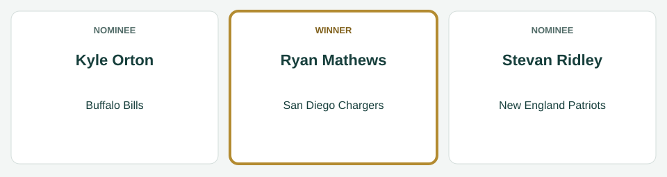
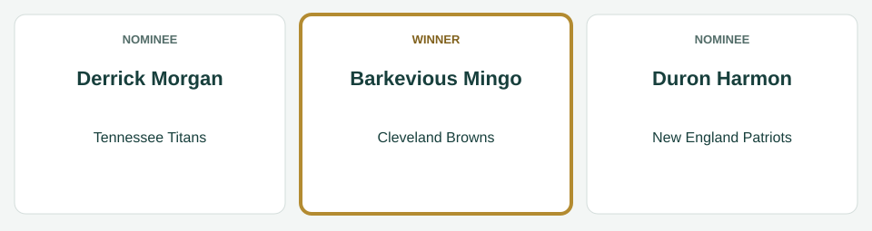
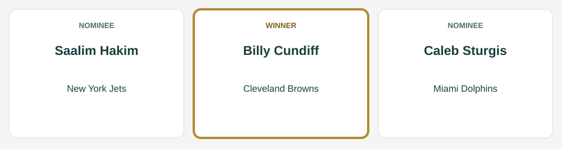
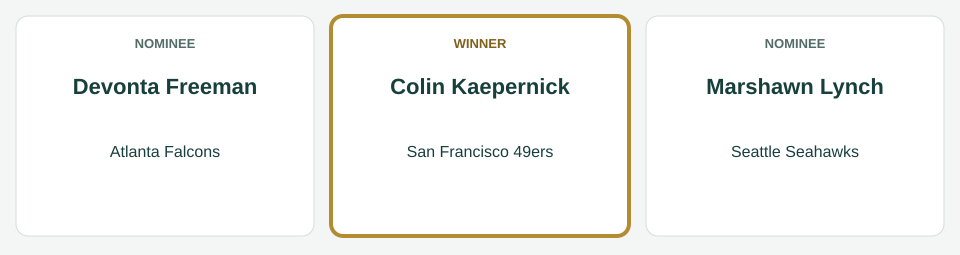
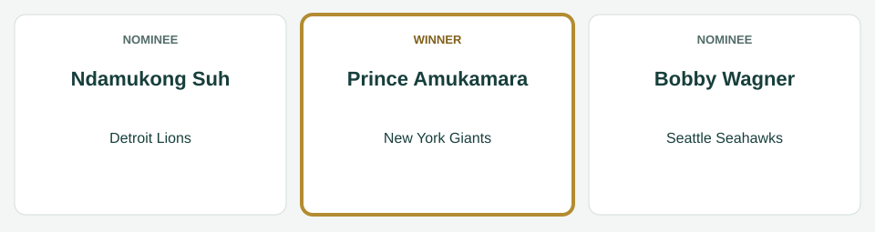
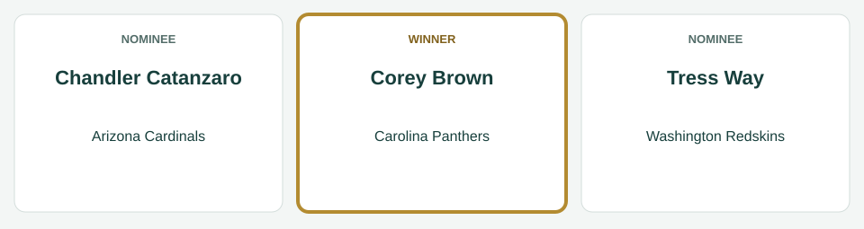

# Week 6 Players of the Week

[All regular-season awards](../README.md)

The league’s players of the week for Week 6, for the games of October 9 to October 13, 2014.

| Award | Player | Club |
|---|---|---|
| AFC Offensive Player of the Week | Ryan Mathews | San Diego Chargers |
| AFC Defensive Player of the Week | Barkevious Mingo | Cleveland Browns |
| AFC Special Teams Player of the Week | Billy Cundiff | Cleveland Browns |
| NFC Offensive Player of the Week | Colin Kaepernick | San Francisco 49ers |
| NFC Defensive Player of the Week | Prince Amukamara | New York Giants |
| NFC Special Teams Player of the Week | Corey Brown | Carolina Panthers |

## AFC Offensive Player of the Week

**Ryan Mathews, running back, San Diego Chargers.** In the Chargers' 41-7 win over the Oakland Raiders on October 12: 22 carries for 76 yards and 1 touchdown; 5 catches for 68 yards and 1 touchdown.

| Photo | Player | Team | Result |
|---|---|---|---|
|  | Kyle Orton | Buffalo Bills | Nominee |
|  | Stevan Ridley | New England Patriots | Nominee |
|  | Ryan Mathews | San Diego Chargers | Winner |

*Photo: Kyle Orton, Jeffrey Beall, [CC BY-SA 2.0](https://creativecommons.org/licenses/by-sa/2.0), [source](https://commons.wikimedia.org/wiki/File:Kyle_Orton2.jpg).*

*Photo: Stevan Ridley, Jeffrey Beall, [CC BY-SA 3.0](https://creativecommons.org/licenses/by-sa/3.0), [source](https://commons.wikimedia.org/wiki/File:Stevan_Ridley.JPG).*

*Photo: Ryan Mathews, Jeffrey Beall, [CC BY-SA 3.0](https://creativecommons.org/licenses/by-sa/3.0), [source](https://commons.wikimedia.org/wiki/File:Ryan_Mathews_(American_football).JPG).*

## AFC Defensive Player of the Week

**Barkevious Mingo, linebacker, Cleveland Browns.** In the Browns' 33-30 win over the Pittsburgh Steelers on October 12: 14 tackles, 1 sack, 1 forced fumble.

| Photo | Player | Team | Result |
|---|---|---|---|
|  | Barkevious Mingo | Cleveland Browns | Winner |
|  | Derrick Morgan | Tennessee Titans | Nominee |
|  | Duron Harmon | New England Patriots | Nominee |

*Photo: Barkevious Mingo, Erik Daniel Drost, [CC BY 2.0](https://creativecommons.org/licenses/by/2.0), [source](https://commons.wikimedia.org/wiki/File:Barkevious_Mingo_2014.jpg).*

*Photo: Derrick Morgan, Chipermc, [CC BY-SA 4.0](https://creativecommons.org/licenses/by-sa/4.0), [source](https://commons.wikimedia.org/wiki/File:Derrick_Morgan_2018_08-09.jpg).*

*Photo: Duron Harmon, Jeffrey Beall, [CC BY 3.0](https://creativecommons.org/licenses/by/3.0), [source](https://commons.wikimedia.org/wiki/File:Duron_Harmon.JPG).*

## AFC Special Teams Player of the Week

**Billy Cundiff, kicker, Cleveland Browns.** In the Browns' 33-30 win over the Pittsburgh Steelers on October 12: 4 of 4 field goals; 3 of 3 extra points.

| Photo | Player | Team | Result |
|---|---|---|---|
|  | Saalim Hakim | New York Jets | Nominee |
|  | Billy Cundiff | Cleveland Browns | Winner |
|  | Caleb Sturgis | Miami Dolphins | Nominee |

*Photo: Billy Cundiff, Thibous, [CC BY-SA 3.0](https://creativecommons.org/licenses/by-sa/3.0), [source](https://commons.wikimedia.org/wiki/File:Billy_Cundiff_2011_stadium_practice.jpg).*

*Photo: Caleb Sturgis, Jeffrey Beall, [CC BY 3.0](https://creativecommons.org/licenses/by/3.0), [source](https://commons.wikimedia.org/wiki/File:Caleb_Sturgis.JPG).*

## NFC Offensive Player of the Week

**Colin Kaepernick, quarterback, San Francisco 49ers.** In the 49ers' 38-17 win over the St. Louis Rams on October 13: 27 of 38 passing for 338 yards, 4 touchdowns and 1 interception; 6 carries for 6 yards.

| Photo | Player | Team | Result |
|---|---|---|---|
|  | Colin Kaepernick | San Francisco 49ers | Winner |
|  | Devonta Freeman | Atlanta Falcons | Nominee |
|  | Marshawn Lynch | Seattle Seahawks | Nominee |

*Photo: Colin Kaepernick, Erik Drost, [CC BY 2.0](https://creativecommons.org/licenses/by/2.0), [source](https://commons.wikimedia.org/wiki/File:Colin_Kaepernick_(18391502680).jpg).*

*Photo: Devonta Freeman, Thomson200, [CC0](http://creativecommons.org/publicdomain/zero/1.0/deed.en), [source](https://commons.wikimedia.org/wiki/File:Devonta_Freeman_training_camp_2016.jpg).*

*Photo: Marshawn Lynch, Marshawn_Lynch_and_Mike_Williams.jpg : Kelly Bailey derivative work: Lpdrew, [CC BY 2.0](https://creativecommons.org/licenses/by/2.0), [source](https://commons.wikimedia.org/wiki/File:Marshawn_Lynch_2011.jpg).*

## NFC Defensive Player of the Week

**Prince Amukamara, cornerback, New York Giants.** In the Giants' 27-24 loss to the Philadelphia Eagles on October 12: 9 tackles, 1 interception, 2 passes defended.

| Photo | Player | Team | Result |
|---|---|---|---|
|  | Ndamukong Suh | Detroit Lions | Nominee |
|  | Bobby Wagner | Seattle Seahawks | Nominee |
|  | Prince Amukamara | New York Giants | Winner |

*Photo: Ndamukong Suh, Keith Allison, [CC BY-SA 2.0](https://creativecommons.org/licenses/by-sa/2.0), [source](https://commons.wikimedia.org/wiki/File:Ndamukong_Suh_Dolphins.jpg).*

*Photo: Bobby Wagner, All-Pro Reels, [CC BY-SA 4.0](https://creativecommons.org/licenses/by-sa/4.0), [source](https://commons.wikimedia.org/wiki/File:Bobby_Wagner_-_2025_Commanders_at_Chargers_(cropped).jpg).*

*Photo: Prince Amukamara, David Shankbone, [CC BY 3.0](https://creativecommons.org/licenses/by/3.0), [source](https://commons.wikimedia.org/wiki/File:Prince_Amukamara_2012_Shankbone.JPG).*

## NFC Special Teams Player of the Week

**Corey Brown, wide receiver, Carolina Panthers.** In the Panthers' 27-24 win over the Cincinnati Bengals on October 12: 3 kickoff returns for 82 yards; 4 punt returns for 87 yards.

| Photo | Player | Team | Result |
|---|---|---|---|
|  | Chandler Catanzaro | Arizona Cardinals | Nominee |
|  | Corey Brown | Carolina Panthers | Winner |
|  | Tress Way | Washington Redskins | Nominee |

*Photo: Chandler Catanzaro, Jeffrey Beall, [CC BY 3.0](https://creativecommons.org/licenses/by/3.0), [source](https://commons.wikimedia.org/wiki/File:Chandler_Catanzaro.JPG).*

*Photo: Corey Brown, Keith Allison, [CC BY-SA 2.0](https://creativecommons.org/licenses/by-sa/2.0), [source](https://commons.wikimedia.org/wiki/File:Philly_Corey_Brown_2016-08-11_crop.jpg).*

*Photo: Tress Way, Keith Allison from Hanover, MD, USA, [CC BY-SA 2.0](https://creativecommons.org/licenses/by-sa/2.0), [source](https://commons.wikimedia.org/wiki/File:Tress_Way_(15171046507).jpg).*
