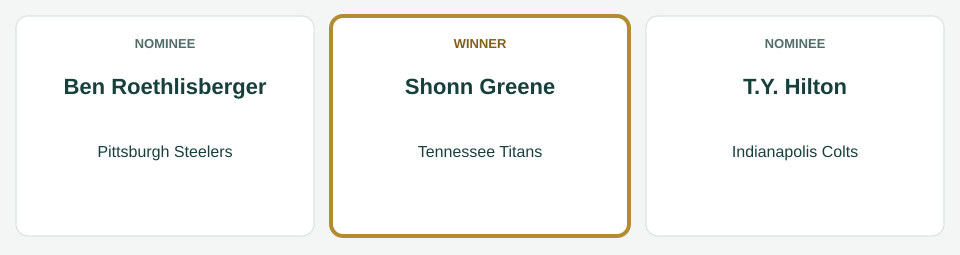
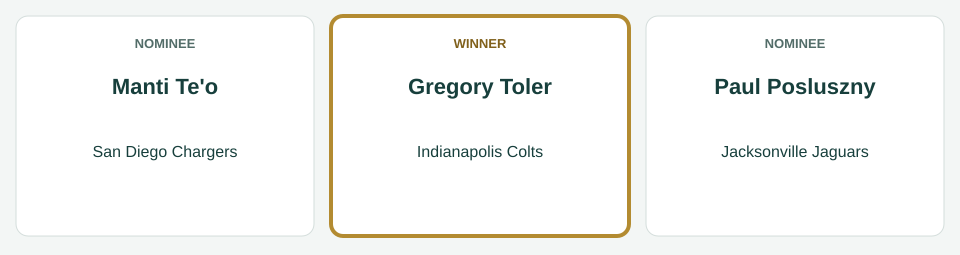
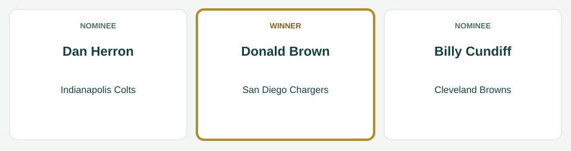
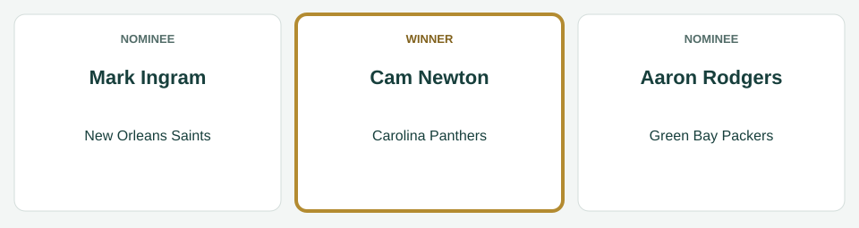
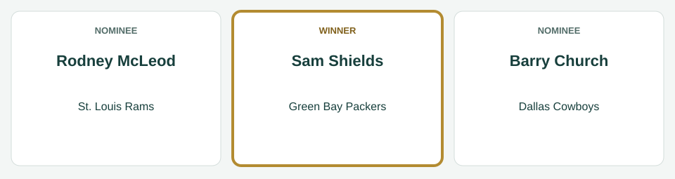
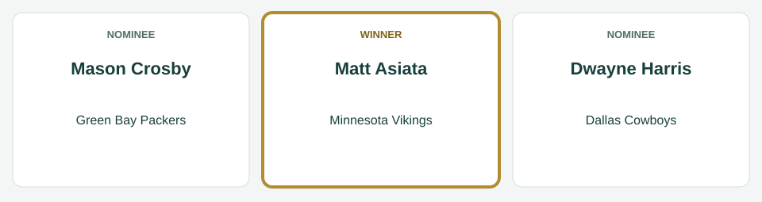

# Week 7 Players of the Week

[All regular-season awards](../README.md)

The league’s players of the week for Week 7, for the games of October 16 to October 20, 2014.

| Award | Player | Club |
|---|---|---|
| AFC Offensive Player of the Week | Shonn Greene | Tennessee Titans |
| AFC Defensive Player of the Week | Gregory Toler | Indianapolis Colts |
| AFC Special Teams Player of the Week | Donald Brown | San Diego Chargers |
| NFC Offensive Player of the Week | Cam Newton | Carolina Panthers |
| NFC Defensive Player of the Week | Sam Shields | Green Bay Packers |
| NFC Special Teams Player of the Week | Matt Asiata | Minnesota Vikings |

## AFC Offensive Player of the Week

**Shonn Greene, running back, Tennessee Titans.** In the Titans' 27-24 win over the Washington Redskins on October 19: 26 carries for 207 yards and 3 touchdowns; 3 catches for 51 yards.

| Photo | Player | Team | Result |
|---|---|---|---|
|  | Shonn Greene | Tennessee Titans | Winner |
|  | Ben Roethlisberger | Pittsburgh Steelers | Nominee |
|  | T.Y. Hilton | Indianapolis Colts | Nominee |

*Photo: Shonn Greene, Marianne O'Leary, [CC BY 2.0](https://creativecommons.org/licenses/by/2.0), [source](https://commons.wikimedia.org/wiki/File:Shonn_Greene_2011.jpg).*

*Photo: Ben Roethlisberger, Joey Gannon from Pittsburgh, PA, [CC BY-SA 2.0](https://creativecommons.org/licenses/by-sa/2.0), [source](https://commons.wikimedia.org/wiki/File:Ben_Roethlisberger.JPG).*

*Photo: T.Y. Hilton, Nothingxs, [CC0](http://creativecommons.org/publicdomain/zero/1.0/deed.en), [source](https://commons.wikimedia.org/wiki/File:T.Y._Hilton_-_2008_Shula_Bowl.png).*

## AFC Defensive Player of the Week

**Gregory Toler, cornerback, Indianapolis Colts.** In the Colts' 30-23 win over the Cincinnati Bengals on October 19: 9 tackles, 1 tackle for loss, 2 interceptions, 3 passes defended.

| Photo | Player | Team | Result |
|---|---|---|---|
|  | Gregory Toler | Indianapolis Colts | Winner |
|  | Manti Te'o | San Diego Chargers | Nominee |
|  | Paul Posluszny | Jacksonville Jaguars | Nominee |

*Photo: Gregory Toler, C Watts, [CC BY 2.0](https://creativecommons.org/licenses/by/2.0), [source](https://commons.wikimedia.org/wiki/File:Greg_Toler_training_camp,_2016.jpg).*

*Photo: Manti Te'o, Shotgun Spratling/Neon Tommy, [CC BY-SA 2.0](https://creativecommons.org/licenses/by-sa/2.0), [source](https://commons.wikimedia.org/wiki/File:Mantiteo2010.jpg).*

*Photo: Paul Posluszny, Lance Cpl. Matthew Bragg, Public domain, [source](https://commons.wikimedia.org/wiki/File:Paul_Posluszny_2014_Pro_Bowl.jpg).*

## AFC Special Teams Player of the Week

**Donald Brown, running back, San Diego Chargers.** In the Chargers' 23-20 win over the Kansas City Chiefs on October 19: 3 kickoff returns for 171 yards.

| Photo | Player | Team | Result |
|---|---|---|---|
|  | Donald Brown | San Diego Chargers | Winner |
|  | Dan Herron | Indianapolis Colts | Nominee |
|  | Billy Cundiff | Cleveland Browns | Nominee |

*Photo: Donald Brown, Jeffrey Beall, [CC BY-SA 3.0](https://creativecommons.org/licenses/by-sa/3.0), [source](https://commons.wikimedia.org/wiki/File:Donald_Brown.JPG).*

*Photo: Dan Herron, Jeffrey Beall, [CC BY 3.0](https://creativecommons.org/licenses/by/3.0), [source](https://commons.wikimedia.org/wiki/File:Dan_Herron.JPG).*

*Photo: Billy Cundiff, Thibous, [CC BY-SA 3.0](https://creativecommons.org/licenses/by-sa/3.0), [source](https://commons.wikimedia.org/wiki/File:Billy_Cundiff_2011_stadium_practice.jpg).*

## NFC Offensive Player of the Week

**Cam Newton, quarterback, Carolina Panthers.** In the Panthers' 47-30 loss to the Green Bay Packers on October 19: 22 of 36 passing for 348 yards, 4 touchdowns and 2 interceptions; 2 carries for 22 yards.

| Photo | Player | Team | Result |
|---|---|---|---|
|  | Mark Ingram | New Orleans Saints | Nominee |
|  | Aaron Rodgers | Green Bay Packers | Nominee |
|  | Cam Newton | Carolina Panthers | Winner |

*Photo: Mark Ingram, Executive Office of the President, Public domain, [source](https://commons.wikimedia.org/wiki/File:Mark_Ingram,_Jr._at_the_White_House_2010-03-08_3.jpg).*

*Photo: Aaron Rodgers, All-Pro Reels, [CC BY-SA 2.0](https://creativecommons.org/licenses/by-sa/2.0), [source](https://commons.wikimedia.org/wiki/File:Aaron_Rodgers_Packers_OCT2021_(cropped).jpg).*

*Photo: Cam Newton, sportiqe, [CC BY-SA 2.0](https://creativecommons.org/licenses/by-sa/2.0), [source](https://commons.wikimedia.org/wiki/File:Cam_Newton_-_Carolina_Panthers.jpg).*

## NFC Defensive Player of the Week

**Sam Shields, cornerback, Green Bay Packers.** In the Packers' 47-30 win over the Carolina Panthers on October 19: 5 tackles, 1 sack, 2 interceptions, 3 passes defended.

| Photo | Player | Team | Result |
|---|---|---|---|
|  | Sam Shields | Green Bay Packers | Winner |
|  | Rodney McLeod | St. Louis Rams | Nominee |
|  | Barry Church | Dallas Cowboys | Nominee |

*Photo: Sam Shields, Gabriel Cervantes, [CC BY-SA 3.0](https://creativecommons.org/licenses/by-sa/3.0), [source](https://commons.wikimedia.org/wiki/File:Sam_Shields.jpg).*

*Photo: Rodney McLeod, All-Pro Reels, [CC BY-SA 2.0](https://creativecommons.org/licenses/by-sa/2.0), [source](https://commons.wikimedia.org/wiki/File:Rodney_McLeod_Colts_vs_Commanders_OCT2022_(cropped).jpg).*

*Photo: Barry Church, Keith Allison, [CC BY-SA 2.0](https://creativecommons.org/licenses/by-sa/2.0), [source](https://commons.wikimedia.org/wiki/File:Barry_Church.jpg).*

## NFC Special Teams Player of the Week

**Matt Asiata, running back, Minnesota Vikings.** In the Vikings' 35-21 loss to the Buffalo Bills on October 19: 2 kickoff returns for 71 yards; 3 punt returns for 113 yards.

| Photo | Player | Team | Result |
|---|---|---|---|
|  | Matt Asiata | Minnesota Vikings | Winner |
|  | Mason Crosby | Green Bay Packers | Nominee |
|  | Dwayne Harris | Dallas Cowboys | Nominee |

*Photo: Matt Asiata, MN National Guard, [CC BY 3.0](https://creativecommons.org/licenses/by/3.0), [source](https://commons.wikimedia.org/wiki/File:Matt_Asiata.JPG).*

*Photo: Mason Crosby, Paul Cutler, [CC BY-SA 2.0](https://creativecommons.org/licenses/by-sa/2.0), [source](https://commons.wikimedia.org/wiki/File:Mason_Crosby_kicks_a_field_goal_for_Green_Bay_Packers_off_ball_held_by_Jon_Ryan_during_October_7,_2007_game_against_Chicago_Bears_at_Lambeau_Field_in_Green_Bay.jpg).*

*Photo: Dwayne Harris, U.S. Air Force photo/Airman 1st Class Rae Perry, Public domain, [source](https://commons.wikimedia.org/wiki/File:Dwayne_Harris,_2009_(cropped).jpg).*
