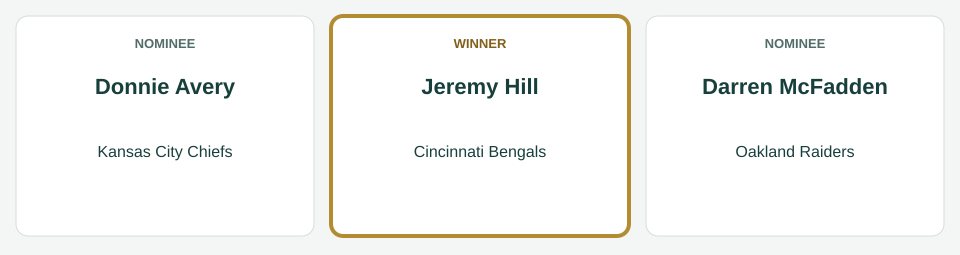
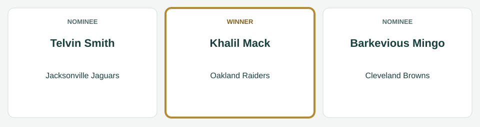
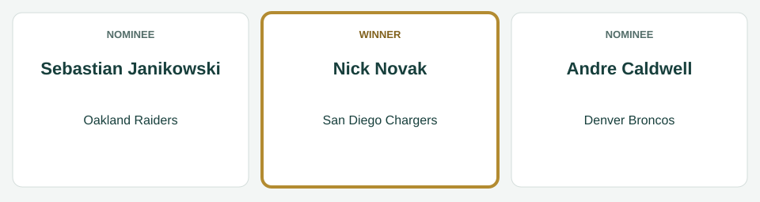
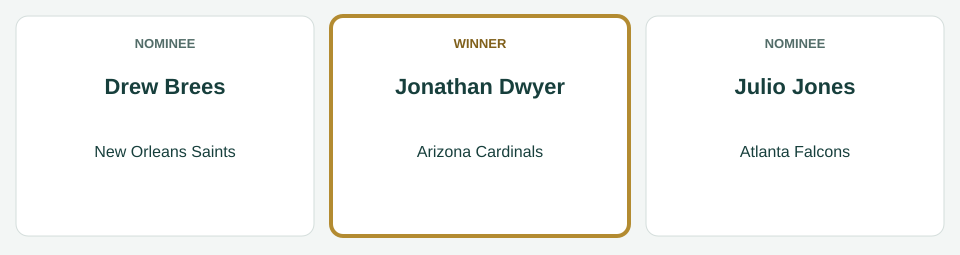
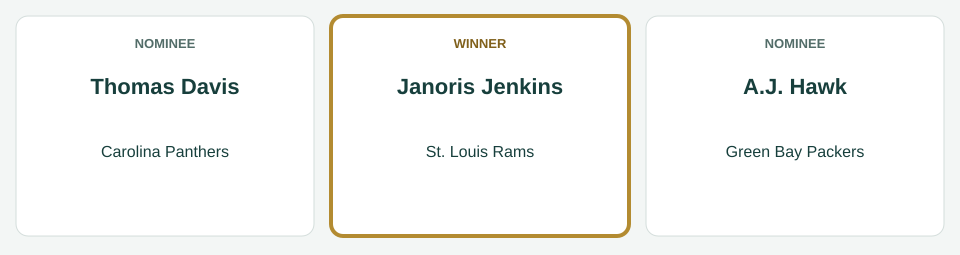
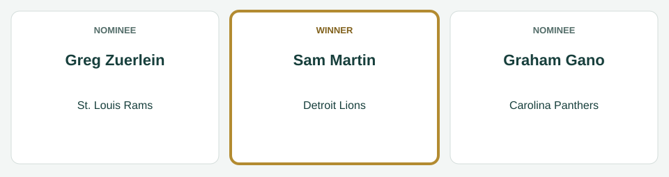

# Week 8 Players of the Week

[All regular-season awards](../README.md)

The league’s players of the week for Week 8, for the games of October 23 to October 27, 2014.

| Award | Player | Club |
|---|---|---|
| AFC Offensive Player of the Week | Jeremy Hill | Cincinnati Bengals |
| AFC Defensive Player of the Week | Khalil Mack | Oakland Raiders |
| AFC Special Teams Player of the Week | Nick Novak | San Diego Chargers |
| NFC Offensive Player of the Week | Jonathan Dwyer | Arizona Cardinals |
| NFC Defensive Player of the Week | Janoris Jenkins | St. Louis Rams |
| NFC Special Teams Player of the Week | Sam Martin | Detroit Lions |

## AFC Offensive Player of the Week

**Jeremy Hill, running back, Cincinnati Bengals.** In the Bengals' 31-21 win over the Baltimore Ravens on October 26: 18 carries for 65 yards and 2 touchdowns; 3 catches for 39 yards and 1 touchdown.

| Photo | Player | Team | Result |
|---|---|---|---|
|  | Donnie Avery | Kansas City Chiefs | Nominee |
|  | Jeremy Hill | Cincinnati Bengals | Winner |
|  | Darren McFadden | Oakland Raiders | Nominee |

*Photo: Donnie Avery, Jeffrey Beall, [CC BY 3.0](https://creativecommons.org/licenses/by/3.0), [source](https://commons.wikimedia.org/wiki/File:Donnie_Avery.JPG).*

*Photo: Jeremy Hill, Keith Allison, [CC BY-SA 2.0](https://creativecommons.org/licenses/by-sa/2.0), [source](https://commons.wikimedia.org/wiki/File:Jeremy_Hill_(American_football).jpg).*

*Photo: Darren McFadden, Jeffrey Beall, [CC BY-SA 3.0](https://creativecommons.org/licenses/by-sa/3.0), [source](https://commons.wikimedia.org/wiki/File:Darren_McFadden_Raiders.JPG).*

## AFC Defensive Player of the Week

**Khalil Mack, defensive end, Oakland Raiders.** In the Raiders' 51-14 win over the Cleveland Browns on October 26: 8 tackles, 4 sacks, 1 interception, 1 pass defended, 1 fumble recovery.

| Photo | Player | Team | Result |
|---|---|---|---|
|  | Khalil Mack | Oakland Raiders | Winner |
|  | Telvin Smith | Jacksonville Jaguars | Nominee |
|  | Barkevious Mingo | Cleveland Browns | Nominee |

*Photo: Khalil Mack, All-Pro Reels from District of Columbia, USA, [CC BY-SA 2.0](https://creativecommons.org/licenses/by-sa/2.0), [source](https://commons.wikimedia.org/wiki/File:Khalil_Mack_Bears_2019_(cropped).jpg).*

*Photo: Telvin Smith, Jacksonville Sheriff's Office, Public domain, [source](https://commons.wikimedia.org/wiki/File:Telvin_Smith.png).*

*Photo: Barkevious Mingo, Erik Daniel Drost, [CC BY 2.0](https://creativecommons.org/licenses/by/2.0), [source](https://commons.wikimedia.org/wiki/File:Barkevious_Mingo_2014.jpg).*

## AFC Special Teams Player of the Week

**Nick Novak, kicker, San Diego Chargers.** In the Chargers' 35-29 loss to the Denver Broncos on October 23: 5 of 6 field goals; 2 of 2 extra points.

| Photo | Player | Team | Result |
|---|---|---|---|
|  | Nick Novak | San Diego Chargers | Winner |
|  | Sebastian Janikowski | Oakland Raiders | Nominee |
|  | Andre Caldwell | Denver Broncos | Nominee |

*Photo: Nick Novak, pdtghq, [CC BY 2.0](https://creativecommons.org/licenses/by/2.0), [source](https://commons.wikimedia.org/wiki/File:Nick_Novak_(cropped).jpg).*

*Photo: Sebastian Janikowski, Jeffrey Beall, [CC BY 4.0](https://creativecommons.org/licenses/by/4.0), [source](https://commons.wikimedia.org/wiki/File:Sebastian_Janikowski_2018.JPG).*

*Photo: Andre Caldwell, Jeffrey Beall, [CC BY-SA 3.0](https://creativecommons.org/licenses/by-sa/3.0), [source](https://commons.wikimedia.org/wiki/File:Andre_Caldwell_2012.JPG).*

## NFC Offensive Player of the Week

**Jonathan Dwyer, running back, Arizona Cardinals.** In the Cardinals' 42-3 win over the Philadelphia Eagles on October 26: 19 carries for 64 yards and 2 touchdowns; 5 catches for 101 yards and 1 touchdown.

| Photo | Player | Team | Result |
|---|---|---|---|
|  | Jonathan Dwyer | Arizona Cardinals | Winner |
|  | Drew Brees | New Orleans Saints | Nominee |
|  | Julio Jones | Atlanta Falcons | Nominee |

*Photo: Jonathan Dwyer, Jeffrey Beall, [CC BY-SA 3.0](https://creativecommons.org/licenses/by-sa/3.0), [source](https://commons.wikimedia.org/wiki/File:Jonathan_Dwyer.JPG).*

*Photo: Drew Brees, Senate Democrats, [CC BY 2.0](https://creativecommons.org/licenses/by/2.0), [source](https://commons.wikimedia.org/wiki/File:Drew_Brees_(49396271982)_(1).jpg).*

*Photo: Julio Jones, Keith Allison from Hanover, MD, USA, [CC BY-SA 2.0](https://creativecommons.org/licenses/by-sa/2.0), [source](https://commons.wikimedia.org/wiki/File:Julio_Jones_2018.jpg).*

## NFC Defensive Player of the Week

**Janoris Jenkins, cornerback, St. Louis Rams.** In the Rams' 33-24 win over the Kansas City Chiefs on October 26: 2 tackles, 2 interceptions, 2 passes defended.

| Photo | Player | Team | Result |
|---|---|---|---|
|  | Janoris Jenkins | St. Louis Rams | Winner |
|  | Thomas Davis | Carolina Panthers | Nominee |
|  | A.J. Hawk | Green Bay Packers | Nominee |

*Photo: Janoris Jenkins, Erik Drost, [CC BY 2.0](https://creativecommons.org/licenses/by/2.0), [source](https://commons.wikimedia.org/wiki/File:Janoris_Jenkins_(cropped).jpg).*

*Photo: Thomas Davis, original: Spc. Klinton Smith of the 3d U.S. Infantry Regiment of the United States Army derivative: Diddykong1130, Public domain, [source](https://commons.wikimedia.org/wiki/File:Thomas_davis_2014.jpg).*

*Photo: A.J. Hawk, Mike Morbeck, [CC BY-SA 2.0](https://creativecommons.org/licenses/by-sa/2.0), [source](https://commons.wikimedia.org/wiki/File:A._J._Hawk.jpg).*

## NFC Special Teams Player of the Week

**Sam Martin, punter, Detroit Lions.** In the Lions' 35-14 loss to the Atlanta Falcons on October 26: 8 punts for a 52.5-yard average, 3 inside the 20.

| Photo | Player | Team | Result |
|---|---|---|---|
|  | Sam Martin | Detroit Lions | Winner |
|  | Greg Zuerlein | St. Louis Rams | Nominee |
|  | Graham Gano | Carolina Panthers | Nominee |

*Photo: Sam Martin, All-Pro Reels, [CC BY-SA 2.0](https://creativecommons.org/licenses/by-sa/2.0), [source](https://commons.wikimedia.org/wiki/File:Sam_Martin_(51651272550)_(cropped).jpg).*

*Photo: Greg Zuerlein, All-Pro Reels, [CC BY-SA 2.0](https://creativecommons.org/licenses/by-sa/2.0), [source](https://commons.wikimedia.org/wiki/File:Cowboys_K_Greg_Zuerlein_(50530256403).jpg).*

*Photo: Graham Gano, original: Keith Allison derivative: Diddykong1130, [CC BY-SA 2.0](https://creativecommons.org/licenses/by-sa/2.0), [source](https://commons.wikimedia.org/wiki/File:Graham_gano.jpg).*
