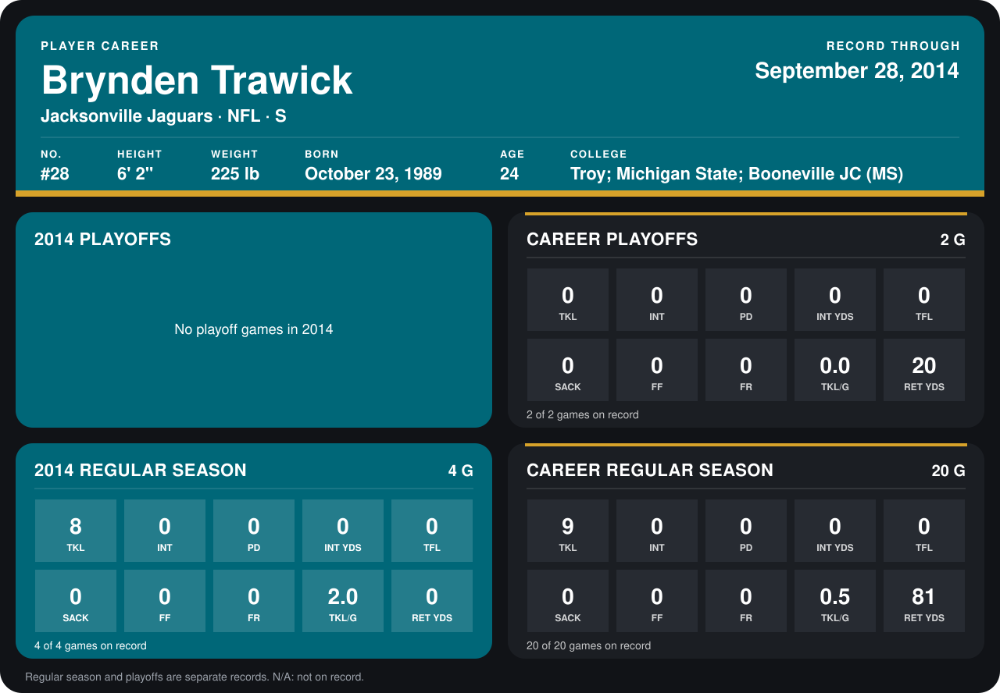

# Brynden Trawick — 2014 Player Profile

<!-- player-card:begin -->

[Career statistics](../../../../league_players/jacksonville_jaguars/brynden_trawick.md)
<!-- player-card:end -->

<!-- photo -->

*Photo: Jeffrey Beall, [CC BY 3.0](https://creativecommons.org/licenses/by/3.0) ([source](https://commons.wikimedia.org/wiki/File:Brynden_Trawick.JPG)).*
<!-- /photo -->

**Team:** Jacksonville Jaguars  
**Season:** 2014  
**Profile status:** Working player card  
**Assessment stage:** Opening annual assessment  
**Evaluation policy:** Preserve this opening assessment and add dated coaching updates through the year. Write the separate final assessment after season close. Statistics update after each closed game.  
**Checkpoint:** March 31, 2014 starting evaluation  
**Age:** 24  
**Position:** S  
**NFL standing:** Starting staff view; exact theoretical personnel grades  
**Player identity:** A physical developmental safety whose coverage-unit communication and run-support tools offer a path to playing time. I see his defensive recognition and coverage positioning as less developed.  
**Previous annual profile:** [2013 baseline](../../../../2013/player_profiles/brynden_trawick.md)  

> This is a dated personnel snapshot, not a game-engine rating card. Established
> abilities carry forward from the prior profile unless new causal evidence
> supports a change. A grade summarizes the staff view at this checkpoint; it
> does not directly set play probabilities, potential, or future development.

## Player grades

| Category | Grade | NFL standing |
| --- | ---: | --- |
| Overall | 4.5 /10 | Staff judgment |
| Athleticism | 4.5 /10 | Staff judgment |
| Speed | 4.5 /10 | Staff judgment |
| Strength / Power | 5.0 /10 | Staff judgment |
| Agility / Change of direction | 4.0 /10 | Staff judgment |
| Technique | 3.5 /10 | Staff judgment |
| Football IQ | 5.5 /10 | Staff judgment |
| Range | 4.5 /10 | Staff judgment |
| Speed / change of direction | 4.5 /10 | Staff judgment |
| Route-combination recognition | 3.5 /10 | Staff judgment |
| Deep positioning | 3.5 /10 | Staff judgment |
| Man / slot coverage | 3.0 /10 | Staff judgment |
| Ball skills | 3.5 /10 | Staff judgment |
| Tackling | 5.0 /10 | Staff judgment |
| Run support / angles | 5.0 /10 | Staff judgment |
| Communication | 5.5 /10 | Staff judgment |
| Play-action discipline | 3.5 /10 | Staff judgment |

Exact theoretical personnel judgments. Retained position grades carry the 2013 evaluation; the six broad categories summarize that starting view. No new 2014 improvement or decline is asserted.

## League comparison

| Trait | vs. Average | vs. Best | vs. Worst |
| --- | --- | --- | --- |
| Athleticism | Below NFL starter standard | Below elite standard | Above low-end standard |
| Speed | Below NFL starter standard | Below elite standard | Above low-end standard |
| Strength / Power | Below NFL starter standard | Below elite standard | Above low-end standard |
| Agility / Change of direction | Below NFL starter standard | Below elite standard | Above low-end standard |
| Technique | Below NFL starter standard | Below elite standard | Above low-end standard |
| Football IQ | Below NFL starter standard | Below elite standard | Above low-end standard |
| Range | Below NFL starter standard | Below elite standard | Above low-end standard |
| Speed / change of direction | Below NFL starter standard | Below elite standard | Above low-end standard |
| Route-combination recognition | Below NFL starter standard | Below elite standard | Above low-end standard |
| Deep positioning | Below NFL starter standard | Below elite standard | Above low-end standard |
| Man / slot coverage | Below NFL starter standard | Below elite standard | At low-end standard |
| Ball skills | Below NFL starter standard | Below elite standard | Above low-end standard |
| Tackling | Below NFL starter standard | Below elite standard | Above low-end standard |
| Run support / angles | Below NFL starter standard | Below elite standard | Above low-end standard |
| Communication | Below NFL starter standard | Below elite standard | Above low-end standard |
| Play-action discipline | Below NFL starter standard | Below elite standard | Above low-end standard |

These are staff comparisons against personnel standards, not measured 2014 league ranks.

## Established player state

A physical developmental safety whose coverage-unit communication and run-support tools offer a path to playing time. I see his defensive recognition and coverage positioning as less developed.

Source: [2013 profile](../../../../2013/player_profiles/brynden_trawick.md) and its recorded practice/game sources.

## Year-over-year change

| Area | Prior profile | Current checkpoint | Change | Evidence / football reason |
| --- | --- | --- | --- | --- |
| Player identity and position traits | 2013 baseline | Starting 2014 view | Retained | No new individual football evidence establishing change |

## What supports this assessment

A physical developmental safety whose coverage-unit communication and run-support tools offer a path to playing time. I see his defensive recognition and coverage positioning as less developed.

[2013 profile](../../../../2013/player_profiles/brynden_trawick.md) and its recorded practice/game sources.

## Historical comparison

The 2013 record below supplies prior-season context. The 2014 evaluation uses only information available at this checkpoint; the real player’s later career is not an answer key.

## Play style

A physical developmental safety whose coverage-unit communication and run-support tools offer a path to playing time. I see his defensive recognition and coverage positioning as less developed.

## Best traits

- Communication: 5.5 /10.
- Tackling: 5.0 /10.
- Run support / angles: 5.0 /10.

## Main weaknesses

- Man / slot coverage: 3.0 /10.
- Route-combination recognition: 3.5 /10.
- Deep positioning: 3.5 /10.

## Evidence and uncertainty

- **Primary evidence:** [2013 profile](../../../../2013/player_profiles/brynden_trawick.md) and its recorded practice/game sources.
- **Evaluation basis:** Theoretical staff judgment, with thin evidence identified in the source profile.
- **During the year:** Preserve the opening personnel judgment; add dated material coaching findings without creating another full assessment. Update recorded statistics after games.
- **At season close:** Write a separate final assessment from the completed season and exit reviews; retain this opening card and its dated updates. Keep prior-year statistics.

**One-line description:** A physical developmental safety whose coverage-unit communication and run-support tools offer a path to playing time. I see his defensive recognition and coverage positioning as less developed.

## 2013 season production

| Statistic | 2013 regular season | 2013 playoffs |
| --- | ---: | ---: |
| G | 16 | 2 |
| TOT | 1 | 0 |
| SOLO | 1 | 0 |
| AST | 0 | 0 |
| TFL | 0 | 0 |
| INT | 0 | 0 |
| INT YDS | 0 | 0 |
| PD | 0 | 0 |
| SCK | 0 | 0 |
| PRESS | 0 | 0 |
| FF | 0 | 0 |
| FR | 0 | 0 |
| Returns: KR | 3 | 1 |
| Returns: KR YDS | 64 | 20 |
| Returns: KR AVG | 21.3 | 20.0 |
| Returns: PR | 3 | 0 |
| Returns: PR YDS | 17 | 0 |
| Returns: PR AVG | 5.7 | — |

Source: [2013 season statistics](../../../../2013/stats/team_player_stats.md) and the two postseason game receipts.

## Dated coaching updates

### October 5, 2014 | Week 5, Pittsburgh at Jacksonville

All 60 defensive snaps at safety next to Rambo and five on the kicking game, with eight tackles, seven solo, and a pass defended, the incompletion for Antonio Brown at 0:45 of the second quarter on the possession that ended in Suisham's field goal. Three of the tackles came on Pittsburgh's 80-yard touchdown drive in the fourth quarter: Bell's 2-yard run on second-and-6, Blount's 6-yard run on third-and-4 and, shared with Daryl Smith, Roethlisberger's 3-yard scramble on second-and-8. The play-by-play records the tackle and not the fit or the coverage, so the run support on that drive is a film item for the staff. A minor lower-extremity injury was logged at the end of that drive, at 2:28 of the fourth quarter; he was not removed and was on the field for the three kneel-downs that ended the game: out, projected return October 11, reassessment October 7 ([medical record](../../Medical/incidents/brynden_trawick_2014-10-05.md)). No role change follows from the instruction; the Week 6 safety pairing is Stone's after the reassessment.

Source: [Week 5 game record](../../../Regular_Season/Games/Week_05/output.md) and its public receipt. This coaching update preserves the opening grades above.

<!-- yearly-statistics:start -->

## Regular-season statistics by year

| Season | Team | Age | # | Coverage | G | TOT | SOLO | AST | TFL | INT | INT YDS | PD | SCK | PRESS | FF | FR | DEF SNAPS | QB HITS | KR | KR YDS | KR AVG | PR | PR YDS | PR AVG | ST TKL |
| --- | --- | --- | --- | --- | --- | --- | --- | --- | --- | --- | --- | --- | --- | --- | --- | --- | --- | --- | --- | --- | --- | --- | --- | --- | --- |
| 2014 | Jacksonville Jaguars | 24 | 28 | Through Week 5 | 5 | 16 | 14 | 2 | 0 | 0 | 0 | 1 | 0 | 0 | 0 | 0 | 265 | Unrecorded | 0 | 0 | — | 0 | 0 | — | 1 |

## Playoff statistics by year

| Season | Team | Age | # | Coverage | G | TOT | SOLO | AST | TFL | INT | INT YDS | PD | SCK | PRESS | FF | FR | DEF SNAPS | QB HITS | KR | KR YDS | KR AVG | PR | PR YDS | PR AVG | ST TKL |
| --- | --- | --- | --- | --- | --- | --- | --- | --- | --- | --- | --- | --- | --- | --- | --- | --- | --- | --- | --- | --- | --- | --- | --- | --- | --- |
| 2014 | Jacksonville Jaguars | 24 | 28 | Not played | Not played | Not played | Not played | Not played | Not played | Not played | Not played | Not played | Not played | Not played | Not played | Not played | Not played | Not played | Not played | Not played | Not played | Not played | Not played | Not played | Not played |

<!-- yearly-statistics:end -->
