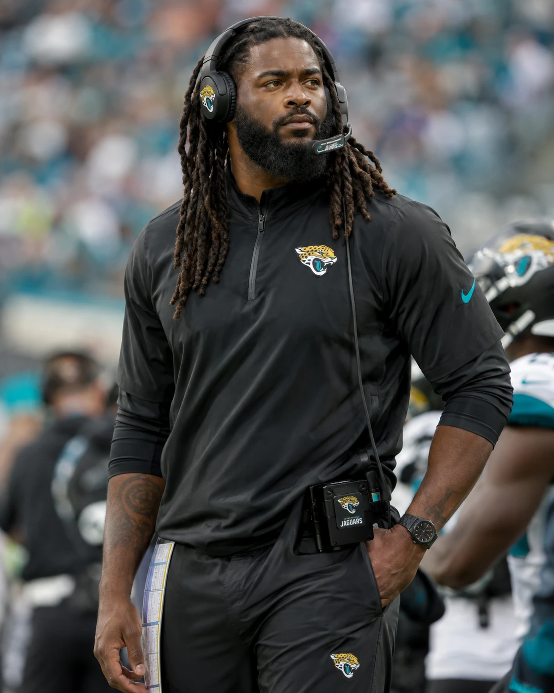

# Alex Stone

**Head coach · Jacksonville Jaguars · Age 51**

Born September 21, 1963, Miami, Florida · Tight end, University of Miami, 1982 to 1985 · Tight end, San Diego Chargers, 1986 to 1995

As of October 12, 2014, after Week 6.

## Career at a glance

| Current season | Career regular season | Career playoffs | Division standing |
|---|---|---|---|
| 4-2 | 26-12 | 2-2 | Second in the AFC South after Week 6 |

[Coaching philosophy](Coaching_Profile.md) · [Ownership review](Performance_Reviews.md) · [Current season](../2014/README.md)

## Job and contract

| Job | Head coach, Jacksonville Jaguars |
|---|---|
| Since | January 15, 2013 |
| Retained | January 15, 2014, on his existing contract |
| Employment decided by | Shad Khan and David Caldwell |
| Calls | The offense (since the 2013 season) and the defense (since September 28, 2014) |
| Contract | 2013 to 2016 |
| Ends | The later of January 31, 2017 or the day after Jacksonville's last game of the 2016 season |
| Remaining | 2014 (in progress), 2015 and 2016 |
| Salary | $2,800,000 a season |
| Guarantee | Every season guaranteed |

Signed on January 15, 2013: the length, the guarantee and the authority terms. Completed from the wording of Jacksonville's own 2010 assistant contracts: the end date. Completed from comparable head-coach contracts of the time: the salary, the offset, the dismissal terms, the signing bonus and the options. The research behind them: [head-coach contracts, 2005 to 2014](../../library/nfl_head_coach_contracts_2005_2014.md).

Every term, what is owed and any contact from another club: [Contract and jobs](Contract_and_Jobs.md).

## Record by season

Regular season and playoffs; preseason games are not counted.

| Season | Team | Job | Regular season | Pct | Division finish | Playoffs |
|---|---|---|---:|---:|---|---|
| 2014 (through Week 6) | Jacksonville | Head coach | 4-2 | .667 | Second in the AFC South after Week 6 | Season in progress |
| 2013 | Jacksonville | Head coach | 10-6 | .625 | Second in the AFC South | Won the Wild Card game at Kansas City, 38-14; lost the Divisional game at Tennessee, 20-13 |
| 2012 | New Orleans | Interim head coach | 12-4 | .750 | Second in the NFC South | Won the Wild Card game; lost in the Divisional round |
| Career |  |  | 26-12 | .684 |  | 2-2 in the playoffs |

## Awards

- 2013: Coach of the Year finalist; Rex Ryan of the New York Jets won.

## Career history

### Coaching

| Years | Club | Job | Work |
|---|---|---|---|
| 1996 to 1997 | University of Miami | Graduate assistant, offense | Offensive preparation and teaching during doctoral study |
| 1999 | Miami Dolphins | Offensive quality control / assistant quarterbacks | Opponent tendencies, quarterback room and weekly passing-game preparation under Jimmy Johnson |
| 2000 | University of San Diego | Offensive coordinator / quarterbacks | Called the offense under Kevin McGarry |
| 2001 | University of San Diego | Assistant head coach / offensive coordinator / quarterbacks | Called the offense; practice organization and game management |
| 2002 to 2004 | New England Patriots | Defensive coaching assistant | The secondary, under defensive backs coach Eric Mangini |
| 2005 to 2006 | New England Patriots | Tight ends coach | Position coaching |
| 2007 to 2008 | New England Patriots | Passing game coordinator / tight ends | Passing preparation and selected preseason calls; Josh McDaniels called the regular-season games |
| 2009 to 2010 | New Orleans Saints | Offensive coordinator | Weekly offensive planning; Sean Payton called the games |
| 2011 | New Orleans Saints | Offensive coordinator | Primary caller from Payton's Week 6 injury through the playoffs |
| 2012 | New Orleans Saints | Interim head coach and offensive coordinator | The whole team and the offensive calls from April 16, 2012, during Payton's suspension |
| 2013 to present | Jacksonville Jaguars | Head coach | Calls the offense (since the 2013 season) and the defense (since September 28, 2014) |

### Playing

| Years | Team | Position | Note |
|---|---|---|---|
| 1982 to 1985 | University of Miami | Tight end | On the 1983 national championship team |
| 1986 to 1995 | San Diego Chargers | Tight end | Played in Super Bowl XXIX, a 49-26 loss to San Francisco |

| NFL seasons | Games | Receptions | Yards | Touchdowns | Pro Bowls | First-team All-Pro |
|---:|---:|---:|---:|---:|---:|---:|
| 10 | 150 | 488 | 5,912 | 44 | 5 | 2 |

### Education

BS, University of Miami, 1986 · MBA, University of San Diego, 1996 · PhD, exercise physiology, University of Miami, 2002

## Coaching philosophy

Alex Stone is a head coach who enjoys an argument about football. He asks his quarterback which calls he trusts, listens when a receiver questions a route and gives an idea a hearing regardless of whose name is attached to it. He wants players to understand the offense well enough to contribute to it.

His meetings are relaxed and often funny. Practice moves quickly. He can tell a veteran that his technique is poor in front of the position group and have him and his family over for dinner that evening. He gets to know the people he coaches and stays involved when they are injured, struggling or losing playing time.

Stone calls his own offense. He favors Dagger, Mesh, play-action, screens, several useful backs and formations with multiple tight ends. He works closely with his coordinators, takes responsibility publicly and expects a much more specific conversation behind closed doors.

The full approach, in his own terms: [coaching profile](Coaching_Profile.md).

## Reviews

- **January 15, 2014.** Shad Khan and David Caldwell reviewed the 2013 season with him and retained him on his existing contract. David Caldwell's first 2014 measures: the scoring margin; the quarterback's ball security and protection. [Season review](../2013/season_review/owner_and_gm_review.md)

## Opportunities

None recorded: no rumor, call, permission request, interview request or offer from another club.

Every contact, and the rules on approaching a head coach under contract: [Contract and jobs](Contract_and_Jobs.md).
