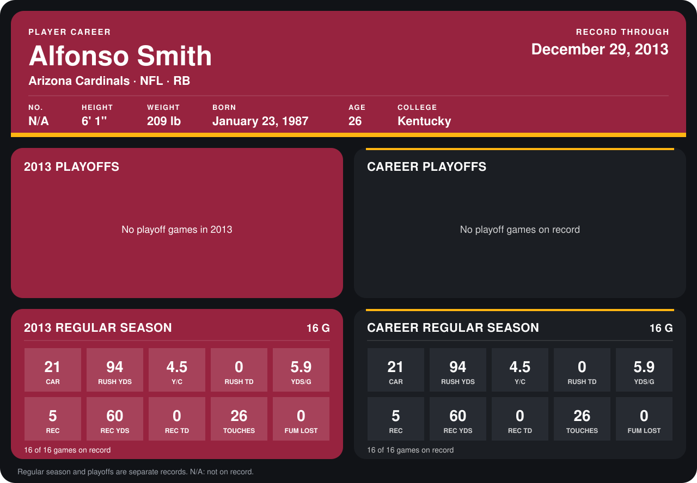

# Alfonso Smith

## Career stats

### Regular season

| Season | Club | G | CAR | RUSH YDS | Y/C | RUSH TD | YDS/G | REC | REC YDS | REC TD | TOUCHES | FUM LOST |
|---|---|---:|---:|---:|---:|---:|---:|---:|---:|---:|---:|---:|
| 2013 | Arizona Cardinals | 16 | 21 | 94 | 4.5 | 0 | 5.9 | 5 | 60 | 0 | 26 | 0 |
| **Career** |  | 16 | 21 | 94 | 4.5 | 0 | 5.9 | 5 | 60 | 0 | 26 | 0 |

### Playoffs

No playoff games on record.

## Awards

None on record.

Records through September 29, 2014. Identity: the public player file's latest listing (no 2014 Weeks 1-4 roster row). [All Arizona Cardinals players](README.md).
