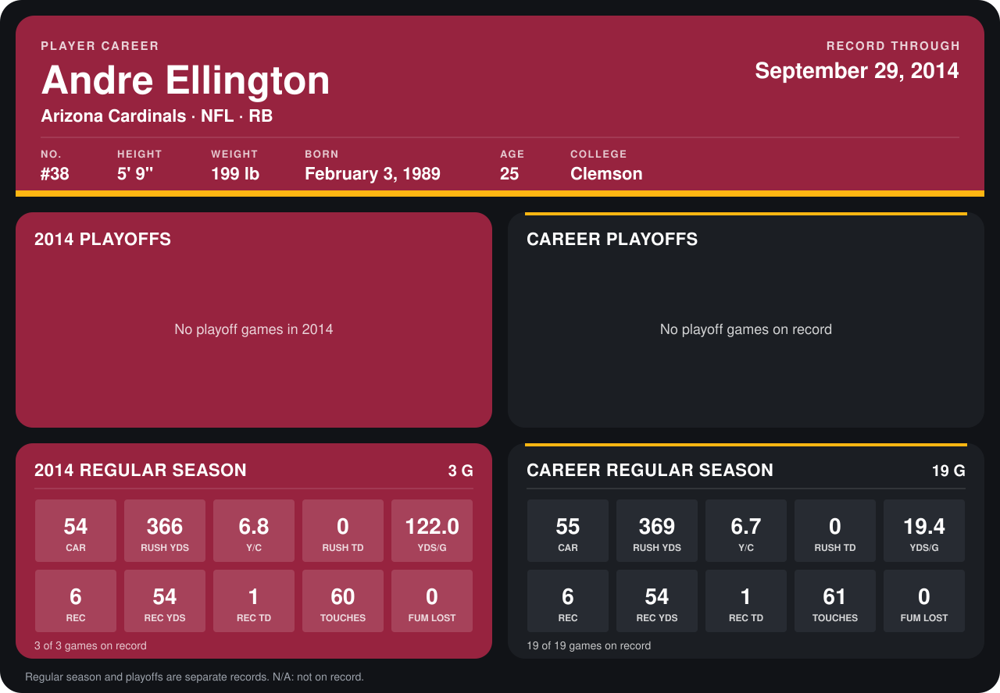

# Andre Ellington

## Career stats

### Regular season

| Season | Team | Age | # | G | CAR | RUSH YDS | Y/C | RUSH TD | YDS/G | REC | REC YDS | REC TD | TOUCHES | FUM LOST |
|---|---|---:|---:|---:|---:|---:|---:|---:|---:|---:|---:|---:|---:|---:|
| 2013 | Arizona Cardinals | 24 | 38 | 16 | 1 | 3 | 3.0 | 0 | 0.2 | 0 | 0 | 0 | 1 | 0 |
| 2014 | Arizona Cardinals | 25 | 38 | 3 | 54 | 366 | 6.8 | 0 | 122.0 | 6 | 54 | 1 | 60 | 0 |
| **Career** |  |  |  | 19 | 55 | 369 | 6.7 | 0 | 19.4 | 6 | 54 | 1 | 61 | 0 |

### Playoffs

No playoff games on record.

## Awards

None on record.

Age is his age on the league's opening game of each season; # is the number listed for him that season with that team (2014: the card's rule; 2013: the 2013 season roster), N/A where no listing applies.

Records through September 21, 2014. Identity: listed 2014 roster data, Weeks 1-4; number: 2014 Week 1 roster. [All Arizona Cardinals players](README.md).
