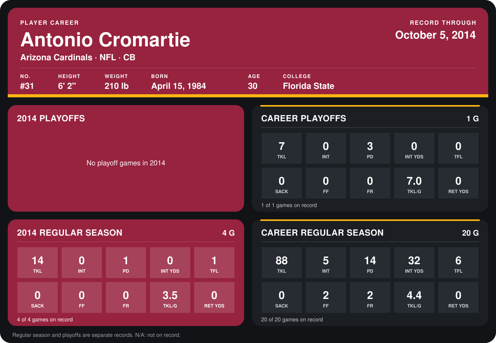

# Antonio Cromartie

## Career stats

### Regular season

| Season | Club | G | TKL | INT | PD | INT YDS | TFL | SACK | FF | FR | TKL/G | RET YDS |
|---|---|---:|---:|---:|---:|---:|---:|---:|---:|---:|---:|---:|
| 2013 | New York Jets | 16 | 74 | 5 | 13 | 32 | 5 | 0 | 2 | 2 | 4.6 | 0 |
| 2014 | Arizona Cardinals | 3 | 12 | 0 | 1 | 0 | 1 | 0 | 0 | 0 | 4.0 | 0 |
| **Career** |  | 19 | 86 | 5 | 14 | 32 | 6 | 0 | 2 | 2 | 4.5 | 0 |

### Playoffs

| Season | Club | G | TKL | INT | PD | INT YDS | TFL | SACK | FF | FR | TKL/G | RET YDS |
|---|---|---:|---:|---:|---:|---:|---:|---:|---:|---:|---:|---:|
| 2013 | New York Jets | 1 | 7 | 0 | 3 | 0 | 0 | 0 | 0 | 0 | 7.0 | 0 |
| **Career** |  | 1 | 7 | 0 | 3 | 0 | 0 | 0 | 0 | 0 | 7.0 | 0 |

## Awards

None on record.

Records through September 29, 2014. Identity: listed 2014 roster data, Weeks 1-4; number: 2014 Week 1 roster. [All Arizona Cardinals players](README.md).
