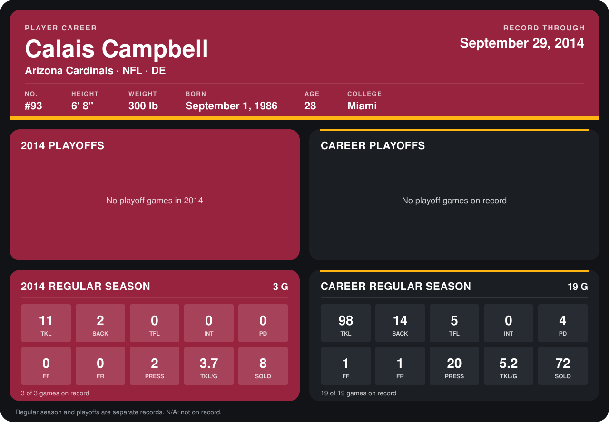

# Calais Campbell

## Career stats

### Regular season

| Season | Club | G | TKL | SACK | TFL | INT | PD | FF | FR | PRESS | TKL/G | SOLO |
|---|---|---:|---:|---:|---:|---:|---:|---:|---:|---:|---:|---:|
| 2013 | Arizona Cardinals | 16 | 87 | 12 | 5 | 0 | 4 | 1 | 1 | 18 | 5.4 | 64 |
| 2014 | Arizona Cardinals | 4 | 12 | 2 | 0 | 0 | 0 | 0 | 0 | 2 | 3.0 | 8 |
| **Career** |  | 20 | 99 | 14 | 5 | 0 | 4 | 1 | 1 | 20 | 5.0 | 72 |

### Playoffs

No playoff games on record.

## Awards

- AP Second-Team All-Pro (2013, DE)
- Pro Bowl selection (2013, DE)

Records through October 5, 2014. Identity: listed 2014 roster data, Weeks 1-4; number: 2014 Week 1 roster. [All Arizona Cardinals players](README.md).
