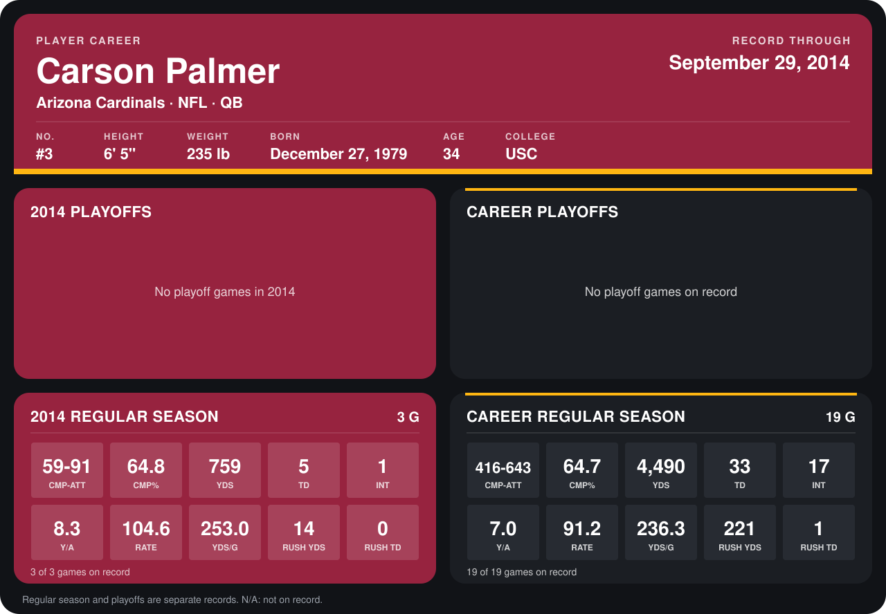

# Carson Palmer

## Career stats

### Regular season

| Season | Club | G | CMP-ATT | CMP% | YDS | TD | INT | Y/A | RATE | YDS/G | RUSH YDS | RUSH TD |
|---|---|---:|---:|---:|---:|---:|---:|---:|---:|---:|---:|---:|
| 2013 | Arizona Cardinals | 16 | 357-552 | 64.7 | 3,731 | 28 | 16 | 6.8 | 89.0 | 233.2 | 207 | 1 |
| 2014 | Arizona Cardinals | 4 | 82-121 | 67.8 | 1,017 | 7 | 1 | 8.4 | 109.4 | 254.2 | 47 | 0 |
| **Career** |  | 20 | 439-673 | 65.2 | 4,748 | 35 | 17 | 7.1 | 92.6 | 237.4 | 254 | 1 |

### Playoffs

No playoff games on record.

## Awards

None on record.

Records through October 5, 2014. Identity: listed 2014 roster data, Weeks 1-4; number: 2014 Week 1 roster. [All Arizona Cardinals players](README.md).
