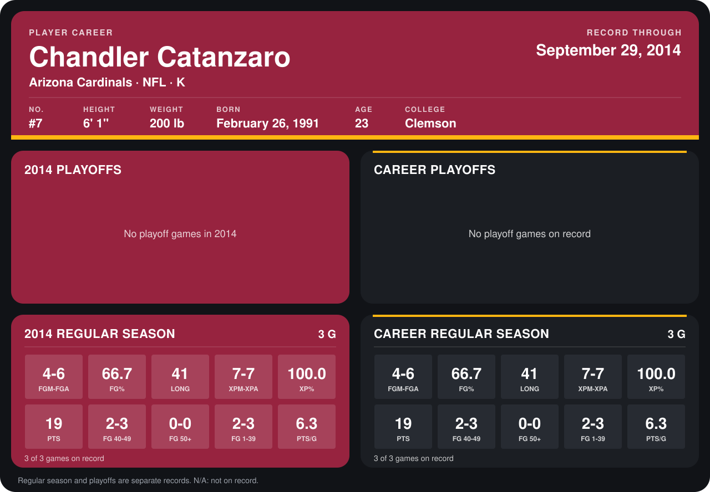

# Chandler Catanzaro

## Career stats

### Regular season

| Season | Team | Age | # | G | FGM-FGA | FG% | LONG | XPM-XPA | XP% | PTS | FG 40-49 | FG 50+ | FG 1-39 | PTS/G |
|---|---|---:|---:|---:|---:|---:|---:|---:|---:|---:|---:|---:|---:|---:|
| 2014 | Arizona Cardinals | 23 | 7 | 3 | 4-6 | 66.7 | 41 | 7-7 | 100.0 | 19 | 2-3 | 0-0 | 2-3 | 6.3 |
| **Career** |  |  |  | 3 | 4-6 | 66.7 | 41 | 7-7 | 100.0 | 19 | 2-3 | 0-0 | 2-3 | 6.3 |

### Playoffs

No playoff games on record.

## Awards

None on record.

Age is his age on the league's opening game of each season; # is the number listed for him that season with that team (2014: the card's rule; 2013: the 2013 season roster), N/A where no listing applies.

Records through September 21, 2014. Identity: listed 2014 roster data, Weeks 1-4; number: 2014 Week 1 roster. [All Arizona Cardinals players](README.md).
