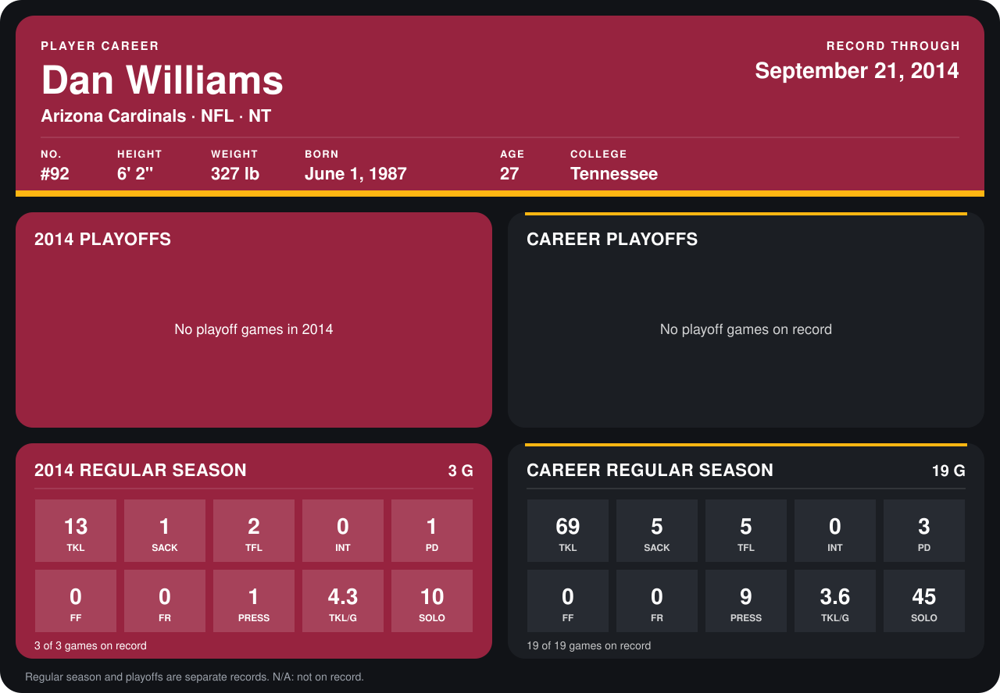

# Dan Williams

## Career stats

### Regular season

| Season | Club | G | TKL | SACK | TFL | INT | PD | FF | FR | PRESS | TKL/G | SOLO |
|---|---|---:|---:|---:|---:|---:|---:|---:|---:|---:|---:|---:|
| 2013 | Arizona Cardinals | 16 | 56 | 4 | 3 | 0 | 2 | 0 | 0 | 8 | 3.5 | 35 |
| 2014 | Arizona Cardinals | 4 | 16 | 2 | 2 | 0 | 1 | 0 | 0 | 3 | 4.0 | 12 |
| **Career** |  | 20 | 72 | 6 | 5 | 0 | 3 | 0 | 0 | 11 | 3.6 | 47 |

### Playoffs

No playoff games on record.

## Awards

None on record.

Records through October 5, 2014. Identity: listed 2014 roster data, Weeks 1-4; number: 2014 Week 1 roster. [All Arizona Cardinals players](README.md).
