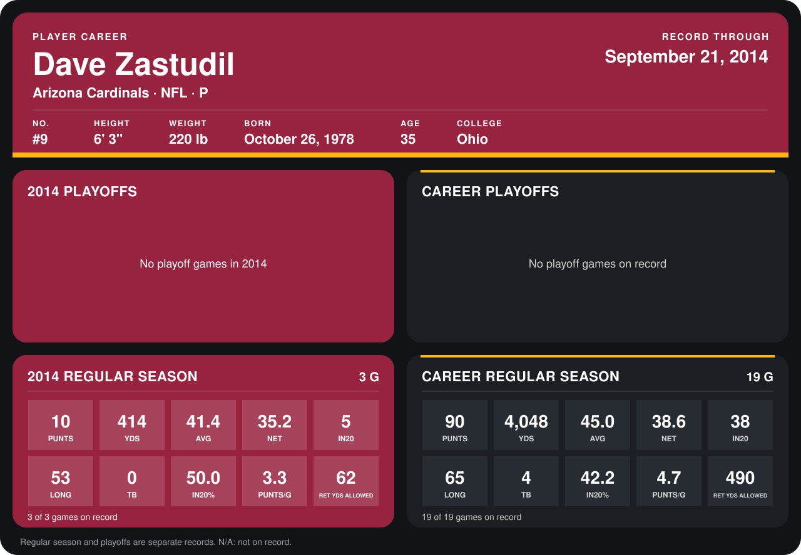

# Dave Zastudil

## Career stats

### Regular season

| Season | Team | Age | # | G | PUNTS | YDS | AVG | NET | IN20 | LONG | TB | IN20% | PUNTS/G | RET YDS ALLOWED |
|---|---|---:|---:|---:|---:|---:|---:|---:|---:|---:|---:|---:|---:|---:|
| 2013 | Arizona Cardinals | 34 | 9 | 16 | 80 | 3,634 | 45.4 | 39.1 | 33 | 65 | 4 | 41.2 | 5.0 | 428 |
| 2014 | Arizona Cardinals | 35 | 9 | 3 | 10 | 414 | 41.4 | 35.2 | 5 | 53 | 0 | 50.0 | 3.3 | 62 |
| **Career** |  |  |  | 19 | 90 | 4,048 | 45.0 | 38.6 | 38 | 65 | 4 | 42.2 | 4.7 | 490 |

### Playoffs

No playoff games on record.

## Awards

- NFC Special Teams Player of the Week (2013, Week 14)

Age is his age on the league's opening game of each season; # is the number listed for him that season with that team (2014: the card's rule; 2013: the 2013 season roster), N/A where no listing applies.

Records through September 21, 2014. Identity: listed 2014 roster data, Weeks 1-4; number: 2014 Week 1 roster. [All Arizona Cardinals players](README.md).
