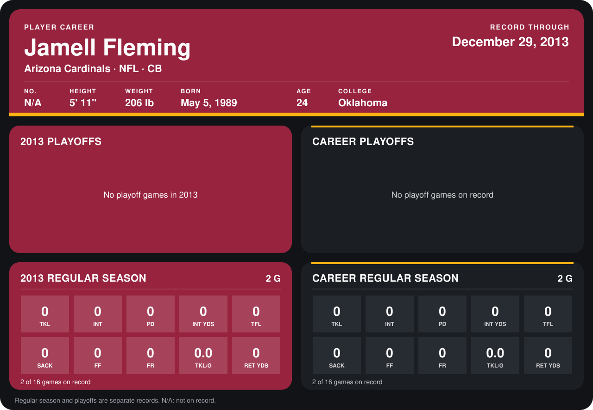

# Jamell Fleming

## Career stats

### Regular season

| Season | Club | G | TKL | INT | PD | INT YDS | TFL | SACK | FF | FR | TKL/G | RET YDS |
|---|---|---:|---:|---:|---:|---:|---:|---:|---:|---:|---:|---:|
| 2013 | Arizona Cardinals | 2 | 0 | 0 | 0 | 0 | 0 | 0 | 0 | 0 | 0.0 | 0 |
| **Career** |  | 2 | 0 | 0 | 0 | 0 | 0 | 0 | 0 | 0 | 0.0 | 0 |

### Playoffs

No playoff games on record.

## Awards

None on record.

Records through September 29, 2014. Identity: listed 2014 roster data, Weeks 1-4. [All Arizona Cardinals players](README.md).
