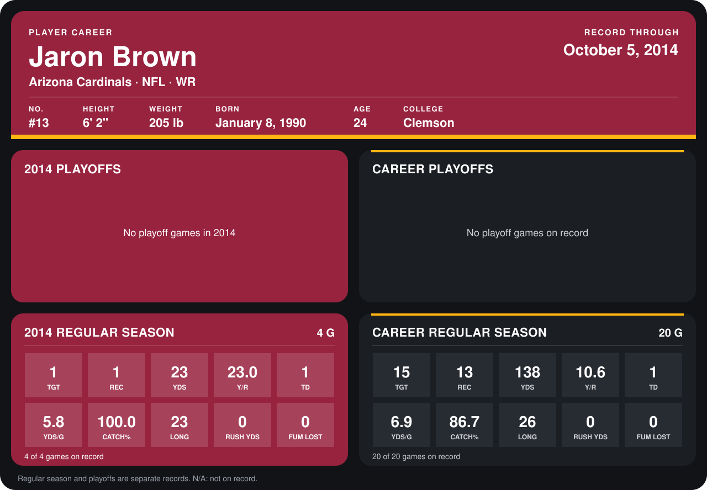

# Jaron Brown

## Career stats

### Regular season

| Season | Club | G | TGT | REC | YDS | Y/R | TD | YDS/G | CATCH% | LONG | RUSH YDS | FUM LOST |
|---|---|---:|---:|---:|---:|---:|---:|---:|---:|---:|---:|---:|
| 2013 | Arizona Cardinals | 16 | 14 | 12 | 115 | 9.6 | 0 | 7.2 | 85.7 | 26 | 0 | 0 |
| 2014 | Arizona Cardinals | 3 | 0 | 0 | 0 | N/A | 0 | 0.0 | N/A | N/A | 0 | 0 |
| **Career** |  | 19 | 14 | 12 | 115 | 9.6 | 0 | 6.1 | 85.7 | 26 | 0 | 0 |

### Playoffs

No playoff games on record.

## Awards

None on record.

Records through September 21, 2014. Identity: listed 2014 roster data, Weeks 1-4; number: 2014 Week 1 roster. [All Arizona Cardinals players](README.md).
