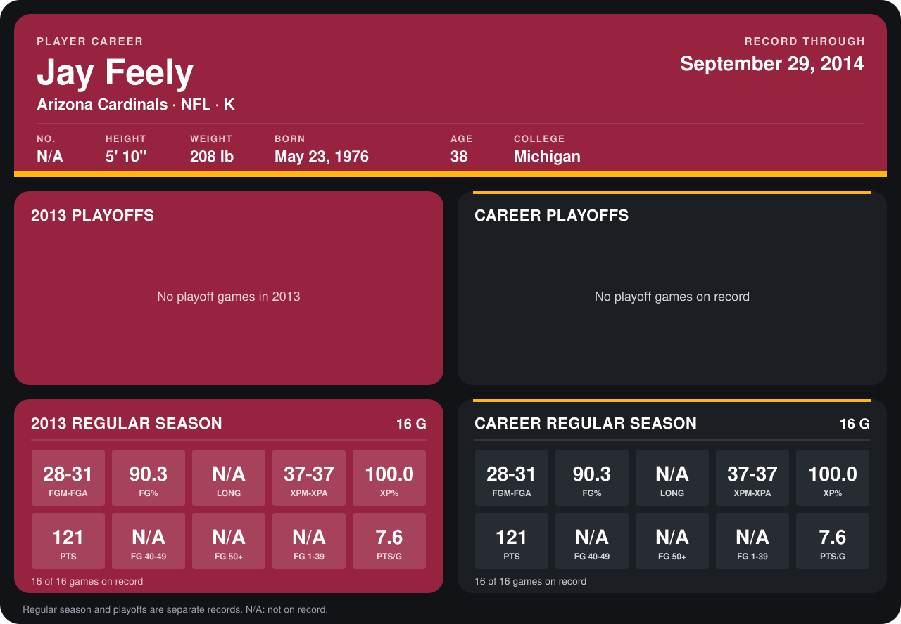

# Jay Feely

## Career stats

### Regular season

| Season | Club | G | FGM-FGA | FG% | LONG | XPM-XPA | XP% | PTS | FG 40-49 | FG 50+ | FG 1-39 | PTS/G |
|---|---|---:|---:|---:|---:|---:|---:|---:|---:|---:|---:|---:|
| 2013 | Arizona Cardinals | 16 | 28-31 | 90.3 | N/A | 37-37 | 100.0 | 121 | N/A | N/A | N/A | 7.6 |
| **Career** |  | 16 | 28-31 | 90.3 | N/A | 37-37 | 100.0 | 121 | N/A | N/A | N/A | 7.6 |

### Playoffs

No playoff games on record.

## Awards

None on record.

Records through September 29, 2014. Identity: the public player file's latest listing (no 2014 Weeks 1-4 roster row). [All Arizona Cardinals players](README.md).
