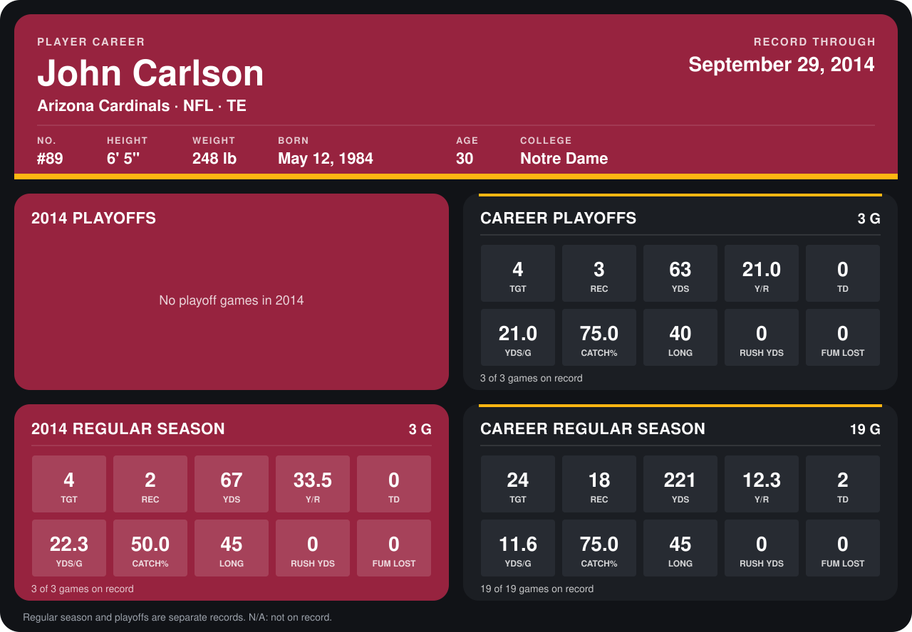

# John Carlson

## Career stats

### Regular season

| Season | Team | Age | # | G | TGT | REC | YDS | Y/R | TD | YDS/G | CATCH% | LONG | RUSH YDS | FUM LOST |
|---|---|---:|---:|---:|---:|---:|---:|---:|---:|---:|---:|---:|---:|---:|
| 2013 | Minnesota Vikings | 29 | 89 | 16 | 20 | 16 | 154 | 9.6 | 2 | 9.6 | 80.0 | 25 | 0 | 0 |
| 2014 | Arizona Cardinals | 30 | 89 | 3 | 4 | 2 | 67 | 33.5 | 0 | 22.3 | 50.0 | 45 | 0 | 0 |
| **Career** |  |  |  | 19 | 24 | 18 | 221 | 12.3 | 2 | 11.6 | 75.0 | 45 | 0 | 0 |

### Playoffs

| Season | Team | Age | # | G | TGT | REC | YDS | Y/R | TD | YDS/G | CATCH% | LONG | RUSH YDS | FUM LOST |
|---|---|---:|---:|---:|---:|---:|---:|---:|---:|---:|---:|---:|---:|---:|
| 2013 | Minnesota Vikings | 29 | 89 | 3 | 4 | 3 | 63 | 21.0 | 0 | 21.0 | 75.0 | 40 | 0 | 0 |
| **Career** |  |  |  | 3 | 4 | 3 | 63 | 21.0 | 0 | 21.0 | 75.0 | 40 | 0 | 0 |

## Awards

None on record.

Age is his age on the league's opening game of each season; # is the number listed for him that season with that team (2014: the card's rule; 2013: the 2013 season roster), N/A where no listing applies.

Records through September 21, 2014. Identity: listed 2014 roster data, Weeks 1-4; number: 2014 Week 1 roster. [All Arizona Cardinals players](README.md).
