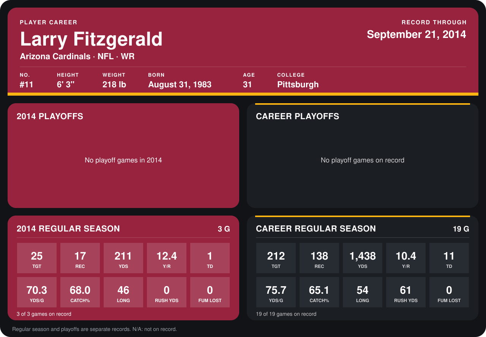

# Larry Fitzgerald

## Career stats

### Regular season

| Season | Team | Age | # | G | TGT | REC | YDS | Y/R | TD | YDS/G | CATCH% | LONG | RUSH YDS | FUM LOST |
|---|---|---:|---:|---:|---:|---:|---:|---:|---:|---:|---:|---:|---:|---:|
| 2013 | Arizona Cardinals | 30 | 11 | 16 | 187 | 121 | 1,227 | 10.1 | 10 | 76.7 | 64.7 | 54 | 61 | 0 |
| 2014 | Arizona Cardinals | 31 | 11 | 3 | 25 | 17 | 211 | 12.4 | 1 | 70.3 | 68.0 | 46 | 0 | 0 |
| **Career** |  |  |  | 19 | 212 | 138 | 1,438 | 10.4 | 11 | 75.7 | 65.1 | 54 | 61 | 0 |

### Playoffs

No playoff games on record.

## Awards

- AP First-Team All-Pro (2013, WR)
- Pro Bowl selection (2013, WR)

Age is his age on the league's opening game of each season; # is the number listed for him that season with that team (2014: the card's rule; 2013: the 2013 season roster), N/A where no listing applies.

Records through September 21, 2014. Identity: listed 2014 roster data, Weeks 1-4; number: 2014 Week 1 roster. [All Arizona Cardinals players](README.md).
