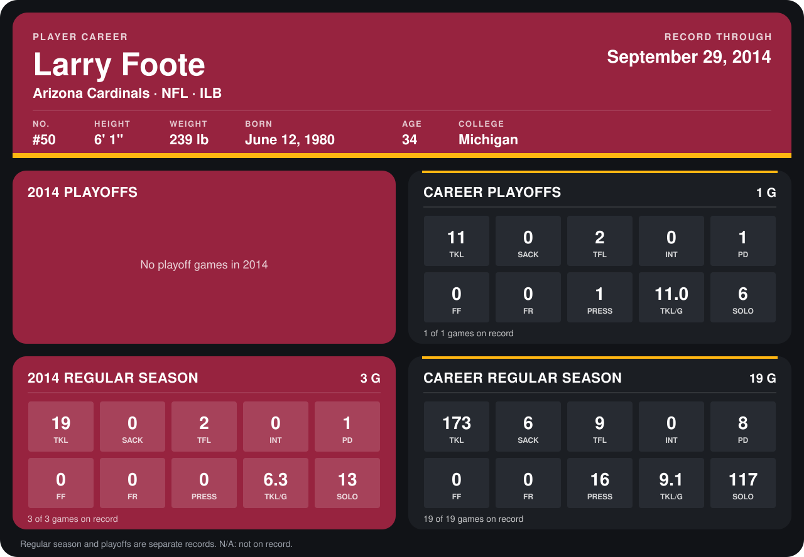

# Larry Foote

## Career stats

### Regular season

| Season | Club | G | TKL | SACK | TFL | INT | PD | FF | FR | PRESS | TKL/G | SOLO |
|---|---|---:|---:|---:|---:|---:|---:|---:|---:|---:|---:|---:|
| 2013 | Pittsburgh Steelers | 16 | 154 | 6 | 7 | 0 | 7 | 0 | 0 | 16 | 9.6 | 104 |
| 2014 | Arizona Cardinals | 3 | 19 | 0 | 2 | 0 | 1 | 0 | 0 | 0 | 6.3 | 13 |
| **Career** |  | 19 | 173 | 6 | 9 | 0 | 8 | 0 | 0 | 16 | 9.1 | 117 |

### Playoffs

| Season | Club | G | TKL | SACK | TFL | INT | PD | FF | FR | PRESS | TKL/G | SOLO |
|---|---|---:|---:|---:|---:|---:|---:|---:|---:|---:|---:|---:|
| 2013 | Pittsburgh Steelers | 1 | 11 | 0 | 2 | 0 | 1 | 0 | 0 | 1 | 11.0 | 6 |
| **Career** |  | 1 | 11 | 0 | 2 | 0 | 1 | 0 | 0 | 1 | 11.0 | 6 |

## Awards

None on record.

Records through September 29, 2014. Identity: listed 2014 roster data, Weeks 1-4; number: 2014 Week 1 roster. [All Arizona Cardinals players](README.md).
