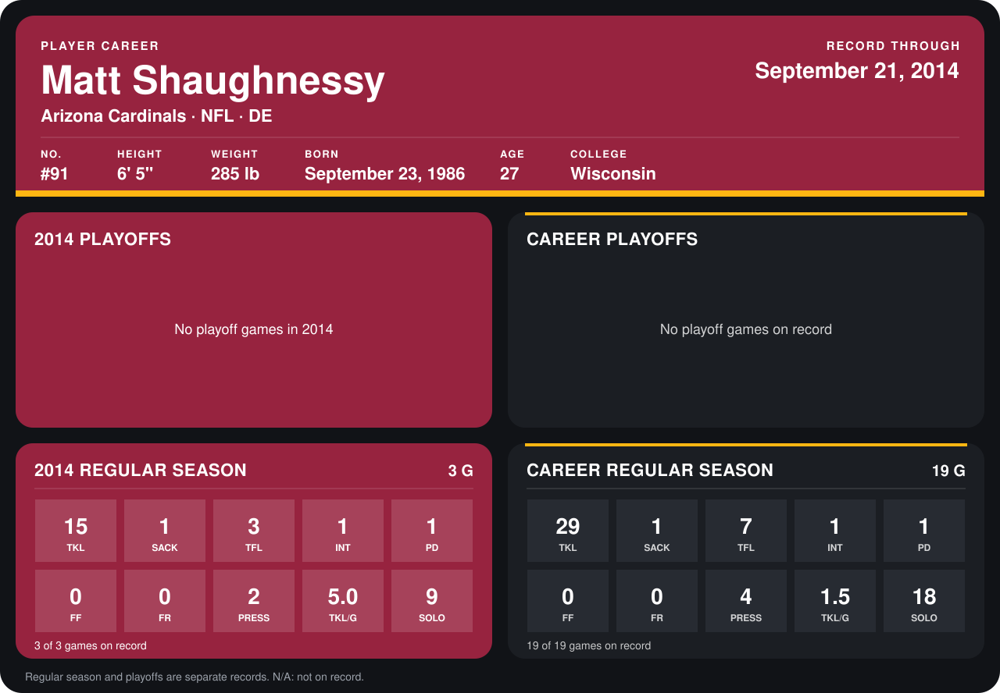

# Matt Shaughnessy

## Career stats

### Regular season

| Season | Team | Age | # | G | TKL | SACK | TFL | INT | PD | FF | FR | PRESS | TKL/G | SOLO |
|---|---|---:|---:|---:|---:|---:|---:|---:|---:|---:|---:|---:|---:|---:|
| 2013 | Arizona Cardinals | 26 | 91 | 16 | 14 | 0 | 4 | 0 | 0 | 0 | 0 | 2 | 0.9 | 9 |
| 2014 | Arizona Cardinals | 27 | 91 | 4 | 23 | 1 | 3 | 1 | 2 | 0 | 0 | 3 | 5.8 | 16 |
| **Career** |  |  |  | 20 | 37 | 1 | 7 | 1 | 2 | 0 | 0 | 5 | 1.9 | 25 |

### Playoffs

No playoff games on record.

## Awards

- NFC Defensive Player of the Week (2014, Week 3)

Age is his age on the league's opening game of each season; # is the number listed for him that season with that team (2014: the card's rule; 2013: the 2013 season roster), N/A where no listing applies.

Records through October 5, 2014. Identity: listed 2014 roster data, Weeks 1-4; number: 2014 Week 1 roster. [All Arizona Cardinals players](README.md).
