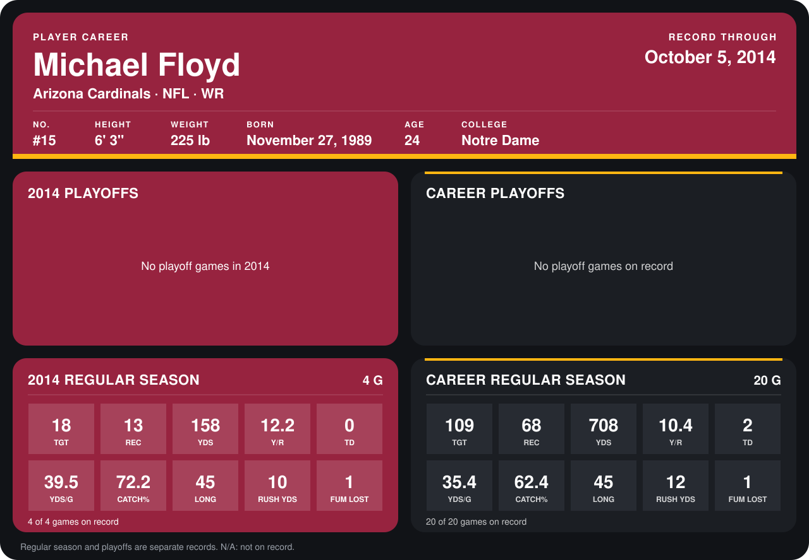

# Michael Floyd

## Career stats

### Regular season

| Season | Club | G | TGT | REC | YDS | Y/R | TD | YDS/G | CATCH% | LONG | RUSH YDS | FUM LOST |
|---|---|---:|---:|---:|---:|---:|---:|---:|---:|---:|---:|---:|
| 2013 | Arizona Cardinals | 16 | 91 | 55 | 550 | 10.0 | 2 | 34.4 | 60.4 | 40 | 2 | 0 |
| 2014 | Arizona Cardinals | 3 | 15 | 10 | 138 | 13.8 | 0 | 46.0 | 66.7 | 45 | 10 | 1 |
| **Career** |  | 19 | 106 | 65 | 688 | 10.6 | 2 | 36.2 | 61.3 | 45 | 12 | 1 |

### Playoffs

No playoff games on record.

## Awards

None on record.

Records through September 21, 2014. Identity: listed 2014 roster data, Weeks 1-4; number: 2014 Week 1 roster. [All Arizona Cardinals players](README.md).
