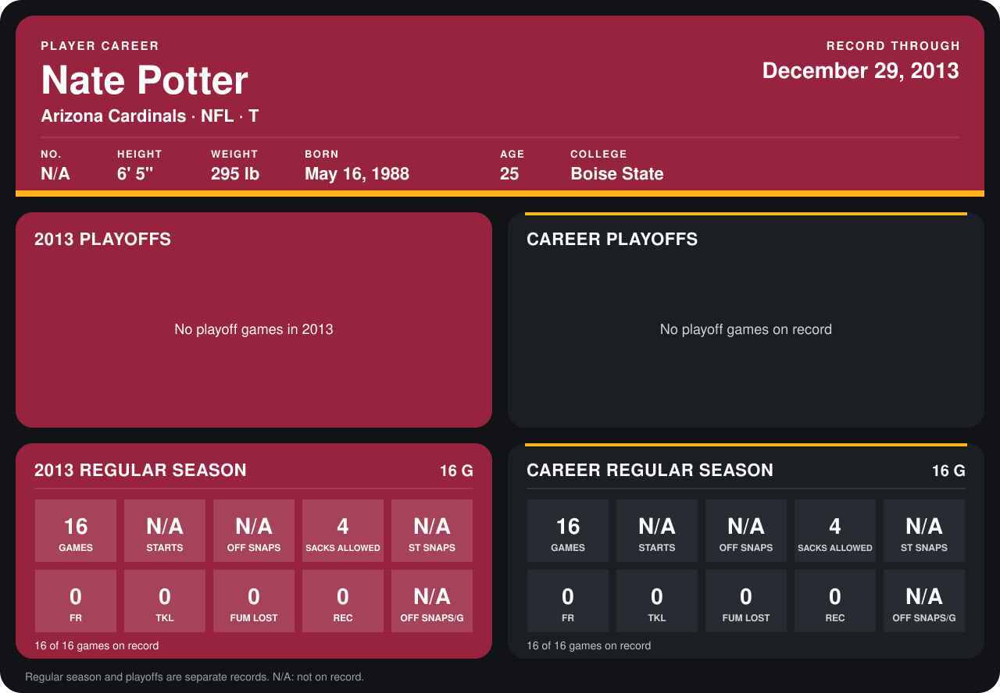

# Nate Potter

## Career stats

### Regular season

| Season | Club | G | STARTS | OFF SNAPS | SACKS ALLOWED | ST SNAPS | FR | TKL | FUM LOST | REC | OFF SNAPS/G |
|---|---|---:|---:|---:|---:|---:|---:|---:|---:|---:|---:|
| 2013 | Arizona Cardinals | 16 | N/A | N/A | 4 | N/A | 0 | 0 | 0 | 0 | N/A |
| **Career** |  | 16 | N/A | N/A | 4 | N/A | 0 | 0 | 0 | 0 | N/A |

### Playoffs

No playoff games on record.

## Awards

None on record.

Records through September 29, 2014. Identity: the public player file's latest listing (no 2014 Weeks 1-4 roster row). [All Arizona Cardinals players](README.md).
