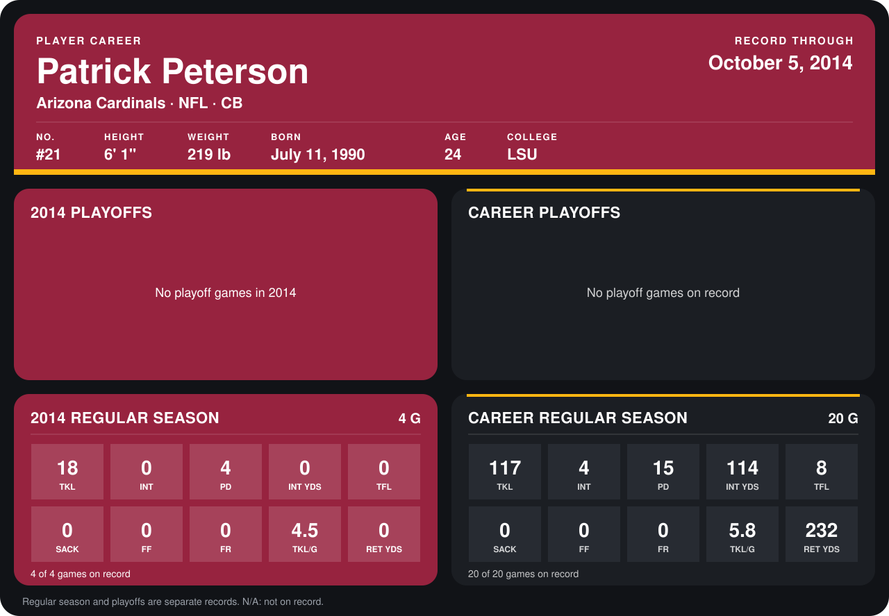

# Patrick Peterson

## Career stats

### Regular season

| Season | Team | Age | # | G | TKL | INT | PD | INT YDS | TFL | SACK | FF | FR | TKL/G | RET YDS |
|---|---|---:|---:|---:|---:|---:|---:|---:|---:|---:|---:|---:|---:|---:|
| 2013 | Arizona Cardinals | 23 | 21 | 16 | 99 | 4 | 11 | 114 | 8 | 0 | 0 | 0 | 6.2 | 232 |
| 2014 | Arizona Cardinals | 24 | 21 | 3 | 16 | 0 | 3 | 0 | 0 | 0 | 0 | 0 | 5.3 | 0 |
| **Career** |  |  |  | 19 | 115 | 4 | 14 | 114 | 8 | 0 | 0 | 0 | 6.1 | 232 |

### Playoffs

No playoff games on record.

## Awards

- Pro Bowl selection, replacement (2013, CB)

Age is his age on the league's opening game of each season; # is the number listed for him that season with that team (2014: the card's rule; 2013: the 2013 season roster), N/A where no listing applies.

Records through September 21, 2014. Identity: listed 2014 roster data, Weeks 1-4; number: 2014 Week 1 roster. [All Arizona Cardinals players](README.md).
