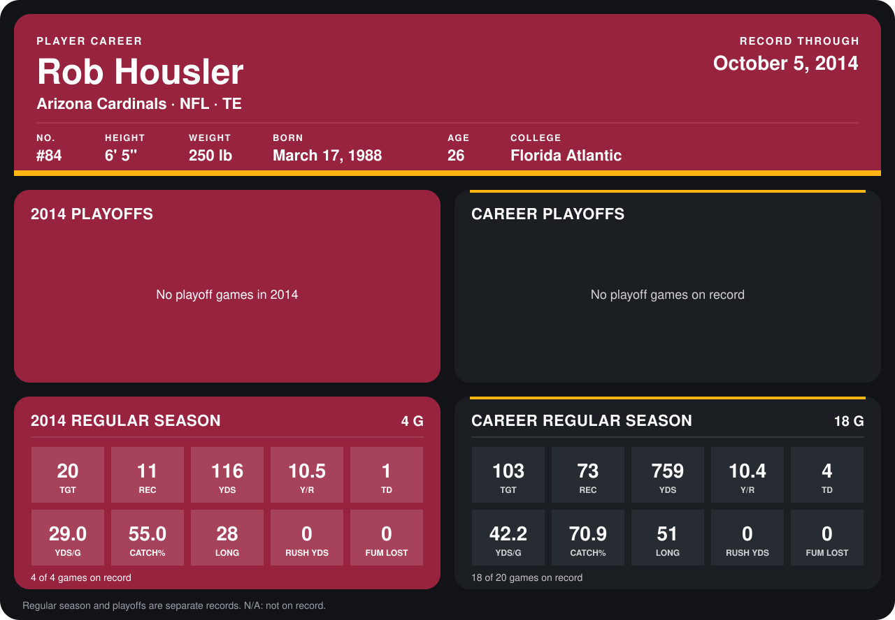

# Rob Housler

## Career stats

### Regular season

| Season | Club | G | TGT | REC | YDS | Y/R | TD | YDS/G | CATCH% | LONG | RUSH YDS | FUM LOST |
|---|---|---:|---:|---:|---:|---:|---:|---:|---:|---:|---:|---:|
| 2013 | Arizona Cardinals | 14 | 83 | 62 | 643 | 10.4 | 3 | 45.9 | 74.7 | 51 | 0 | 0 |
| 2014 | Arizona Cardinals | 3 | 15 | 7 | 86 | 12.3 | 1 | 28.7 | 46.7 | 28 | 0 | 0 |
| **Career** |  | 17 | 98 | 69 | 729 | 10.6 | 4 | 42.9 | 70.4 | 51 | 0 | 0 |

### Playoffs

No playoff games on record.

## Awards

None on record.

Records through September 21, 2014. Identity: listed 2014 roster data, Weeks 1-4; number: 2014 Week 1 roster. [All Arizona Cardinals players](README.md).
