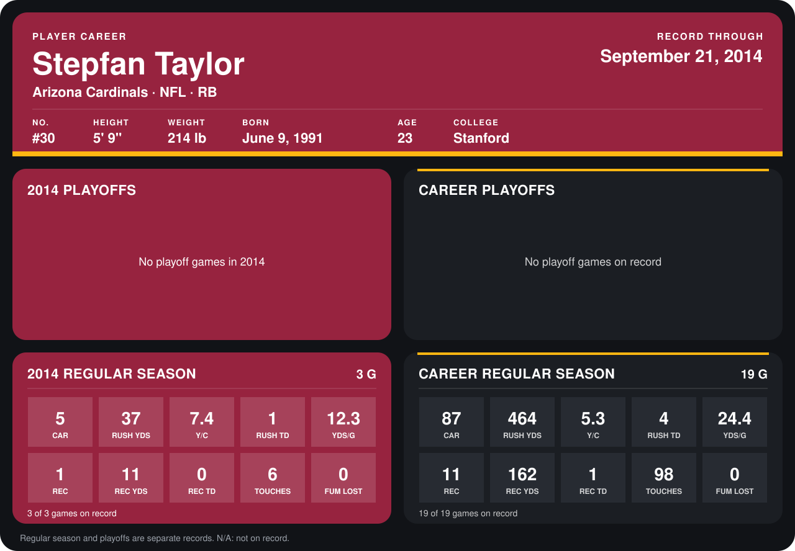

# Stepfan Taylor

## Career stats

### Regular season

| Season | Team | Age | # | G | CAR | RUSH YDS | Y/C | RUSH TD | YDS/G | REC | REC YDS | REC TD | TOUCHES | FUM LOST |
|---|---|---:|---:|---:|---:|---:|---:|---:|---:|---:|---:|---:|---:|---:|
| 2013 | Arizona Cardinals | 22 | 30 | 16 | 82 | 427 | 5.2 | 3 | 26.7 | 10 | 151 | 1 | 92 | 0 |
| 2014 | Arizona Cardinals | 23 | 30 | 3 | 5 | 37 | 7.4 | 1 | 12.3 | 1 | 11 | 0 | 6 | 0 |
| **Career** |  |  |  | 19 | 87 | 464 | 5.3 | 4 | 24.4 | 11 | 162 | 1 | 98 | 0 |

### Playoffs

No playoff games on record.

## Awards

None on record.

Age is his age on the league's opening game of each season; # is the number listed for him that season with that team (2014: the card's rule; 2013: the 2013 season roster), N/A where no listing applies.

Records through September 21, 2014. Identity: listed 2014 roster data, Weeks 1-4; number: 2014 Week 1 roster. [All Arizona Cardinals players](README.md).
