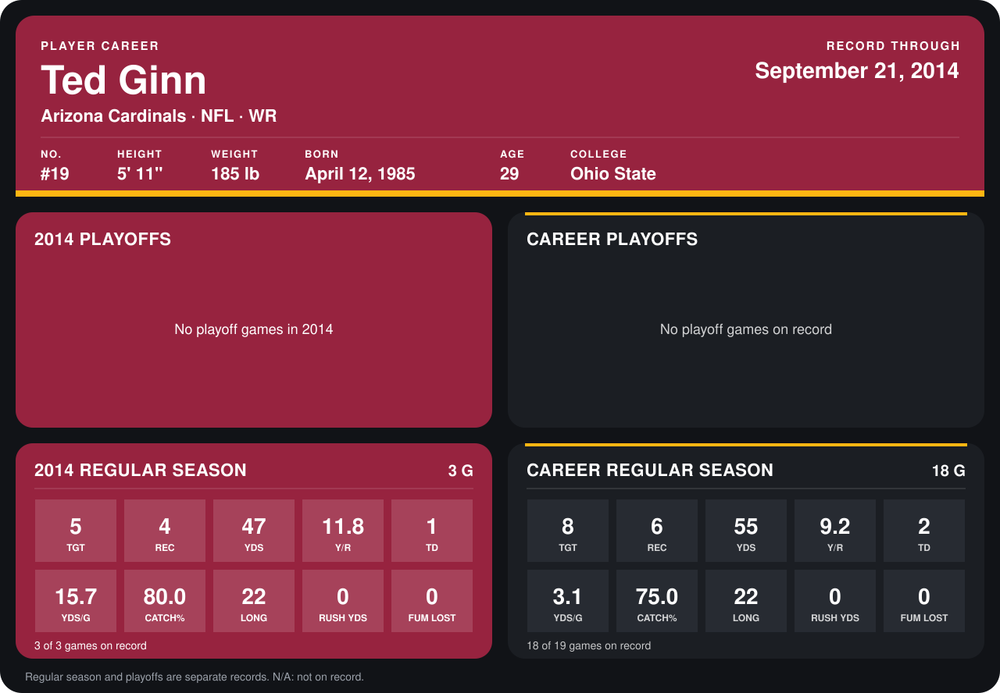

# Ted Ginn

## Career stats

### Regular season

| Season | Club | G | TGT | REC | YDS | Y/R | TD | YDS/G | CATCH% | LONG | RUSH YDS | FUM LOST |
|---|---|---:|---:|---:|---:|---:|---:|---:|---:|---:|---:|---:|
| 2013 | Carolina Panthers | 15 | 3 | 2 | 8 | 4.0 | 1 | 0.5 | 66.7 | 8 | 0 | 0 |
| 2014 | Arizona Cardinals | 4 | 6 | 5 | 55 | 11.0 | 1 | 13.8 | 83.3 | 22 | 0 | 0 |
| **Career** |  | 19 | 9 | 7 | 63 | 9.0 | 2 | 3.3 | 77.8 | 22 | 0 | 0 |

### Playoffs

No playoff games on record.

## Awards

None on record.

Records through October 5, 2014. Identity: listed 2014 roster data, Weeks 1-4; number: 2014 Week 1 roster. [All Arizona Cardinals players](README.md).
