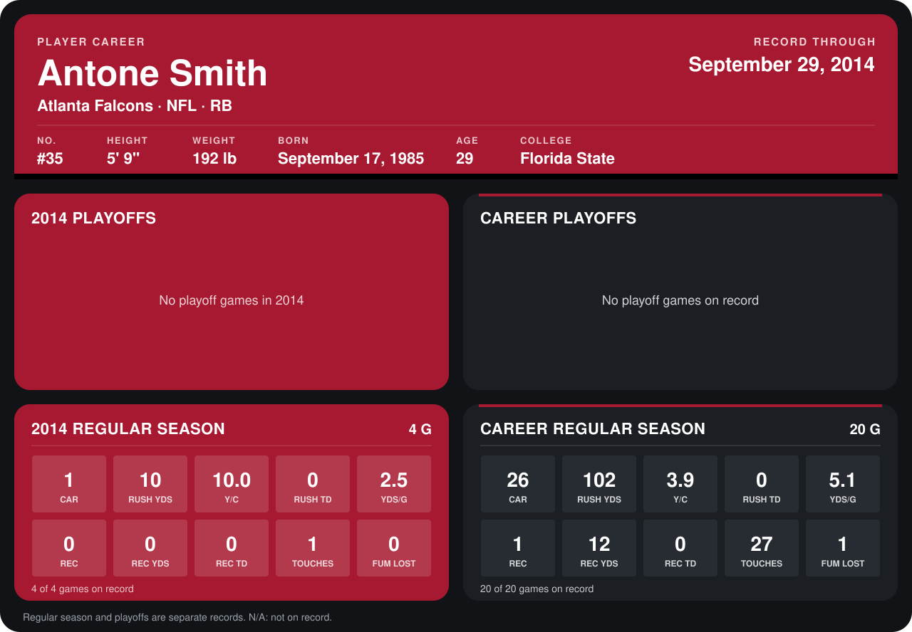

# Antone Smith

## Career stats

### Regular season

| Season | Team | Age | # | G | CAR | RUSH YDS | Y/C | RUSH TD | YDS/G | REC | REC YDS | REC TD | TOUCHES | FUM LOST |
|---|---|---:|---:|---:|---:|---:|---:|---:|---:|---:|---:|---:|---:|---:|
| 2013 | Atlanta Falcons | 27 | 35 | 16 | 25 | 92 | 3.7 | 0 | 5.8 | 1 | 12 | 0 | 26 | 1 |
| 2014 | Atlanta Falcons | 28 | 35 | 5 | 1 | 10 | 10.0 | 0 | 2.0 | 0 | 0 | 0 | 1 | 0 |
| **Career** |  |  |  | 21 | 26 | 102 | 3.9 | 0 | 4.9 | 1 | 12 | 0 | 27 | 1 |

### Playoffs

No playoff games on record.

## Awards

None on record.

Age is his age on the league's opening game of each season; # is the number listed for him that season with that team (2014: the card's rule; 2013: the 2013 season roster), N/A where no listing applies.

Records through October 5, 2014. Identity: listed 2014 roster data, Weeks 1-4; number: 2014 Week 1 roster. [All Atlanta Falcons players](README.md).
