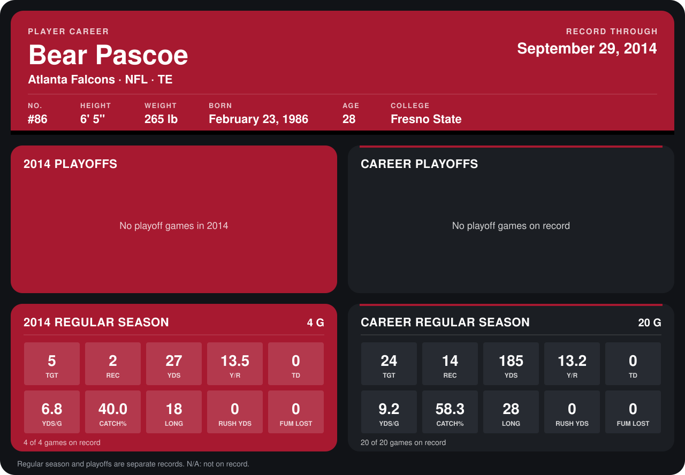

# Bear Pascoe

## Career stats

### Regular season

| Season | Club | G | TGT | REC | YDS | Y/R | TD | YDS/G | CATCH% | LONG | RUSH YDS | FUM LOST |
|---|---|---:|---:|---:|---:|---:|---:|---:|---:|---:|---:|---:|
| 2013 | New York Giants | 16 | 19 | 12 | 158 | 13.2 | 0 | 9.9 | 63.2 | 28 | 0 | 0 |
| 2014 | Atlanta Falcons | 4 | 5 | 2 | 27 | 13.5 | 0 | 6.8 | 40.0 | 18 | 0 | 0 |
| **Career** |  | 20 | 24 | 14 | 185 | 13.2 | 0 | 9.2 | 58.3 | 28 | 0 | 0 |

### Playoffs

No playoff games on record.

## Awards

None on record.

Records through September 28, 2014. Identity: listed 2014 roster data, Weeks 1-4; number: 2014 Week 1 roster. [All Atlanta Falcons players](README.md).
