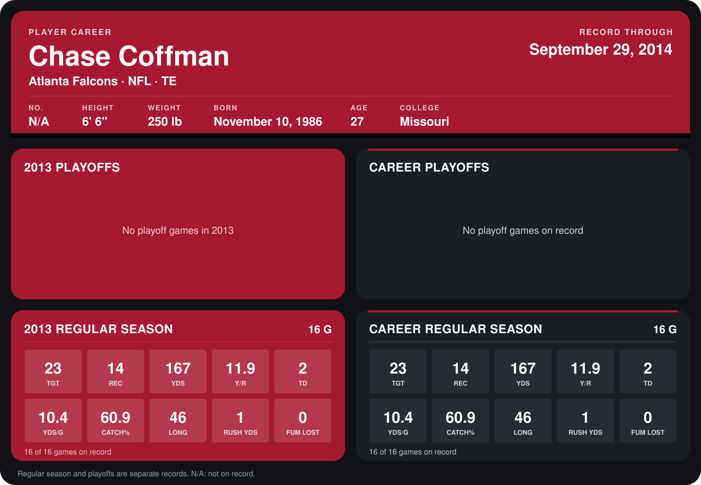

# Chase Coffman

## Career stats

### Regular season

| Season | Club | G | TGT | REC | YDS | Y/R | TD | YDS/G | CATCH% | LONG | RUSH YDS | FUM LOST |
|---|---|---:|---:|---:|---:|---:|---:|---:|---:|---:|---:|---:|
| 2013 | Atlanta Falcons | 16 | 23 | 14 | 167 | 11.9 | 2 | 10.4 | 60.9 | 46 | 1 | 0 |
| **Career** |  | 16 | 23 | 14 | 167 | 11.9 | 2 | 10.4 | 60.9 | 46 | 1 | 0 |

### Playoffs

No playoff games on record.

## Awards

None on record.

Records through September 29, 2014. Identity: listed 2014 roster data, Weeks 1-4. [All Atlanta Falcons players](README.md).
