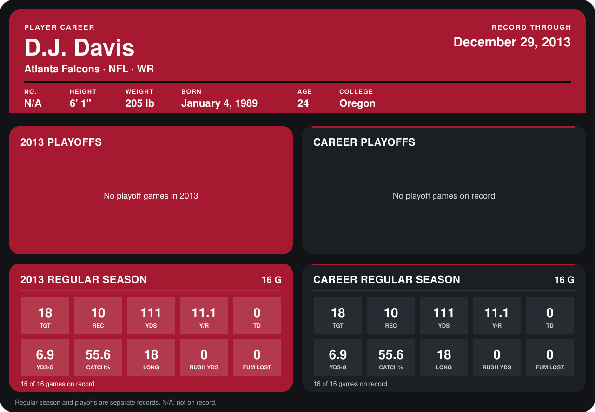

# D.J. Davis

## Career stats

### Regular season

| Season | Club | G | TGT | REC | YDS | Y/R | TD | YDS/G | CATCH% | LONG | RUSH YDS | FUM LOST |
|---|---|---:|---:|---:|---:|---:|---:|---:|---:|---:|---:|---:|
| 2013 | Atlanta Falcons | 16 | 18 | 10 | 111 | 11.1 | 0 | 6.9 | 55.6 | 18 | 0 | 0 |
| **Career** |  | 16 | 18 | 10 | 111 | 11.1 | 0 | 6.9 | 55.6 | 18 | 0 | 0 |

### Playoffs

No playoff games on record.

## Awards

None on record.

Records through September 29, 2014. Identity: the public player file's latest listing (no 2014 Weeks 1-4 roster row). [All Atlanta Falcons players](README.md).
