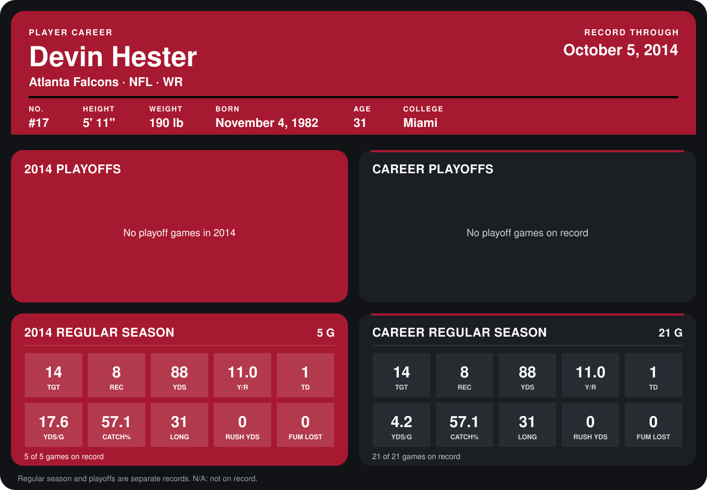

# Devin Hester

## Career stats

### Regular season

| Season | Team | Age | # | G | TGT | REC | YDS | Y/R | TD | YDS/G | CATCH% | LONG | RUSH YDS | FUM LOST |
|---|---|---:|---:|---:|---:|---:|---:|---:|---:|---:|---:|---:|---:|---:|
| 2013 | Chicago Bears | 30 | 23 | 16 | 0 | 0 | 0 | N/A | 0 | 0.0 | N/A | N/A | 0 | 0 |
| 2014 | Atlanta Falcons | 31 | 17 | 4 | 12 | 6 | 45 | 7.5 | 0 | 11.2 | 50.0 | 17 | 0 | 0 |
| **Career** |  |  |  | 20 | 12 | 6 | 45 | 7.5 | 0 | 2.2 | 50.0 | 17 | 0 | 0 |

### Playoffs

No playoff games on record.

## Awards

None on record.

Age is his age on the league's opening game of each season; # is the number listed for him that season with that team (2014: the card's rule; 2013: the 2013 season roster), N/A where no listing applies.

Records through September 28, 2014. Identity: listed 2014 roster data, Weeks 1-4; number: 2014 Week 1 roster. [All Atlanta Falcons players](README.md).
