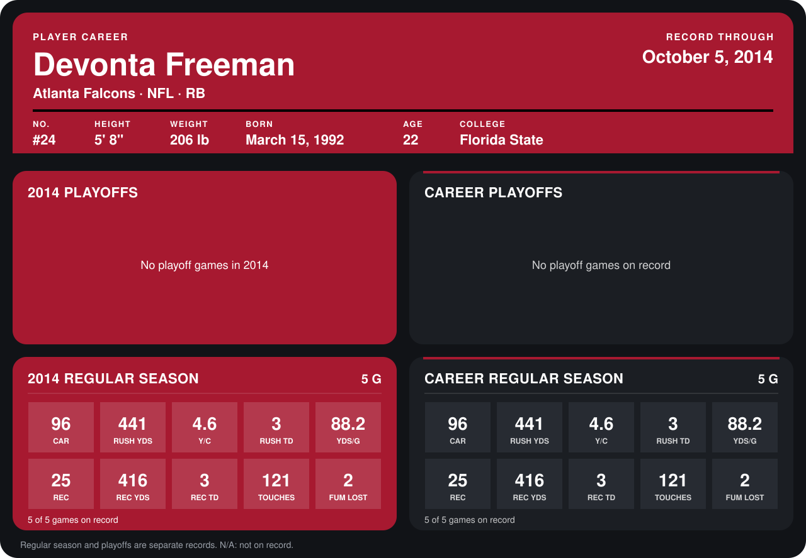

# Devonta Freeman

## Career stats

### Regular season

| Season | Club | G | CAR | RUSH YDS | Y/C | RUSH TD | YDS/G | REC | REC YDS | REC TD | TOUCHES | FUM LOST |
|---|---|---:|---:|---:|---:|---:|---:|---:|---:|---:|---:|---:|
| 2014 | Atlanta Falcons | 4 | 72 | 349 | 4.8 | 2 | 87.2 | 19 | 369 | 2 | 91 | 2 |
| **Career** |  | 4 | 72 | 349 | 4.8 | 2 | 87.2 | 19 | 369 | 2 | 91 | 2 |

### Playoffs

No playoff games on record.

## Awards

None on record.

Records through September 29, 2014. Identity: listed 2014 roster data, Weeks 1-4; number: 2014 Week 1 roster. [All Atlanta Falcons players](README.md).
