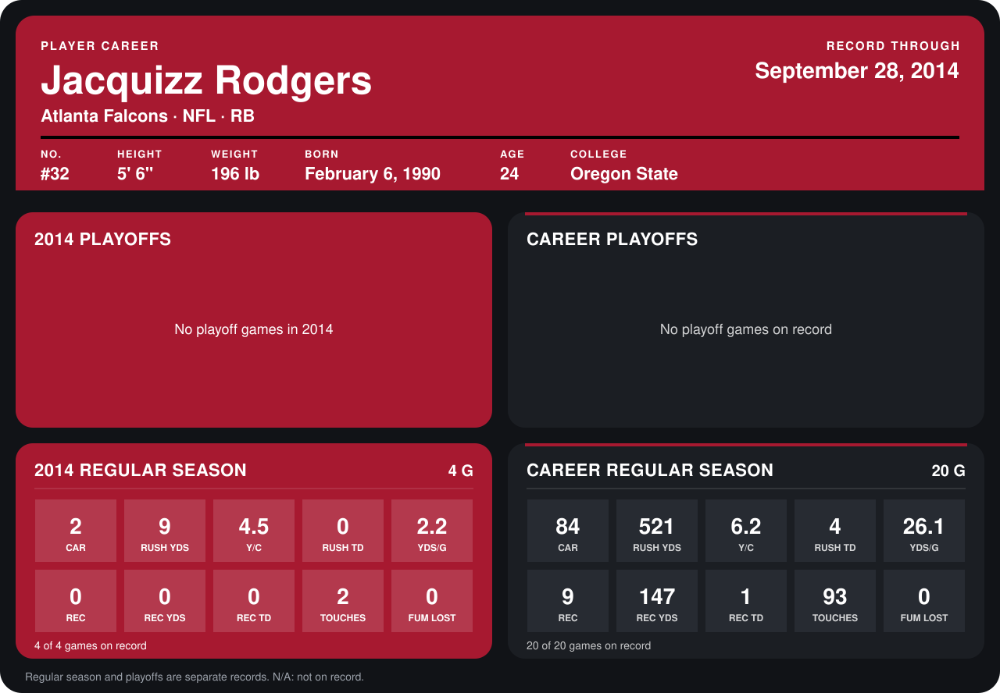

# Jacquizz Rodgers

## Career stats

### Regular season

| Season | Club | G | CAR | RUSH YDS | Y/C | RUSH TD | YDS/G | REC | REC YDS | REC TD | TOUCHES | FUM LOST |
|---|---|---:|---:|---:|---:|---:|---:|---:|---:|---:|---:|---:|
| 2013 | Atlanta Falcons | 16 | 82 | 512 | 6.2 | 4 | 32.0 | 9 | 147 | 1 | 91 | 0 |
| 2014 | Atlanta Falcons | 4 | 2 | 9 | 4.5 | 0 | 2.2 | 0 | 0 | 0 | 2 | 0 |
| **Career** |  | 20 | 84 | 521 | 6.2 | 4 | 26.1 | 9 | 147 | 1 | 93 | 0 |

### Playoffs

No playoff games on record.

## Awards

None on record.

Records through September 29, 2014. Identity: listed 2014 roster data, Weeks 1-4; number: 2014 Week 1 roster. [All Atlanta Falcons players](README.md).
