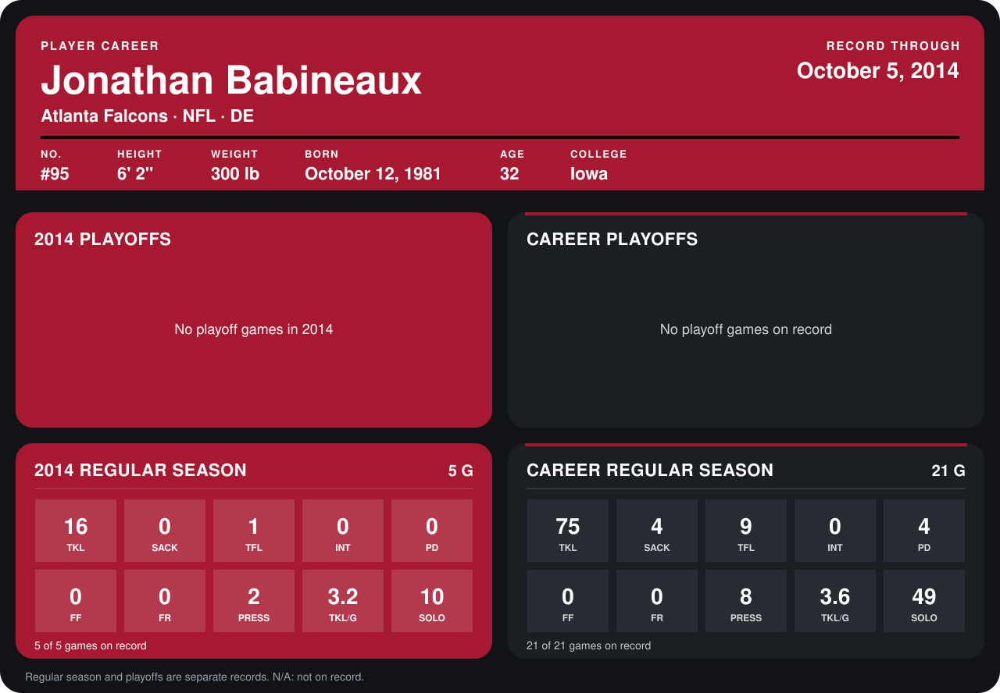

# Jonathan Babineaux

## Career stats

### Regular season

| Season | Club | G | TKL | SACK | TFL | INT | PD | FF | FR | PRESS | TKL/G | SOLO |
|---|---|---:|---:|---:|---:|---:|---:|---:|---:|---:|---:|---:|
| 2013 | Atlanta Falcons | 16 | 59 | 4 | 8 | 0 | 4 | 0 | 0 | 6 | 3.7 | 39 |
| 2014 | Atlanta Falcons | 4 | 11 | 0 | 0 | 0 | 0 | 0 | 0 | 2 | 2.8 | 6 |
| **Career** |  | 20 | 70 | 4 | 8 | 0 | 4 | 0 | 0 | 8 | 3.5 | 45 |

### Playoffs

No playoff games on record.

## Awards

None on record.

Records through September 28, 2014. Identity: listed 2014 roster data, Weeks 1-4; number: 2014 Week 1 roster. [All Atlanta Falcons players](README.md).
