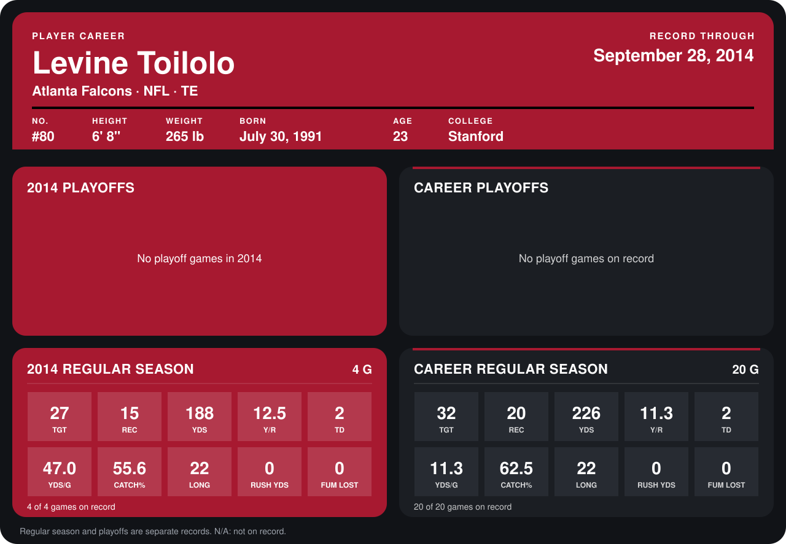

# Levine Toilolo

## Career stats

### Regular season

| Season | Club | G | TGT | REC | YDS | Y/R | TD | YDS/G | CATCH% | LONG | RUSH YDS | FUM LOST |
|---|---|---:|---:|---:|---:|---:|---:|---:|---:|---:|---:|---:|
| 2013 | Atlanta Falcons | 16 | 5 | 5 | 38 | 7.6 | 0 | 2.4 | 100.0 | 15 | 0 | 0 |
| 2014 | Atlanta Falcons | 4 | 27 | 15 | 188 | 12.5 | 2 | 47.0 | 55.6 | 22 | 0 | 0 |
| **Career** |  | 20 | 32 | 20 | 226 | 11.3 | 2 | 11.3 | 62.5 | 22 | 0 | 0 |

### Playoffs

No playoff games on record.

## Awards

None on record.

Records through September 29, 2014. Identity: listed 2014 roster data, Weeks 1-4; number: 2014 Week 1 roster. [All Atlanta Falcons players](README.md).
