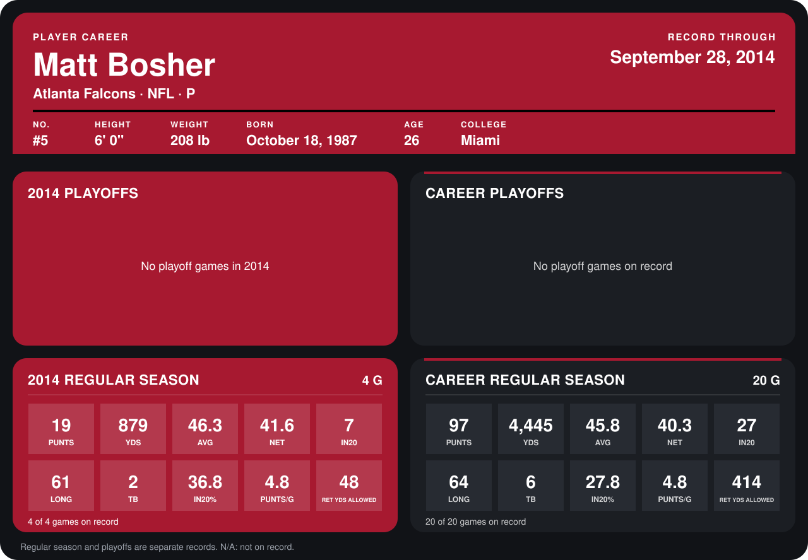

# Matt Bosher

## Career stats

### Regular season

| Season | Club | G | PUNTS | YDS | AVG | NET | IN20 | LONG | TB | IN20% | PUNTS/G | RET YDS ALLOWED |
|---|---|---:|---:|---:|---:|---:|---:|---:|---:|---:|---:|---:|
| 2013 | Atlanta Falcons | 16 | 78 | 3,566 | 45.7 | 40.0 | 20 | 64 | 4 | 25.6 | 4.9 | 366 |
| 2014 | Atlanta Falcons | 4 | 19 | 879 | 46.3 | 41.6 | 7 | 61 | 2 | 36.8 | 4.8 | 48 |
| **Career** |  | 20 | 97 | 4,445 | 45.8 | 40.3 | 27 | 64 | 6 | 27.8 | 4.8 | 414 |

### Playoffs

No playoff games on record.

## Awards

None on record.

Records through September 29, 2014. Identity: listed 2014 roster data, Weeks 1-4; number: 2014 Week 1 roster. [All Atlanta Falcons players](README.md).
