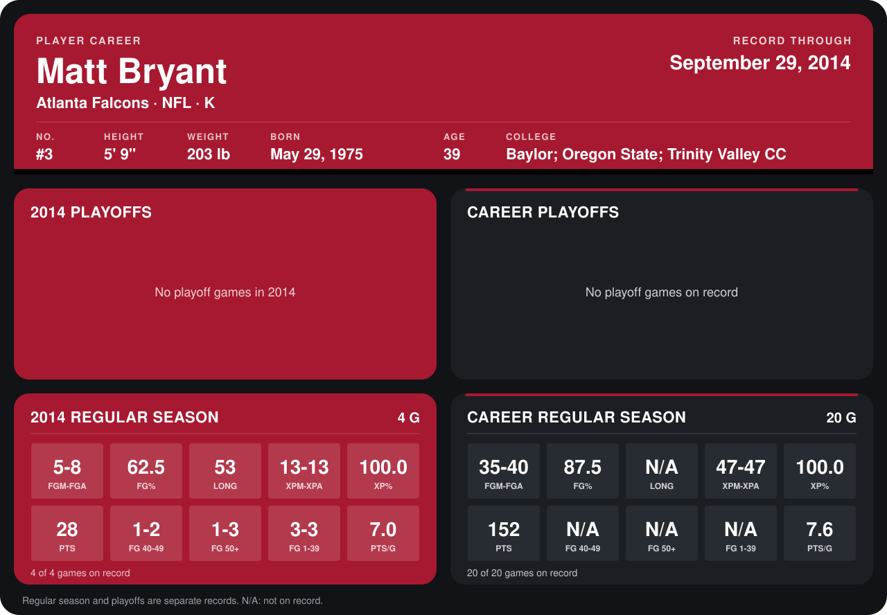

# Matt Bryant

## Career stats

### Regular season

| Season | Club | G | FGM-FGA | FG% | LONG | XPM-XPA | XP% | PTS | FG 40-49 | FG 50+ | FG 1-39 | PTS/G |
|---|---|---:|---:|---:|---:|---:|---:|---:|---:|---:|---:|---:|
| 2013 | Atlanta Falcons | 16 | 30-32 | 93.8 | N/A | 34-34 | 100.0 | 124 | N/A | N/A | N/A | 7.8 |
| 2014 | Atlanta Falcons | 5 | 6-9 | 66.7 | 53 | 17-17 | 100.0 | 35 | 1-2 | 1-3 | 4-4 | 7.0 |
| **Career** |  | 21 | 36-41 | 87.8 | N/A | 51-51 | 100.0 | 159 | N/A | N/A | N/A | 7.6 |

### Playoffs

No playoff games on record.

## Awards

- NFC Special Teams Player of the Week (2013, Week 1)
- NFC Special Teams Player of the Week (2013, Week 15)

Records through October 5, 2014. Identity: listed 2014 roster data, Weeks 1-4; number: 2014 Week 1 roster. [All Atlanta Falcons players](README.md).
