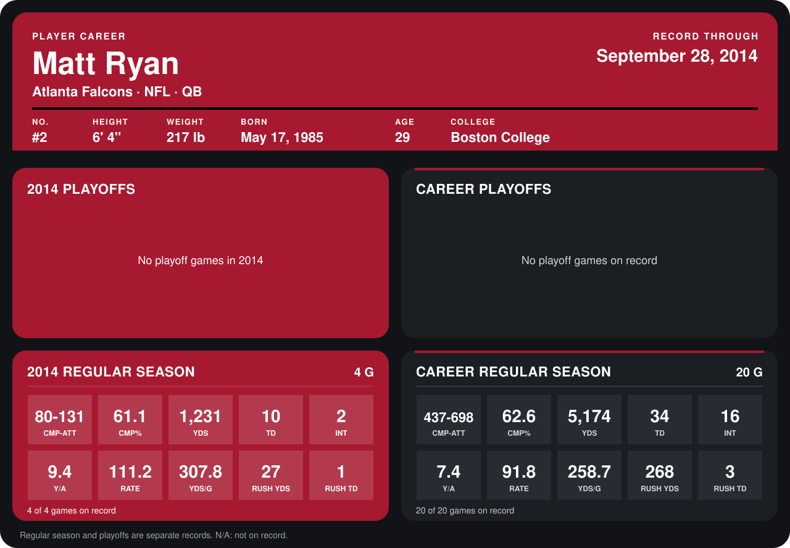

# Matt Ryan

## Career stats

### Regular season

| Season | Team | Age | # | G | CMP-ATT | CMP% | YDS | TD | INT | Y/A | RATE | YDS/G | RUSH YDS | RUSH TD |
|---|---|---:|---:|---:|---:|---:|---:|---:|---:|---:|---:|---:|---:|---:|
| 2013 | Atlanta Falcons | 28 | 2 | 16 | 357-567 | 63.0 | 3,943 | 24 | 14 | 7.0 | 87.3 | 246.4 | 241 | 2 |
| 2014 | Atlanta Falcons | 29 | 2 | 4 | 80-131 | 61.1 | 1,231 | 10 | 2 | 9.4 | 111.2 | 307.8 | 27 | 1 |
| **Career** |  |  |  | 20 | 437-698 | 62.6 | 5,174 | 34 | 16 | 7.4 | 91.8 | 258.7 | 268 | 3 |

### Playoffs

No playoff games on record.

## Awards

- NFC Offensive Player of the Month (2013, September)
- Pro Bowl selection (2013, QB)
- NFC Offensive Player of the Week (2014, Week 1)

Age is his age on the league's opening game of each season; # is the number listed for him that season with that team (2014: the card's rule; 2013: the 2013 season roster), N/A where no listing applies.

Records through September 28, 2014. Identity: listed 2014 roster data, Weeks 1-4; number: 2014 Week 1 roster. [All Atlanta Falcons players](README.md).
