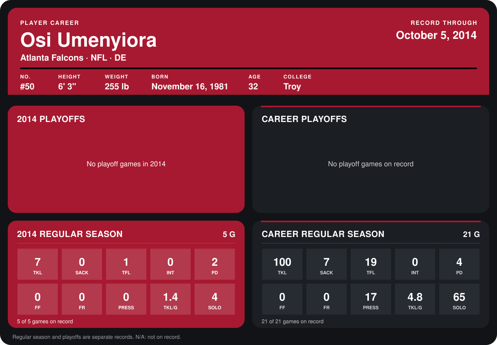

# Osi Umenyiora

## Career stats

### Regular season

| Season | Club | G | TKL | SACK | TFL | INT | PD | FF | FR | PRESS | TKL/G | SOLO |
|---|---|---:|---:|---:|---:|---:|---:|---:|---:|---:|---:|---:|
| 2013 | Atlanta Falcons | 16 | 93 | 7 | 18 | 0 | 2 | 0 | 0 | 17 | 5.8 | 61 |
| 2014 | Atlanta Falcons | 4 | 6 | 0 | 1 | 0 | 2 | 0 | 0 | 0 | 1.5 | 3 |
| **Career** |  | 20 | 99 | 7 | 19 | 0 | 4 | 0 | 0 | 17 | 5.0 | 64 |

### Playoffs

No playoff games on record.

## Awards

None on record.

Records through September 29, 2014. Identity: listed 2014 roster data, Weeks 1-4; number: 2014 Week 1 roster. [All Atlanta Falcons players](README.md).
