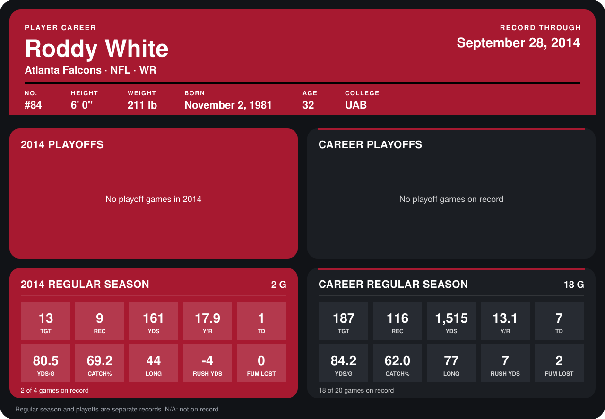

# Roddy White

## Career stats

### Regular season

| Season | Club | G | TGT | REC | YDS | Y/R | TD | YDS/G | CATCH% | LONG | RUSH YDS | FUM LOST |
|---|---|---:|---:|---:|---:|---:|---:|---:|---:|---:|---:|---:|
| 2013 | Atlanta Falcons | 16 | 174 | 107 | 1,354 | 12.7 | 6 | 84.6 | 61.5 | 77 | 11 | 2 |
| 2014 | Atlanta Falcons | 3 | 19 | 13 | 245 | 18.8 | 1 | 81.7 | 68.4 | 52 | -4 | 0 |
| **Career** |  | 19 | 193 | 120 | 1,599 | 13.3 | 7 | 84.2 | 62.2 | 77 | 7 | 2 |

### Playoffs

No playoff games on record.

## Awards

- NFC Offensive Player of the Week (2013, Week 16)
- Pro Bowl selection (2013, WR)

Records through October 5, 2014. Identity: listed 2014 roster data, Weeks 1-4; number: 2014 Week 1 roster. [All Atlanta Falcons players](README.md).
