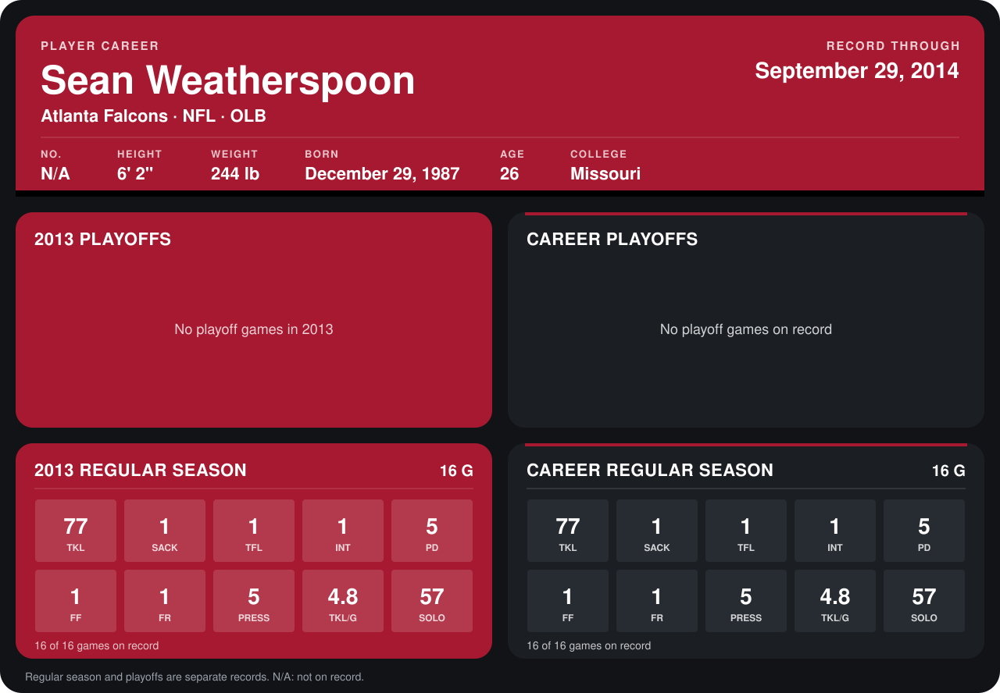

# Sean Weatherspoon

## Career stats

### Regular season

| Season | Club | G | TKL | SACK | TFL | INT | PD | FF | FR | PRESS | TKL/G | SOLO |
|---|---|---:|---:|---:|---:|---:|---:|---:|---:|---:|---:|---:|
| 2013 | Atlanta Falcons | 16 | 77 | 1 | 1 | 1 | 5 | 1 | 1 | 5 | 4.8 | 57 |
| **Career** |  | 16 | 77 | 1 | 1 | 1 | 5 | 1 | 1 | 5 | 4.8 | 57 |

### Playoffs

No playoff games on record.

## Awards

None on record.

Records through September 29, 2014. Identity: the public player file's latest listing (no 2014 Weeks 1-4 roster row). [All Atlanta Falcons players](README.md).
