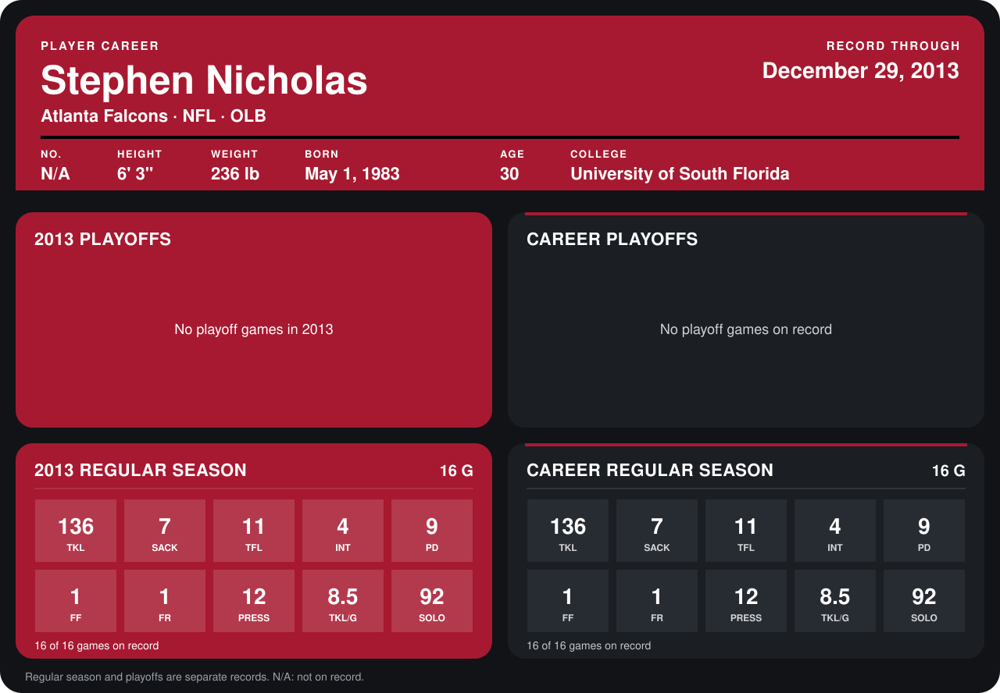

# Stephen Nicholas

## Career stats

### Regular season

| Season | Club | G | TKL | SACK | TFL | INT | PD | FF | FR | PRESS | TKL/G | SOLO |
|---|---|---:|---:|---:|---:|---:|---:|---:|---:|---:|---:|---:|
| 2013 | Atlanta Falcons | 16 | 136 | 7 | 11 | 4 | 9 | 1 | 1 | 12 | 8.5 | 92 |
| **Career** |  | 16 | 136 | 7 | 11 | 4 | 9 | 1 | 1 | 12 | 8.5 | 92 |

### Playoffs

No playoff games on record.

## Awards

- NFC Defensive Player of the Week (2013, Week 5)
- NFC Defensive Player of the Week (2013, Week 11)
- AP First-Team All-Pro (2013, OLB)
- Pro Bowl selection (2013, OLB)

Records through September 29, 2014. Identity: the public player file's latest listing (no 2014 Weeks 1-4 roster row). [All Atlanta Falcons players](README.md).
